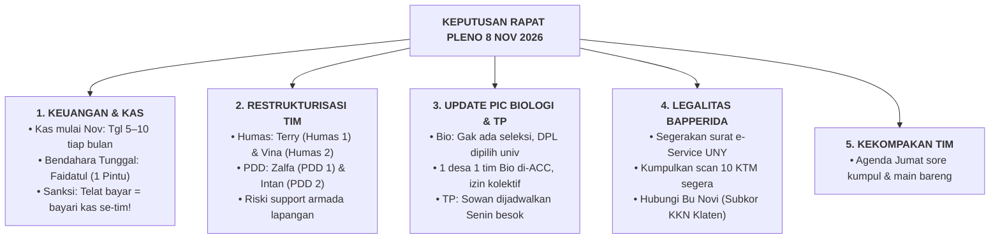
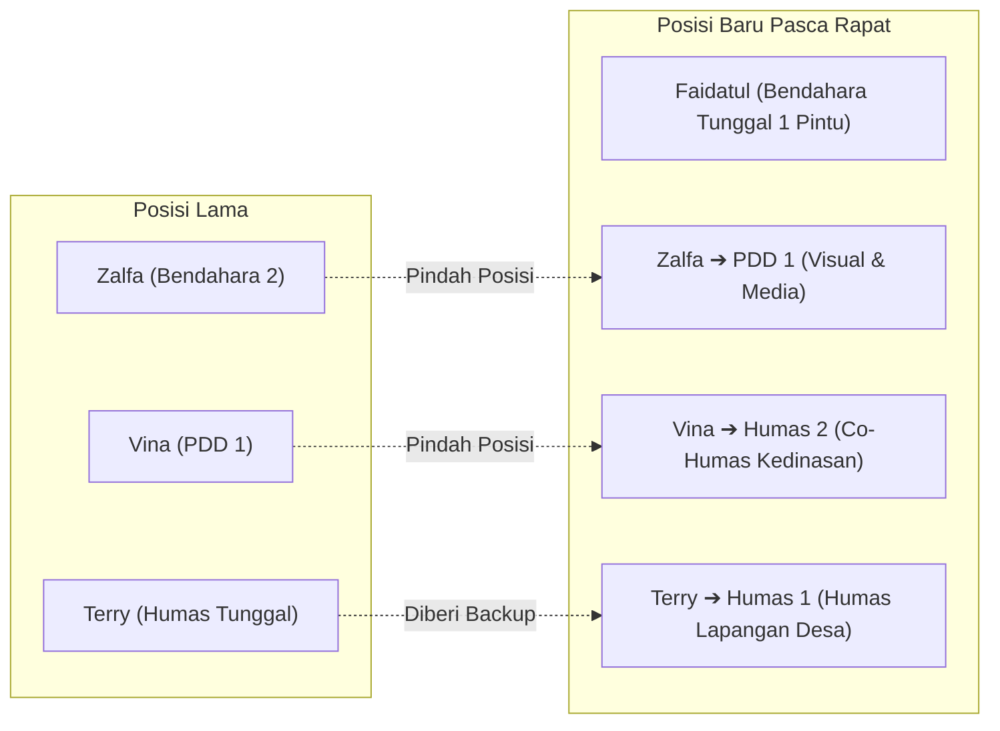

# 📝 NOTULENSI RESMI RAPAT PLENO NIRANTARA (8 NOV 2026)
## **Konsolidasi Legalitas Bapperida, Keputusan Kas Tunggal, Update PIC Biologi & TP, serta Restrukturisasi Organisasi Matrix**
*Program Pembelajaran Luar Kampus (PLK) — UNY Mengabdi 2027 (Desa Wonosari, Trucuk, Klaten)*

---

> [!IMPORTANT]
> **INFORMASI PELAKSANAAN RAPAT:**
> - **Hari, Tanggal**: Minggu, 8 November 2026
> - **Waktu**: Pukul 20.00 – 21.00 WIB
> - **Media**: Google Meet / Discord Resmi Nirantara
> - **Pimpinan Rapat**: Fajar Ahnaf Mahardika (Ketua Tim / Kordes)
> - **Notulis**: Sekretariat Tim Nirantara
> - **Kehadiran**: 10/10 Anggota Lengkap (Fajar, Terry, Riski, Veli, Dinda, Faidatul, Intan, Zalfa, Vina, Sandra)

---

## 📌 RINGKASAN KEPUTUSAN KUNCI RAPAT

---

## 📋 RINCIAN HASIL TANYA JAWAB & KESEPAKATAN RAPAT

### 1. Update Kebijakan Akademik Dosen PIC Prodi
- **Prodi Biologi (FMIPA — Dr. Anna Rakhmawati & Dr. Ixora Sartika)**:
  * 🟢 **Tidak Ada Seleksi Kuota**: Koorprodi dan PIC Biologi menegaskan bahwa tidak ada pembatasan/seleksi kuota di Biologi selagi semua persyaratan administrasi terpenuhi dan berkas lengkap.
  * 🟢 **Status 1 Kelompok 1 Desa**: Dari pihak Prodi Biologi **memperbolehkan** tim berjalan 1 kelompok tunggal di Desa Wonosari, namun disarankan tetap dikonfirmasikan ke tingkat fakultas/LPPM saat sistem buka.
  * 🔵 **Penentuan DPL**: Pihak Biologi menjelaskan bahwa **DPL resmi ditentukan / di-plot langsung oleh pihak universitas (Unit KKN/LPPM)**. *(Catatan Tim: Usulan Dr. Ponco Walipratono tetap disiapkan dan diajukan saat plotting DPL dibuka)*.
  * 🟢 **Perizinan Kolektif**: Surat izin permohonan ke dinas/pemda **sah diwakilkan satu pintu** melalui surat pengantar universitas/ketua kelompok.
  * 🟢 **Logbook 272 Jam**: Pengisian aktivitas logbook diperbolehkan mencatat kegiatan di luar Klaten (tahapan persiapan/riset di Jogja), namun diutamakan dan diperbanyak kegiatan fisik di Klaten.
- **Prodi Teknologi Pendidikan (FIP — Dosen PIC TP)**:
  * 🟡 **Status**: Mahasiswi TP (Vina & Sandra) belum sempat bertemu dengan PIC TP karena padatnya jadwal perkuliahan dan kesibukan dosen.
  * 🟠 **Rencana Eksekusi**: Sowan dan konsultasi dengan PIC TP dijadwalkan terlaksana pada hari **Senin, 9 November 2026** menggunakan panduan bank pertanyaan yang telah disiapkan.

---

### 2. Kebijakan Keuangan Kas Tim & Rekening 1 Pintu
- **Jadwal & Periode Pembayaran Kas**:
  * Iuran kas resmi **dimulai pada bulan November 2026**.
  * Waktu pembayaran rutin: **Setiap tanggal 5 s.d. 10 setiap bulannya** (bulan selanjutnya wajib lunas di bawah tanggal 10).
  * Besaran iuran kas: **Rp 50.000,- per anggota / bulan**.
- **Kebutuhan Rekening Resmi / QRIS**:
  * Tim membutuhkan nomor rekening bank penampung resmi atau QRIS khusus kas Nirantara yang dikelola oleh Bendahara.
- **Restrukturisasi Kebendaharaan (Bendahara Tunggal)**:
  * Forum mengonfirmasi kesiapan **Faidatul Anugraheni M. (Fai - FEB)** untuk memegang posisi **Bendahara Tunggal**.
  * **Kelebihan Sistem 1 Pintu**: Seluruh arus kas masuk dan kas keluar terpusat, meminimalisir risiko selisih pencatatan, dan pelaporan SPJ lebih rapi serta terkontrol.
- **Aturan Sanksi Disiplin Kas (Komitmen Tegas)**:
  * ⚠️ **Kesepakatan Sanksi**: *Anggota yang terlambat membayar uang kas (lewat dari tanggal 10) dikenakan sanksi membayarkan uang kas seluruh anggota kelompok untuk bulan berikutnya!* Aturan ini disepakati bersama demi menjaga kedisiplinan dan likuiditas kas operasional posko.

---

### 3. Restrukturisasi Tim: Penataan Humas, Bendahara, & PDD
Untuk menjawab kendala di lapangan di mana **Mas Terry keberatan jika memegang kehumasan sendirian**, serta mengakomodasi sistem bendahara tunggal, forum menyepakati **pergeseran peran (Switch Posisi)**:

| Nama Anggota | Asal Prodi | Peran Operasional Posko (BARU) | Peran Divisi Proker | Keterangan Perubahan |
|---|---|---|---|---|
| **Fajar Ahnaf Mahardika** | PTI (FT) | **Ketua Tim (Kordes)** | Supervisi, Lobi Desa, & IT | Tetap |
| **Muhadzdzib Terry Al Fauzan**| PTI (FT) | **Humas 1 (Lapangan & Desa)** | Tim Divisi Teknologi & IT | Fokus lobi Kades, RW 01, & warga desa |
| **Alvina Aulia Az Zahra (Vina)**| TP (FIP) | **Humas 2 (Co-Humas Kedinasan)** | Koor. Divisi Pendidikan & Media | **SWITCH**: Backup Terry, urus Bapperida & birokrasi |
| **Faidatul Anugraheni M. (Fai)**| PADP (FEB)| **Bendahara Tunggal (Kas 1 Pintu)** | Koor. Divisi Administrasi & UMKM | **RESTRUKTURISASI**: Kas masuk/keluar terpusat |
| **Zalfa Khoirunnisa** | Biologi (FMIPA) | **PDD 1 (Desain & Branding)** | Tim Divisi Lingkungan & Sampah | **SWITCH**: Pindah dari Bendahara ke Tim Media PDD |
| **Intan Milansari** | Biologi (FMIPA) | **PDD 2 (Dokumentasi & 5W1H)**| Koor. Divisi Lingkungan & Kesehatan | Fokus liputan lapangan & rilis berita pers |
| **Muhamad Riski** | PTI (FT) | **Perkap 1 (Armada & Logistik)**| Tim Divisi Teknologi & IT | Support armada kendaraan & mobilitas Humas |
| **Krissandra Siagian (Sandra)** | TP (FIP) | **Perkap 2 (Operasional Posko)**| Tim Divisi Pendidikan & Media | Logistik perlengkapan posko & acara |
| **Dinda Amelia Putri** | PADP (FEB)| **Sekretaris 1 (Proposal & LPJ)**| Tim Divisi Administrasi & UMKM | Korespondensi surat e-Service & proposal |
| **Novelia Harlinda (Veli)** | PTI (FT) | **Sekretaris 2 (Logbook & Cloud)**| Koor. Divisi Teknologi & IT | Audit logbook 272 jam & pengarsipan drive |

---

### 4. Legalitas Bapperida Klaten & Pengumpulan KTM
- **Instruksi Percepatan Legalitas**: Berdasarkan hasil survei lapangan, pengurusan izin resmi ke Bapperida Klaten harus segera diselesaikan agar status pengabdian di Desa Wonosari memiliki payung hukum yang kuat.
- **Tindak Lanjut**:
  1. Segera menghubungi **Ibu Novi (Koordinator / Subkor KKN Bapperida Klaten — `0812-9141-9151`)** untuk mengonfirmasi kelengkapan berkas izin KKN.
  2. Seluruh 10 anggota **WAJIB segera mengumpulkan file scan/foto Kartu Tanda Mahasiswa (KTM)** yang jelas dan terbaca ke Google Drive kesekretariatan.
  3. Mengajukan surat pengantar resmi permohonan izin KKN melalui laman e-Service UNY.

---

### 5. Agenda Kebersamaan Tim (Team Bonding)
- Forum menyepakati agenda informal untuk mempererat kekompakan seluruh 10 anggota:
  * 🗓️ **Waktu**: **Jumat sore, 13 November 2026**
  * 🎯 **Agenda**: Kumpul santai, makan bersama, dan *main bareng* (*bounding time*) agar komunikasi lintas fakultas semakin cair sebelum menghadapi fase penerjunan lapangan.

---

## 📅 TIMELINE AKSI PASCA RAPAT (9 – 15 NOVEMBER 2026)

| Tenggat Waktu | Rencana Aksi | Penanggung Jawab (PIC) | Target Capaian |
|---|---|---|:---:|
| **Senin, 9 Nov 2026** | Sowan & Konsultasi ke PIC Prodi Teknologi Pendidikan (FIP) | Vina & Sandra | Notulensi ACC dari TP FIP |
| **9 – 10 Nov 2026** | Pengumpulan Scan KTM 10 Anggota di Google Drive | Seluruh Anggota | Folder KTM Lengkap (10 PDF) |
| **10 Nov 2026** | Penerbitan QRIS / Rekening Bank Kas Nirantara & Penarikan Kas | Faidatul (Bendahara) | Rekening Kas 1 Pintu Aktif |
| **10 – 11 Nov 2026** | Submit Pengajuan Surat Pengantar Izin KKN di e-Service UNY | Fajar & Dinda | Surat Ber-barcode UNY Terbit |
| **11 – 12 Nov 2026** | Koordinasi dengan Ibu Novi Bapperida & Pengisian Form Desa | Vina (Humas 2) & Terry | Konfirmasi Berkas Bapperida |
| **Jumat, 13 Nov 2026** | Agenda Kumpul & Main Bareng Tim Nirantara | Seluruh Tim (10/10) | Kekompakan & Evaluasi Santai |
| **14 – 15 Nov 2026** | Submit Bundle 4 Berkas ke Email Bapperida Klaten | Vina, Terry, & Fajar | Email `siip.bappedaklt@gmail.com` |

---

> [!TIP]
> **Dokumen Terkait yang Telah Diperbarui:**
> - [Struktur Organisasi Matrix Tim PLK](file:///d:/KULIAH/UNY%20PLK/Tim%20PLK/02%20-%20Fase%20Pre-PLK/01%20-%20Tata%20Kelola%20Tim%20&%20First%20Gathering/Struktur%20Organisasi%20Matrix%20Tim%20PLK.md)
> - [Database Profil Anggota Tim](file:///d:/KULIAH/UNY%20PLK/Tim%20PLK/02%20-%20Fase%20Pre-PLK/01%20-%20Tata%20Kelola%20Tim%20&%20First%20Gathering/Database%20Profil%20Anggota%20Tim.md)
> - [Panduan & Prosedur Perizinan KKN Bapperida Klaten](file:///d:/KULIAH/UNY%20PLK/Tim%20PLK/02%20-%20Fase%20Pre-PLK/04%20-%20Integrasi%20Kelompok%20&%20Survei%20Klaten/bapedalitbang/Panduan%20&%20Prosedur%20Perizinan%20KKN%20Bapperida%20Klaten.md)
> - [PETA CARI FILE (Cheat Sheet Direktori)](file:///d:/KULIAH/UNY%20PLK/PETA%20CARI%20FILE%20(Cheat%20Sheet%20Direktori).md)

