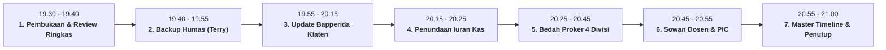
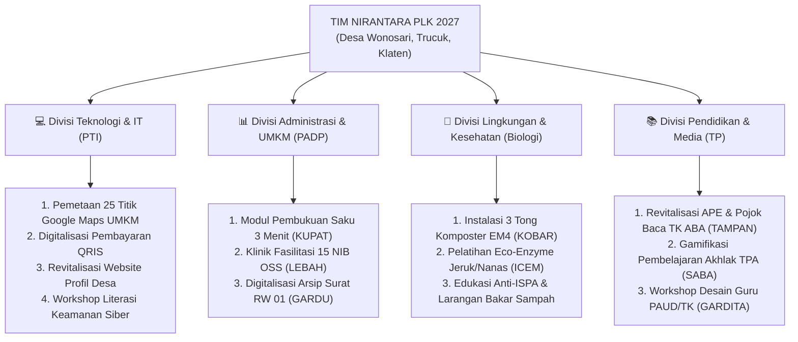

# 📢 PANDUAN & AGENDA RAPAT PLENO NIRANTARA (31 OKT 2026)
## **Konsolidasi Perizinan Bapperida, Penataan Humas, Kebijakan Kas, & Pembagian Proposal 4 Divisi**
*Panduan Pimpinan Rapat (Fajar Ahnaf M.) & Lembar Kerja Seluruh Anggota Tim Nirantara*

---

> [!IMPORTANT]
> **INFORMASI PELAKSANAAN RAPAT:**
> - **Hari, Tanggal**: Sabtu, 31 Oktober 2026
> - **Waktu**: Pukul 19.30 WIB – 21.00 WIB (Durasi: ~90 Menit)
> - **Media**: Google Meet / Discord Resmi Nirantara
> - **Pimpinan Rapat**: Fajar Ahnaf Mahardika (Ketua / Kordes)
> - **Notulis Resmi**: Dinda Amelia Putri (Sekretaris 1) & Novelia Harlinda (Sekretaris 2)
> - **Kehadiran**: WAJIB 10/10 Anggota Lengkap

---

## 🎯 RUNDOWN & AGENDA UTAMA RAPAT

---

## 📌 AGENDA 1: EVALUASI BEBAN KERJA HUMAS & PENUNJUKAN CO-HUMAS (BACKUP MAS TERRY)

### 1. Masalah di Lapangan
- Selama fase survei dan komunikasi posko, **Muhadzdzib Terry Al Fauzan** memegang beban kerja humas lapangan yang sangat berat sendirian:
  1. Menjaga komunikasi dengan pemilik rumah posko (Mbah Terry di Majegan).
  2. Berkoordinasi intensif dengan Ketua RW 01 (Bpk. Ramelan) dan Kepala Desa Wonosari (Bpk. Adi).
  3. Mengurus alur perizinan kedinasan Bappedalitbang/Bapperida Klaten.
  4. Sekaligus bertindak sebagai tim teknis Website Profil Desa & TIK di Divisi Teknologi (PTI).
- Kondisi ini berisiko menimbulkan *burnout*, keterlambatan *follow-up*, dan beban mental yang tidak seimbang.

### 2. Keputusan Rapat: Pengangkatan Co-Humas (Pendamping Humas)
Untuk membagi beban kerja secara adil, dibentuk struktur kemitraan humas 2 pilar:

| Pilar Tugas | Penanggung Jawab Utama | Pendamping / Backup (Co-Humas) | Fokus Tanggung Jawab |
|---|---|---|---|
| **Pilar 1: Kemitraan Desa & Posko** | **Muhadzdzib Terry** (PTI) | **Muhamad Riski** (PTI / Perkap 1) | - Komunikasi harian ke Bpk. RW Ramelan & Bpk. Kades Adi. - Koordinasi teknis kelayakan posko, listrik, & lingkungan Majegan. - Pendampingan sowan langsung ke Klaten (armada motor). |
| **Pilar 2: Hubungan Kedinasan & Birokrasi** | **Co-Humas Kedinasan** (*Ditunjuk Malam Ini*) | **Dinda Amelia** (PADP / Sekre 1) | - Komunikasi resmi ke Bapperida Klaten (Ibu Novi). - Manajemen email perizinan resmi (`siip.bappedaklt@gmail.com`). - Monitoring revisi surat e-Service UNY & pengarsipan disposisi. |

> [!TIP]
> **Opsi Rekomendasi Pendamping Humas Kedinasan:**
> 1. **Intan Milansari (FMIPA / PDD 2)**: Memiliki keahlian komunikasi tertulis, sopan, dan terbiasa dengan relasi publik jurnalistik.
> 2. **Krissandra Siagian (FIP / Perkap 2)**: Memiliki keaktifan koordinasi operasional dan lobi antarinstansi.
> *(Diputuskan bersama dalam forum rapat malam ini).*

---

## 📌 AGENDA 2: UPDATE HASIL KOORDINASI BAPPERIDA KLATEN (30 OKT 2026)

### 1. Kronologi WA Mas Rizal Bapperida (30 Oktober 2026)
Pada 30 Oktober 2026, perwakilan tim (zann/Terry) telah berkoordinasi via WhatsApp dengan **Mas Rizal (Admin Pelayanan Izin Bapperida Klaten)**.
- **Hasil Koordinasi**:
  * Surat izin sebelumnya yang dibuat di e-Service UNY berjudul *"Permohonan Izin Observasi"*.
  * Mas Rizal menjelaskan bahwa jika hanya **observasi singkat**, perizinan **cukup langsung ke kelurahan/desa setempat** tanpa melalui Bapperida.
  * Namun, karena tim Nirantara akan melaksanakan **PLK Mandiri / KKN selama 4,5 bulan** dengan sistem **menginap di posko** (tiap akhir pekan Sabtu-Minggu), maka kegiatan ini secara hukum wajib mengurus **Surat Rekomendasi Izin KKN dari Bapperida Kabupaten Klaten**.
  * Mas Rizal meminta tim untuk **merevisi surat permohonan kampus** agar berbunyi *"Permohonan Izin KKN"* dan melengkapi 4 persyaratan wajib.
  * Penanganan KKN di Bapperida diampu langsung oleh Subkoordinator KKN: **Ibu Novi (Sri Nuryani, SE)**.

### 2. Kontak Resmi Bapperida Klaten (Simpan di HP Tim)
- **Subkor Pengampu KKN**: Ibu Novi (Sri Nuryani, SE) — 📱 `0812-9141-9151`
- **Admin Pelayanan Izin**: Mas Rizal — 📱 `0822-2615-5554`
- **Email Pelayanan Izin**: `siip.bappedaklt@gmail.com`
- **Tautan Resmi SOP**: [https://bapperida.klaten.go.id/pelayanan-izin-penelitian-magang-dan-kkn](https://bapperida.klaten.go.id/pelayanan-izin-penelitian-magang-dan-kkn)

### 3. Berkas Wajib Izin KKN Bapperida (Checklist Persiapan)

| No | Nama Berkas | Penanggung Jawab | Cara Mendapatkan / Status |
|:---:|---|---|---|
| 1 | **Surat Pengantar Permohonan Izin KKN dari UNY** | Fajar & Veli | Revisi via laman `eservice.uny.ac.id`, ubah tujuan menjadi *"Permohonan Izin KKN di Desa Wonosari Kec. Trucuk"* dengan tembusan Kepala Bapperida Klaten. |
| 2 | **Scan Kartu Tanda Mahasiswa (KTM) 10 Anggota** | Seluruh Anggota | Seluruh 10 anggota wajib mengunggah scan/foto KTM yang jelas ke folder Google Drive Nirantara. |
| 3 | **Proposal KKN / PLK Nirantara Lengkap** | Dinda & Fai (Koor) + 4 Divisi | Format Word/PDF memuat maksud, tujuan, rencana program kerja 4 divisi, lokasi, dan susunan tim. |
| 4 | **Formulir Surat Persetujuan Lokasi KKN** | Terry & Riski (Humas) | Unduh template resmi di [bit.ly/Srt_Persetujuan_Magang_KKN](https://bit.ly/Srt_Persetujuan_Magang_KKN), diisi data tim, lalu dimintakan tanda tangan & cap basah ke Bpk. Adi (Kades Wonosari). |

> [!NOTE]
> Semua berkas di atas disatukan menjadi format PDF dan dikirimkan secara online ke email `siip.bappedaklt@gmail.com` dengan subjek: `Permohonan Izin KKN - UNY - Desa Wonosari Trucuk - Tim Nirantara`. Estimasi verifikasi Bapperida: 2–3 hari kerja (gratis/tanpa biaya).

---

## 📌 AGENDA 3: KEBIJAKAN KEUANGAN: PENUNDAAN/FREEZE UANG KAS BULANAN (RP 50.000,-)

### 1. Latar Belakang Kebijakan Penundaan
Pada First Gathering 16 Oktober 2026, disepakati iuran kas posko sebesar Rp 50.000,- per anak/bulan mulai akhir Oktober 2026. Namun, tim pimpinan memutuskan untuk **MENUNDA SEMENTARA (FREEZE)** penarikan uang kas tersebut karena pertimbangan:
1. **Belum Dibukanya Dashboard Resmi PLK UNY**: Sistem pendaftaran resmi kelompok di LPPM (`plk.uny.ac.id`) belum dibuka secara resmi oleh universitas.
2. **Isu Pembatasan Kuota & Skema Seleksi PLK**: Beredar kabar bahwa antusiasme mahasiswa angkatan 2024 mengambil PLK di Semester 6 sangat tinggi, sehingga ada potensi verifikasi kuota bertahap oleh prodi/LPPM.
3. **Prinsip Kehati-hatian Finansial (Zero Risk)**: Mengumpulkan uang kas sebelum kelompok resmi divalidasi sistem berisiko menimbulkan beban psikologis dan kerumitan administrasi *refund* (pengembalian uang) seandainya ada penyesuaian regulasi dari pihak rektorat.

### 2. Keputusan & Arahan kepada Anggota
- 🟢 **Uang Kas Belum Ditarik**: Anggota belum perlu menyetor uang kas Rp 50.000,- untuk bulan Oktober/November.
- 🟢 **Waktu Penarikan Baru**: Iuran kas pertama baru akan dibuka secara resmi **setelah akun kelompok Tim Nirantara resmi terdaftar dan divalidasi (ACC) di sistem dashboard LPPM UNY**.
- 🟢 **Sistem Keuangan Tetap Disiapkan**: Bendahara 1 (Fai) dan Bendahara 2 (Zalfa) tetap menyiapkan Buku Kas Umum, rekening resmi penampung, dan format nota SPJ di Google Sheets agar saat sistem kampus dibuka, eksekusi kas bisa langsung berjalan tanpa hambatan.

---

## 📌 AGENDA 4: SOSIALISASI MASTER RISET & PEMBAGIAN TUGAS PROPOSAL 4 DIVISI

### 1. Struktur Riset Ilmiah Telah Siap di Sistem
Ketua dan tim riset telah menyelesaikan dokumen dasar ilmiah program kerja berbasis *Participatory Action Research (PAR)* dan metode analisis *5 Whys* yang tersimpan rapi di vault:
- Master Dokumen: `[Matriks Analisis Ilmiah & Integrasi Proker](file:///d:/KULIAH/UNY%20PLK/Tim%20PLK/03%20-%20Fase%20PLK/Matriks%20Analisis%20Ilmiah%20&%20Integrasi%20Proker.md)`
- Simulasi Logbook: Telah dirancang konversi jam kerja 280 jam efektif (di atas batas minimal 272 jam UNY).

### 2. Rincian Program Kerja 4 Divisi untuk Proposal

### 3. Pembagian Tugas Penulisan Proposal (Deadline: 10 November 2026)

| Bagian Proposal | Penanggung Jawab | Deskripsi Isi yang Dikerjakan | Rujukan File Panduan |
|---|---|---|---|
| **Bab I: Pendahuluan** | **Dinda & Fai** (PADP) | Latar belakang, profil Desa Wonosari & Dukuh Majegan, permasalahan mitra warga RW 01, maksud & tujuan PLK. | `[Sistematika & Panduan Penyusunan Proposal PLK](file:///d:/KULIAH/UNY%20PLK/Tim%20PLK/02%20-%20Fase%20Pre-PLK/Sistematika%20&%20Panduan%20Penyusunan%20Proposal%20PLK.md)` |
| **Bab II & III (Sub IT)** | **Fajar, Terry, Riski, Veli** (PTI) | Rencana pelaksanaan 4 proker teknologi (TAM, website, maps, QRIS, keamanan data) beserta jadwal rincian jam. | `[Proker & Analisis Ilmiah Divisi Teknologi](file:///d:/KULIAH/UNY%20PLK/Tim%20PLK/03%20-%20Fase%20PLK/01%20-%20Divisi%20Teknologi%20&%20IT/Proker%20&%20Analisis%20Ilmiah%20Divisi%20Teknologi.md)` |
| **Bab II & III (Sub UMKM)** | **Dinda & Fai** (PADP) | Rencana pelaksanaan program KUPAT (buku saku kas), LEBAH (NIB OSS), dan digitalisasi persuratan RW (GARDU). | `[Proker & Analisis Ilmiah Divisi Administrasi & UMKM](file:///d:/KULIAH/UNY%20PLK/Tim%20PLK/03%20-%20Fase%20PLK/02%20-%20Divisi%20Administrasi%20&%20UMKM/Proker%20&%20Analisis%20Ilmiah%20Divisi%20Administrasi%20&%20UMKM.md)` |
| **Bab II & III (Sub Lingkungan)** | **Intan & Zalfa** (Biologi) | Rencana teknis komposting EM4 (KOBAR), fermentasi eco-enzyme (ICEM), dan modul penyuluhan anti-ISPA warga. | `[Proker & Analisis Ilmiah Divisi Lingkungan & Kesehatan](file:///d:/KULIAH/UNY%20PLK/Tim%20PLK/03%20-%20Fase%20PLK/03%20-%20Divisi%20Lingkungan%20&%20Kesehatan/Proker%20&%20Analisis%20Ilmiah%20Divisi%20Lingkungan%20&%20Kesehatan.md)` |
| **Bab II & III (Sub Edukasi)** | **Vina & Sandra** (TP) | Rencana pengadaan APE TK ABA (TAMPAN), media ajar TPA Al-Amin (SABA), dan pelatihan Canva/AI bagi guru (GARDITA). | `[Proker & Analisis Ilmiah Divisi Pendidikan & Media Ajar](file:///d:/KULIAH/UNY%20PLK/Tim%20PLK/03%20-%20Fase%20PLK/04%20-%20Divisi%20Pendidikan%20&%20Media%20Ajar/Proker%20&%20Analisis%20Ilmiah%20Divisi%20Pendidikan%20&%20Media%20Ajar.md)` |
| **Bab IV: Anggaran & Jadwal** | **Fai & Zalfa** (Bendahara) | Rencana Anggaran Biaya (RAB) terpadu 4 divisi dan matriks jadwal pelaksanaan. | `[Strategi Sponsorship & Anggaran Awal Tim](file:///d:/KULIAH/UNY%20PLK/Tim%20PLK/02%20-%20Fase%20Pre-PLK/03%20-%20Anggaran%20&%20Sponsorship/Strategi%20Sponsorship%20&%20Anggaran%20Awal%20Tim.md)` |
| **Kompilasi & Layouting** | **Novelia Harlinda** (Veli) | Menggabungkan seluruh bab ke dalam 1 master template Microsoft Word (margin 4-4-3-3, daftar isi, halaman pengesahan). | Google Docs Master Nirantara |

---

## 📌 AGENDA 5: SOWAN DOSEN PIC PTI & LOBI CALON DPL RESMI

### 1. Sowan Dosen PIC PTI (Dr. Sigit Pambudi, S.Pd., M.Eng.)
- **Jadwal Target**: Senin/Selasa, 2–3 November 2026 di Gedung DPTEI FT UNY.
- **Delegasi**: Fajar Ahnaf M. & Novelia Harlinda.
- **Topik Konsultasi**:
  1. Klarifikasi status pendaftaran resmi PLK Semester 6 (isu seleksi kuota).
  2. Klarifikasi fenomena kelompok lain yang sudah memulai survei di Sleman.
  3. Mengunci persetujuan Prodi PTI untuk lokasi Desa Wonosari, Klaten.

### 2. Sowan Calon DPL Resmi (Dr. Ponco Walipratono, S.Pd.T., M.Pd.)
- **Target DPL**: Dosen DPTEI Fakultas Teknik UNY.
- **Tujuan**: Memperkenalkan kelompok Nirantara (10 orang lintas 4 fakultas), memaparkan kesiapan posko mandiri di Majegan Wonosari, dan menyerahkan draf ringkas proker untuk meminta kesediaan beliau menjadi DPL resmi saat sistem dibuka.
- **Delegasi Sowan**: Fajar, Terry, Riski, dan Veli (Didampingi perwakilan fakultas lain jika jadwal memungkinkan).

---

## 📌 AGENDA 6: MASTER TIMELINE & ACTION ITEMS TIM (1 – 15 NOVEMBER 2026)

| Rentang Tanggal | Target Output / Aktivitas Tim | PIC / Penanggung Jawab | Status / Keterangan |
|---|---|---|---|
| **31 Okt (Malam Ini)** | Rapat Pleno 10 Anggota & Pengesahan Co-Humas | Fajar Ahnaf M. | 🔴 Berlangsung malam ini |
| **1 – 2 Nov 2026** | Revisi Pengajuan e-Service UNY (Surat Izin KKN Bapperida) | Fajar & Veli | 🟠 Prioritas Utama Kampus |
| **1 – 3 Nov 2026** | Pengumpulan Scan 10 KTM Anggota di Google Drive | Seluruh 10 Anggota | 🟠 Wajib format PDF bersih |
| **2 – 3 Nov 2026** | Sowan Dosen PIC PTI (Dr. Sigit Pambudi) di FT | Fajar & Veli | 🟡 Konsultasi akademik |
| **3 – 5 Nov 2026** | Penulisan Draf Proposal 4 Divisi (Bab I - IV) | Masing-masing Divisi | 🟠 Draf disatukan di Google Docs |
| **4 – 6 Nov 2026** | Pengisian Form Persetujuan Lokasi ke Kades Wonosari | Terry & Riski (Humas) | 🟠 Download form Bapperida |
| **5 – 7 Nov 2026** | Sowan & Lobi Calon DPL (Dr. Ponco Walipratono) | Tim PTI FT | 🟡 Mengunci nama DPL |
| **7 – 9 Nov 2026** | Finalisasi & Layouting Master Proposal KKN | Dinda, Fai, & Veli | 🟢 Siap diubah ke PDF |
| **10 Nov 2026** | Submit Berkas Izin KKN ke Email Bapperida Klaten | Humas Kedinasan & Fajar | 🔴 Kirim ke `siip.bappedaklt@gmail.com` |
| **11 – 15 Nov 2026** | Konfirmasi ke Ibu Novi Bapperida & Ambil Surat Rekomendasi | Humas Kedinasan | 🟢 Arsipkan tembusan untuk Desa |

---

## 💬 SCRIPT / PANDUAN BICARA KETUA (CONTOH PEMBUKAAN OLEH FAJAR)

> *"Halo selamat malam teman-teman Nirantara semuanya. Terima kasih banyak sudah meluangkan waktu untuk rapat pleno malam ini.*  
> *Ada beberapa perkembangan penting yang ingin saya sampaikan agar ritme kerja kita tetap solid dan tenang.*  
> *Pertama, mengenai Mas Terry di lapangan. Kemarin kita survei sukses luar biasa, tapi beban humas dan komunikasi desa sangat besar jika dipegang sendirian. Malam ini kita akan tetapkan teman yang mem-backup Mas Terry agar tugas posko dan urusan dinas terbagi rapi.*  
> *Kedua, mengenai izin Bapperida Klaten. Kemarin Mas Terry sudah kontak Mas Rizal Bapperida. Surat izin observasi kita diarahkan untuk direvisi menjadi Izin KKN Resmi Kabupaten karena kita akan beraktivitas selama 4,5 bulan. Kita butuh 4 syarat sederhana, termasuk scan KTM kalian dan proposal ringkas yang materinya sudah kita siapkan.*  
> *Ketiga, mengenai uang kas bulanan Rp 50.000,-. Kita putuskan untuk MENUNDA penarikannya dulu sampai sistem dashboard UNY resmi membuka pendaftaran dan kelompok kita terverifikasi. Jadi teman-teman tenang dulu, uang kas tidak ditarik sebelum status kampus resmi keluar.*  
> *Keempat, bahan proker kita sudah lengkap banget dan berbasis riset ilmiah. Malam ini kita bagi tugas penulisan proposalnya agar minggu depan kita sudah punya proposal jadi untuk Bapperida dan calon DPL kita, Pak Ponco.*  
> *Mari kita mulai diskusi malam ini..."*

---

> [!TIP]
> **Tautan Dokumen Terkait:**
> - [Panduan & Prosedur Perizinan KKN Bapperida Klaten](file:///d:/KULIAH/UNY%20PLK/Tim%20PLK/02%20-%20Fase%20Pre-PLK/04%20-%20Integrasi%20Kelompok%20&%20Survei%20Klaten/bapedalitbang/Panduan%20&%20Prosedur%20Perizinan%20KKN%20Bapperida%20Klaten.md)
> - [Cheatsheet Form e-Service UNY](file:///d:/KULIAH/UNY%20PLK/Tim%20PLK/02%20-%20Fase%20Pre-PLK/Panduan%20&%20Isian%20Form%20e-Service%20UNY%20(Izin%20Bappedalitbang%20Klaten).md)
> - [Matriks Analisis Ilmiah & Integrasi Proker](file:///d:/KULIAH/UNY%20PLK/Tim%20PLK/03%20-%20Fase%20PLK/Matriks%20Analisis%20Ilmiah%20&%20Integrasi%20Proker.md)
> - [Database Profil & K3 Anggota Tim](file:///d:/KULIAH/UNY%20PLK/Tim%20PLK/02%20-%20Fase%20Pre-PLK/01%20-%20Tata%20Kelola%20Tim%20&%20First%20Gathering/Database%20Profil%20Anggota%20Tim.md)
