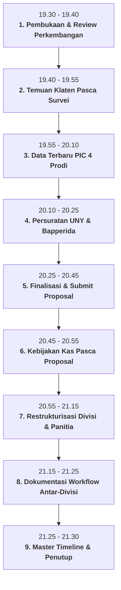
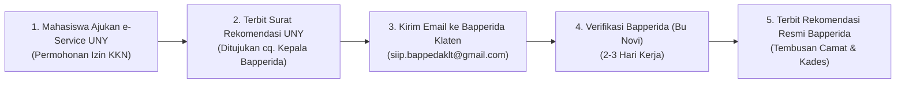
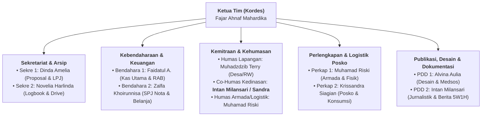
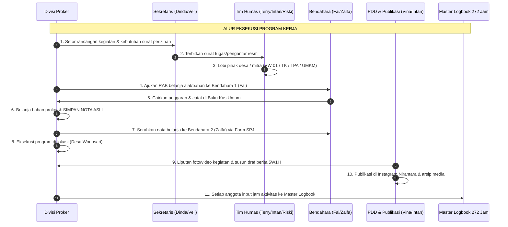

# 📢 PANDUAN & AGENDA RAPAT PLENO NIRANTARA (8 NOV 2026)
## **Konsolidasi Proposal KKN, Legalitas Kampus & Bapperida, Kebijakan Kas, Restrukturisasi Kepanitiaan, & Workflow Kerja Antar-Divisi**
*Panduan Pimpinan Rapat (Fajar Ahnaf M.) & Lembar Kerja Bersama 10 Anggota Tim Nirantara*

---

> [!IMPORTANT]
> **INFORMASI PELAKSANAAN RAPAT:**
> - **Hari, Tanggal**: Minggu, 8 November 2026
> - **Waktu**: Pukul 19.30 WIB – 21.30 WIB (Durasi: ~120 Menit)
> - **Media**: Google Meet / Discord Resmi Nirantara
> - **Pimpinan Rapat**: Fajar Ahnaf Mahardika (Ketua Tim / Kordes)
> - **Notulis Resmi**: Dinda Amelia Putri (Sekretaris 1) & Novelia Harlinda (Sekretaris 2)
> - **Kehadiran**: WAJIB 10/10 Anggota Lengkap (FT, FEB, FMIPA, FIP)

---

## 🎯 RUNDOWN & URUTAN BAHASAN RAPAT

---

## 📌 AGENDA 1: TEMUAN DARI KLATEN PASCA SURVEI LAPANGAN (24 OKTOBER 2026)

### 1. Rekapitulasi Hasil Audiensi Tokoh Wilayah
Delegasi 10 anggota telah berhasil melaksanakan survei awal pada 24 Oktober 2026 dengan hasil:
- **Kepala Desa Wonosari (Bpk. Adi — `0813-2100-1070`)**: Menyambut hangat tim UNY, memberikan izin prinsip tempat, dan menginstruksikan agar seluruh legalitas diajukan melalui Bapperida Kabupaten Klaten dengan tembusan ke Kantor Kecamatan Trucuk dan Balai Desa Wonosari.
- **Ketua RW 01 Dukuh Majegan (Bpk. Ramelan — `0823-2335-3645`)**: Menjamin keamanan lingkungan posko, siap membantu koordinasi dengan warga dukuh, dan mengarahkan proker pada sektor sampah, UMKM, serta pendidikan anak.

### 2. Status Rumah Posko Majegan & Mundurnya Kelompok B
- **Status Posko**: Rumah mandiri milik Mbah Terry di Dukuh Majegan telah diaudit fisik (daya listrik aman, air sumur lancar, ruang tengah luas, kamar mandi bersih, lokasi asri dan tenang).
- **Mundurnya Kelompok B (Teman Terry - PTI per 23 Okt)**:
  * Posko Dukuh Majegan kini **100% eksklusif dan privat dihuni oleh 10 anggota Tim Nirantara**.
  * Tidak ada lagi potensi gesekan ruang atau sekat antar-kelompok.
  * Tim Nirantara tetap mandiri dan fokus memaksimalkan pengabdian di Dukuh Majegan dan Desa Wonosari.

### 3. Pemetaan Masalah Nyata Warga untuk Landasan Proker
Berdasarkan instrumen observasi 3 sub-tim di lapangan:
1. **Lingkungan & Pertanian**: Tidak ada TPS/pengangkut sampah sehingga warga membakar sampah plastik dan dedaunan di pekarangan serta bantaran kali. Petani sawah mengeluhkan keterbatasan alokasi pupuk bersubsidi.
2. **Ekonomi & UMKM**: Terdapat ±25 warung kelontong, produsen makanan ringan, dan usaha rumahan warga yang belum terdaftar di titik Google Maps serta transaksi masih 100% uang tunai (belum memiliki QRIS dan izin NIB OSS).
3. **Pendidikan & Literasi**: TK ABA Majegan (Mbak Nunik, ±15 anak) kekurangan Alat Permainan Edukatif (APE) dan pojok baca. Santri TPA Masjid Al-Amin membutuhkan metode gamifikasi pembelajaran akhlak dan tajwid.
4. **Pemerintahan & Tata Kelola**: Administrasi kearsipan surat di tingkat RW 01 masih berupa pencatatan buku tulis manual yang rentan tercecer/rusak.

---

## 📌 AGENDA 2: DATA TERBARU DARI DOSEN PIC 4 PROGRAM STUDI

Hasil sinkronisasi melalui bank pertanyaan konsultasi akademik (`[Panduan & Bank Pertanyaan Konsultasi PIC 4 Prodi](file:///d:/KULIAH/UNY%20PLK/Tim%20PLK/02%20-%20Fase%20Pre-PLK/02%20-%20DPL%20&%20Konsultasi%20Akademik/Konsultasi%20PIC/Panduan%20&%20Bank%20Pertanyaan%20Konsultasi%20PIC%204%20Prodi%20(Update%20November%202026).md)`):

| Program Studi | Dosen PIC Resmi | Kebijakan Konversi SKS | Aturan Logbook 272 Jam | Rekomendasi Khusus & Catatan PIC |
|---|---|---|---|---|
| **Pendidikan Teknik Informatika (FT)** | **Dr. Sigit Pambudi, S.Pd., M.Eng.** | 🟢 **Bisa s/d 20 SKS** (KKN 6 SKS + MKTK prodi seperti Rekayasa Web, Keamanan Siber, & Media TIK). | 🟢 **Jam Persiapan Diakui**: Survei lapangan, rapat online di Jogja, & koding website desa sah masuk logbook. | • Mengizinkan pengajuan calon DPL **Dr. Ponco Walipratono (DPTEI FT)**. • Dispensasi 1 kelompok di Wonosari aman dikawal prodi. |
| **Pend. Administrasi Perkantoran (FEB)** | **Hilmy Pradana Sundawan, M.Ak.** | 🔵 **Fix 6 SKS KKN** (Fokus luaran KKN, makul teori reguler tetap diambil Senin–Kamis). | 🟢 **Jam Persiapan Diakui**: Jam ngetik proposal, modul KUPAT/LEBAH, dan rapat Jogja sah dihitung. | • Memastikan jadwal Jumat sore–Minggu malam tidak mengganggu kuliah Senin–Kamis. • Proker arsip RW & NIB OSS sangat diapresiasi. |
| **Biologi (FMIPA)** | **Dr. Anna Rakhmawati, M.Si. & Dr. Ixora Sartika Mercuriani, M.Si.** | 🔵 **Fix 6 SKS KKN** (Linieritas lingkungan pengolahan sampah & pupuk kompos). | 🟢 **Persiapan Teknis Diakui**: Jam persiapan starter EM4, sterilisasi wadah, & uji fermentasi di Jogja sah di logbook. | • Formula kompos EM4 dan eco-enzyme disetujui. • Abaikan isu tim Sleman; slot Intan & Zalfa aman 100% di FMIPA. |
| **Teknologi Pendidikan (FIP)** | **Dosen PIC PLK TP FIP** | 🟢 **KKN 6 SKS + Peluang Makul Media Ajar** (Kompetensi perancangan media edukasi). | 🔴 **WAJIB 100% FISIK DI KLATEN**: Jam ngetik proposal di Jogja **tidak diakui** oleh PIC TP. | ⚠️ **Solusi Nirantara**: Vina & Sandra memaksimalkan aktivitas Jumat malam s/d Minggu malam (Bimbel posko malam, TK ABA, TPA, & pelatihan Canva guru) = 25 jam/pekan x 11 pekan = **275 jam fisik Klaten**. |

---

## 📌 AGENDA 3: PERKEMBANGAN PERSURATAN DARI UNIVERSITAS & DARI KLATEN

### A. Persuratan dari Universitas (e-Service UNY)
- **Koreksi Dokumen**: Pengajuan awal berjudul *"Izin Observasi"* direvisi menjadi **"Permohonan Izin KKN / PLK Mandiri"** melalui portal `eservice.uny.ac.id`.
- **Rincian Isian Form**:
  * **Tugas Matakuliah**: Pembelajaran Luar Kampus (PLK) — UNY Mengabdi 2027
  * **Tujuan / Judul**: Permohonan Izin Pelaksanaan KKN Mandiri Tim Nirantara UNY Periode Semester Genap 2026/2027 di Desa Wonosari, Kecamatan Trucuk, Kabupaten Klaten
  * **Nama dan Alamat Penerima**: Bupati Klaten cq. Kepala Badan Perencanaan Pembangunan Daerah, Penelitian dan Pengembangan (Bapperida) Kabupaten Klaten, Jl. Pemuda No. 294, Klaten
  * **Daftar Peserta**: Menginput 9 NIM anggota kelompok di kolom isian mahasiswa (Fajar sebagai pemohon otomatis terdaftar).
- **Rujukan Cepat**: [`Panduan & Isian Form e-Service UNY (Izin Bappedalitbang Klaten).md`](file:///d:/KULIAH/UNY%20PLK/Tim%20PLK/02%20-%20Fase%20Pre-PLK/Panduan%20&%20Isian%20Form%20e-Service%20UNY%20(Izin%20Bappedalitbang%20Klaten).md)

### B. Persuratan dari Klaten (Bapperida Kabupaten Klaten)
- **Hasil Koordinasi Mas Rizal & Arahan Bu Novi (`0812-9141-9151`)**:
  Izin KKN tingkat kabupaten wajib melampirkan **4 Berkas Resmi** via email `siip.bappedaklt@gmail.com`:
  1. **Surat Pengantar Permohonan Izin KKN dari UNY** (Hasil cetak e-Service resmi ber-barcode).
  2. **Scan KTM 10 Anggota Tim** (Format PDF rapi dan terbaca jelas).
  3. **Proposal Lengkap KKN Nirantara** (Bab I–IV memuat maksud, tujuan, rencana 4 divisi, dan susunan anggota).
  4. **Formulir Persetujuan Lokasi dari Desa Mitra** (Unduh dari [bit.ly/Srt_Persetujuan_Magang_KKN](https://bit.ly/Srt_Persetujuan_Magang_KKN), diisi nama tim, lalu ditandatangani dan dicap basah oleh Kades Wonosari Bpk. Adi).
- **Rujukan Cepat**: [`Panduan & Prosedur Perizinan KKN Bapperida Klaten.md`](file:///d:/KULIAH/UNY%20PLK/Tim%20PLK/02%20-%20Fase%20Pre-PLK/04%20-%20Integrasi%20Kelompok%20&%20Survei%20Klaten/bapedalitbang/Panduan%20&%20Prosedur%20Perizinan%20KKN%20Bapperida%20Klaten.md)

---

## 📌 AGENDA 4: PROPOSAL SUBMIT & FINALISASI PENULISAN

### 1. Struktur Bab Master Proposal Sesuai Pedoman
Format proposal mengikuti margin 4-4-3-3, font Times New Roman 12, spasi 1.5:
- **Bab I: Pendahuluan & Analisis Situasi**: Latar belakang kemitraan Desa Wonosari, profil Dukuh Majegan, potensi pertanian/UMKM, dan rumusan masalah 4 pilar. *(PIC: Dinda & Fai)*
- **Bab II: Solusi & Gambaran Program Kerja**: Detail teknis 13 sub-program kerja 4 divisi berbasis Participatory Action Research (PAR) dan analisis 5 Whys. *(PIC: Koor masing-masing Divisi)*
- **Bab III: Metode Pelaksanaan & Rencana Jam Kerja**: Tahapan persiapan di Jogja, pelaksanaan di Klaten, evaluasi luaran, dan simulasi 280 jam logbook. *(PIC: Veli & Dinda)*
- **Bab IV: Rencana Anggaran Biaya (RAB) & Jadwal**: Rincian kebutuhan anggaran operasional posko & proker, serta Gantt Chart 12 pekan. *(PIC: Faidatul & Zalfa)*

### 2. Timeline Submit Berkas Proposal
- **8 – 10 November 2026**: Pengerjaan simultan di dokumen kolaboratif Google Docs Tim Nirantara.
- **11 November 2026**: Review kompilasi naskah dan layouting oleh Novelia Harlinda (Veli) & Dinda Amelia.
- **12 November 2026**: Penandatanganan lembar pengesahan ketua & persetujuan calon DPL Dr. Ponco Walipratono.
- **13 November 2026**: Penggabungan bundle 4 syarat perizinan (Surat UNY, KTM, Proposal, Form Kades) dan **Submit Resmi ke Email Bapperida Klaten (`siip.bappedaklt@gmail.com`)**.

---

## 📌 AGENDA 5: KEBIJAKAN KEUANGAN KAS TIM (DITARIK PASCA SUBMIT PROPOSAL)

### 1. Penetapan Kebijakan Baru
Setelah sebelumnya ditunda (*freeze*) demi kehati-hatian terhadap isu kuota universitas, forum malam ini menyepakati:
> 🟢 **Uang Kas Bulanan Tim Nirantara RESMI MULAI DITARIK SETELAH PROPOSAL KKN DISUBMIT (Per Pertengahan November 2026).**

### 2. Mengapa Ditarik Pasca Submit Proposal?
1. **Status Kelompok Terkunci (*Commitment Locked*)**: Pengiriman proposal dan surat pengantar menandakan legalitas tim sudah berjalan 100% di Pemkab Klaten dan UNY.
2. **Kebutuhan Operasional Riil**: Tim membutuhkan kas riil untuk biaya print & jilid proposal Bapperida, materai form persetujuan desa, operasional transport sowan DPL/Kades, dan DP logistik kebersihan posko Majegan.
3. **Kepastian Finansial Anggota**: Anggota merasa tenang karena menyetor iuran pada saat progres kegiatan telah nyata dan terukur.

### 3. Ketentuan Penarikan & Pembukuan Kas
- **Besaran Iuran**: Rp 50.000,- per orang / bulan (Periode November 2026 – Februari 2027).
- **Jatuh Tempo Pembayaran Pertama**: **15 – 20 November 2026**.
- **Rekening Kas Penampung**: Rekening resmi Bendahara 1 (Faidatul Anugraheni M. — Bank Mandiri/BSI/BCA yang disepakati).
- **Prosedur Pelaporan**: Setiap transfer wajib melampirkan screenshot bukti bayar melalui Google Forms kas tim untuk dicatat otomatis ke Spreadsheet Buku Kas Umum.

---

## 📌 AGENDA 6: RENCANA PERUBAHAN DIVISI & RESTRUKTURISASI KEPANITIAAN

Untuk mengatasi kendala di mana **Mas Terry memegang peran humas lapangan sendirian** dan menyeimbangkan beban kerja seluruh anggota, disahkan restrukturisasi organisasi matrix sebagai berikut:

### 1. Struktur Kepanitiaan Operasional Posko (Hidup Bersama)

### 2. Rincian Perubahan Peran & Penugasan Co-Humas
1. **Penetapan Co-Humas Pendamping Terry**:
   - **Muhadzdzib Terry (Humas Lapangan Utama)**: Fokus menjalin komunikasi kultural dengan tokoh masyarakat Desa Wonosari, Ketua RW 01 Bpk. Ramelan, Kepala Desa Bpk. Adi, dan tuan rumah posko Majegan.
   - **Intan Milansari (Co-Humas Kedinasan & Birokrasi)**: Membantu komunikasi tertulis dengan Subkor KKN Bapperida (Ibu Novi), mengelola korespondensi email resmi, dan berkoordinasi dengan Dinda dalam pengarsipan izin.
   - **Muhamad Riski (Humas Armada & Mobilitas Lapangan)**: Mem-backup mobilitas perjalanan Jogja–Klaten, pengantaran berkas fisik, dan pendampingan sowan langsung ke balai desa.
2. **Kemandirian Seksi Konsumsi Posko**:
   - Tidak ada seksi konsumsi tetap yang membebani anggota tertentu; kebutuhan makan harian di posko dikelola dengan sistem **jadwal piket harian bergilir** (2 orang per hari).

### 3. Struktur 4 Divisi Program Kerja Fungsional (Terjun ke Warga)
Setiap divisi dipimpin oleh 1 Koordinator yang bertanggung jawab atas ketercapaian target program:
- 💻 **Divisi Teknologi & IT (FT)**: Koor: **Novelia Harlinda (Veli)** | Anggota: Fajar, Terry, Riski.
- 📊 **Divisi Administrasi & UMKM (FEB)**: Koor: **Faidatul Anugraheni M. (Fai)** | Anggota: Dinda Amelia.
- 🌿 **Divisi Lingkungan & Kesehatan (FMIPA)**: Koor: **Intan Milansari** | Anggota: Zalfa Khoirunnisa.
- 📚 **Divisi Pendidikan & Media Ajar (FIP)**: Koor: **Alvina Aulia Az Zahra (Vina)** | Anggota: Krissandra Siagian.

---

## 📌 AGENDA 7: DOKUMENTASI WORKFLOW ANTAR-DIVISI & KEPANITIAAN

Agar seluruh anggota memahami alur kerja sehari-hari tanpa tumpang tindih, disahkan **Standard Operating Procedure (SOP) Workflow Tim**:

### 1. SOP Alur Persuratan & Legalitas
- Seluruh kebutuhan surat (izin tempat, surat tugas pengantar, surat undangan warga) diajukan minimal H-3 ke Sekretaris 1 (Dinda).
- Humas Kedinasan (Intan) memastikan surat sudah mendapatkan nomor surat resmi dan diarsipkan di Google Drive `01_Surat_Menyurat`.
- Humas Lapangan (Terry/Riski) mengantarkan surat fisik ke pihak penerima di Desa Wonosari dan mendokumentasikan tanda terima/disposisi.

### 2. SOP Alur Pengeluaran Uang & SPJ Nota Belanja
- Pengeluaran dana di atas Rp 50.000,- wajib melalui persetujuan Ketua & Bendahara 1 (Fai).
- Setiap pembelian barang/bahan proker **WAJIB meminta nota kontan bertanggal dan berstempel toko**.
- Dalam waktu maksimal 1x24 jam pasca pembelian, pemegang nota wajib memfoto nota dan mengunggahnya ke Google Form SPJ Nirantara yang dikelola Bendahara 2 (Zalfa).
- Nota fisik asli disimpan dalam map arsip bendahara untuk penyusunan Laporan Pertanggungjawaban (LPJ) akhir.

### 3. SOP Alur Publikasi & Dokumentasi PDD
- Setiap pelaksanaan program kerja wajib didampingi minimal 1 personel PDD untuk pengambilan dokumentasi foto *high-resolution* (landscape & portrait) serta *b-roll video*.
- PDD 2 (Intan) menyusun draf rilis berita 5W1H maksimal 2 hari setelah kegiatan.
- PDD 1 (Vina) mendesain *feed carousel* atau video *reels* Instagram (`@nirantara.uny`) dan mempublikasikannya secara konsisten untuk membangun portofolio tim di mata DPL dan LPPM.

### 4. SOP Pengisian Master Logbook 272 Jam Kerja
- Pengisian logbook dilakukan mandiri oleh setiap anggota melalui cermin spreadsheet `Master_Logbook_272_Jam_Kerja.xlsx`.
- Sekretaris 2 (Novelia) melakukan audit berkala setiap hari Minggu malam untuk memastikan deskripsi kegiatan rinci dan jam kerja yang dicatat sesuai dengan bukti foto dokumentasi.

---

## 📌 AGENDA 8: MASTER TIMELINE & ACTION ITEMS (8 – 20 NOVEMBER 2026)

| Rentang Waktu | Target Output & Kegiatan Utama | Penanggung Jawab (PIC) | Status / Target |
|---|---|---|:---:|
| **8 Nov (Malam Ini)** | Pelaksanaan Rapat Pleno 10 Anggota & Pengesahan Restrukturisasi Tim | Fajar Ahnaf M. & Tim | 🔴 Berlangsung malam ini |
| **9 – 10 Nov 2026** | Submit Revisi Pengajuan e-Service UNY (Surat Izin KKN ke Bapperida) | Fajar & Novelia (Veli) | 🟠 Prioritas Kampus |
| **9 – 11 Nov 2026** | Pengumpulan Scan 10 KTM Anggota & Penulisan Bab I–IV Proposal KKN | Seluruh 10 Anggota & Divisi | 🟠 Upload di Google Drive |
| **11 – 12 Nov 2026** | Layouting Master Proposal KKN & Pembuatan Form Persetujuan Kades | Dinda, Fai, & Veli | 🟡 Berkas PDF siap cetak |
| **12 – 13 Nov 2026** | Sowan Calon DPL Dr. Ponco Walipratono (Minta TTD Lembar Pengesahan) | Delegasi PTI FT | 🟡 Mengunci DPL Resmi |
| **13 – 14 Nov 2026** | Meminta Tanda Tangan & Cap Basah Form Lokasi ke Kades Wonosari | Terry & Riski (Humas) | 🟠 Sowan ke Balai Desa |
| **14 – 15 Nov 2026** | **Submit Berkas Izin KKN Lengkap ke Email Bapperida Klaten** | Humas Kedinasan & Fajar | 🔴 Kirim ke `siip.bappedaklt@gmail.com` |
| **15 – 20 Nov 2026** | **Penarikan Uang Kas Tim Perdana (Rp 50.000,- / Anggota)** | Faidatul & Zalfa (Bendahara) | 🟢 Masuk Rekening Kas |
| **16 – 18 Nov 2026** | Konfirmasi ke Bu Novi Bapperida & Pengambilan Surat Rekomendasi Resmi | Intan & Dinda (Humas Dinas) | 🟢 Tembusan ke Kecamatan & Desa |

---

## 💬 SCRIPT / PANDUAN BICARA KETUA (FAJAR AHNAF M.)

> *"Selamat malam teman-teman Nirantara semuanya. Terima kasih banyak atas kehadirannya di rapat pleno malam ini.*  
> *Malam ini ada beberapa keputusan strategis yang perlu kita sepakati bersama agar fondasi tim kita semakin solid.*  
> *Pertama, dari survei kemarin, posko kita di Dukuh Majegan sangat siap dan kini 100% eksklusif untuk Nirantara setelah mundurnya kelompok B. Potensi pengabdian masyarakat di Wonosari sangat nyata: masalah sampah, 25 UMKM belum ada di Maps & QRIS, serta adik-adik TK dan TPA yang sangat membutuhkan pendampingan kita.*  
> *Kedua, hasil konsultasi dari 4 dosen PIC prodi membuktikan bahwa formasi 10 orang kita sah dan aman. Khusus untuk Vina dan Sandra dari TP, kita sudah siapkan jadwal weekend intensif di Klaten agar target 272 jam fisik kalian tercapai dengan sempurna.*  
> *Ketiga, terkait perizinan, surat e-Service kampus sedang kita revisi menjadi Izin KKN Resmi Kabupaten, dan minggu ini kita lengkapi 4 syarat Bapperida Klaten, termasuk scan KTM kalian dan proposal yang drafnya malam ini kita finalkan.*  
> *Keempat, mengenai uang kas bulanan Rp 50.000,-, kita sepakati bersama mulai ditarik per pertengahan November ini setelah proposal kita resmi disubmit ke Bapperida. Jadi uang kas ditarik ketika langkah kita sudah terkunci dan kebutuhan operasional proposal mulai berjalan.*  
> *Kelima, untuk membagi beban kerja Mas Terry yang kemarin sendirian di lapangan, malam ini kita sahkan restrukturisasi tim: ada pendampingan Co-Humas untuk urusan Bapperida dan armada lapangan, serta workflow kerja yang jelas antara kepanitiaan posko dan 4 divisi proker.*  
> *Mari kita mulai pembahasan detailnya..."*

---

> [!TIP]
> **Tautan Dokumen Pendukung:**
> - [Panduan & Bank Pertanyaan Konsultasi PIC 4 Prodi](file:///d:/KULIAH/UNY%20PLK/Tim%20PLK/02%20-%20Fase%20Pre-PLK/02%20-%20DPL%20&%20Konsultasi%20Akademik/Konsultasi%20PIC/Panduan%20&%20Bank%20Pertanyaan%20Konsultasi%20PIC%204%20Prodi%20(Update%20November%202026).md)
> - [Panduan & Prosedur Perizinan KKN Bapperida Klaten](file:///d:/KULIAH/UNY%20PLK/Tim%20PLK/02%20-%20Fase%20Pre-PLK/04%20-%20Integrasi%20Kelompok%20&%20Survei%20Klaten/bapedalitbang/Panduan%20&%20Prosedur%20Perizinan%20KKN%20Bapperida%20Klaten.md)
> - [Cheatsheet Isian Form e-Service UNY](file:///d:/KULIAH/UNY%20PLK/Tim%20PLK/02%20-%20Fase%20Pre-PLK/Panduan%20&%20Isian%20Form%20e-Service%20UNY%20(Izin%20Bappedalitbang%20Klaten).md)
> - [Matriks Analisis Ilmiah & Integrasi Proker 4 Divisi](file:///d:/KULIAH/UNY%20PLK/Tim%20PLK/03%20-%20Fase%20PLK/Matriks%20Analisis%20Ilmiah%20&%20Integrasi%20Proker.md)
> - [Pusat Pintas Pencarian Berkas](file:///d:/KULIAH/UNY%20PLK/PETA%20CARI%20FILE%20(Cheat%20Sheet%20Direktori).md)

