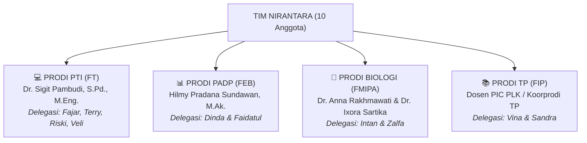

# 🎓 BANK PERTANYAAN RESMI KONSULTASI DOSEN PIC 4 PRODI
## **Panduan Sowan & Sinkronisasi Kebijakan Akademik Lintas Fakultas (FT, FEB, FMIPA, FIP)**
*Disusun untuk Tim Nirantara PLK UNY Mengabdi 2027 — Desa Wonosari, Trucuk, Klaten*

---

> [!IMPORTANT]
> **PANDUAN OPERASIONAL SEBELUM MENGHADAP DOSEN PIC:**
> 1. **Tujuan Utama Konsultasi Tahap 2 (November 2026)**:
>    - Melaporkan hasil survei lapangan 24 Oktober 2026 (audiensi Kades Wonosari & Ketua RW 01 Majegan).
>    - Mengunci kuota dan mengamankan slot keberangkatan tim dari isu pembatasan/seleksi kuota PLK semester 6.
>    - Meminta kepastian konversi mata kuliah (SKS) dan legalitas 1 kelompok mandiri di Desa Wonosari.
>    - Mengonfirmasi persetujuan calon DPL resmi lintas fakultas: **Dr. Ponco Walipratono, S.Pd.T., M.Pd. (DPTEI FT)**.
> 2. **Dokumen yang WAJIB Dibawa (Cetak / Tunjukkan via Tablet)**:
>    - Dokumen 1 Lembar: *Executive Summary Profil Tim Nirantara* (Daftar 10 Anggota, 4 Fakultas, Posko Majegan, Kontak Kades).
>    - Draf Ringkas Program Kerja 4 Divisi (dari folder `03 - Fase PLK`).
>    - Notulensi / Berita Acara Survei Lapangan 24 Oktober 2026.

---

## 🧭 MATRIKS DISTRIBUSI KONSULTASI 4 PRODI



---

## 🏛️ BAGIAN 1: PERTANYAAN UMUM & STRATEGIS TIM (SEMUA PRODI)
*Pertanyaan ini wajib ditanyakan oleh **seluruh perwakilan prodi** untuk memastikan tidak ada perbedaan interpretasi antar fakultas:*

1. **Isu Pembatasan / Seleksi Kuota PLK Semester 6**:
   > *"Bapak/Ibu, beredar kabar mengenai tingginya animo mahasiswa angkatan 2024 mengambil PLK di semester 6 sehingga ada potensi seleksi kuota. Kelompok kami sudah lengkap 10 orang dari 4 fakultas (FT, FEB, FMIPA, FIP), lokasi desa sudah berizin resmi dari Kepala Desa Wonosari Klaten, dan rumah posko sudah siap. Berkas apa yang perlu kami serahkan sekarang agar prodi dapat mengunci slot keberangkatan kami?"*
2. **Legalitas 1 Kelompok Mandiri di Desa Wonosari**:
   > *"Kelompok mitra kedua yang awalnya berencana di Wonosari mengundurkan diri, sehingga tim kami saat ini menjadi kelompok tunggal di Desa Wonosari (Dukuh Majegan). Apakah dari pihak prodi/fakultas mengizinkan kami berjalan mandiri 1 kelompok, atau kami diwajibkan mencari kelompok mitra UNY kedua di desa tersebut?"*
3. **Persetujuan Calon DPL Lintas Fakultas (Dr. Ponco Walipratono - FT)**:
   > *"Untuk Dosen Pembimbing Lapangan (DPL), kelompok kami berencana mengajukan Dr. Ponco Walipratono, S.Pd.T., M.Pd. dari Fakultas Teknik. Apakah dari pihak prodi Bapak/Ibu menyetujui DPL lintas fakultas ini untuk menilai luaran dan mengesahkan logbook kami, atau dari prodi mengharuskan ada DPL pendamping internal prodi?"*
4. **Alur Surat Izin Kampus ke Bapperida Klaten**:
   > *"Berdasarkan koordinasi dengan Bapperida Kabupaten Klaten tanggal 30 Oktober kemarin, Pemkab Klaten mewajibkan adanya Surat Pengantar Permohonan Izin KKN resmi dari UNY. Apakah surat tersebut cukup diterbitkan satu pintu melalui sistem e-Service UNY oleh ketua kelompok (FT) mewakili 10 mahasiswa, atau masing-masing anggota harus meminta surat izin dari fakultas masing-masing?"*

---

## 💻 BAGIAN 2: BANK PERTANYAAN KHUSUS PRODI PTI (FAKULTAS TEKNIK)
**Target Narasumber**: **Dr. Sigit Pambudi, S.Pd., M.Eng.** (Koordinator Program Studi / PIC PTI FT)  
**Mahasiswa Pengusul**: Fajar Ahnaf Mahardika, Muhadzdzib Terry Al Fauzan, Muhamad Riski, Novelia Harlinda

### Pertanyaan 1: Konversi Mata Kuliah Tambahan (MKTK s/d 20 SKS)
* **Latar Belakang**: Pak Sigit sebelumnya menyampaikan bahwa PTI membuka peluang konversi hingga 20 SKS jika proker linier. Proker PTI Nirantara mencakup: Pemetaan 25 Titik Google Maps & QRIS UMKM, Revitalisasi Website Profil Desa Wonosari, dan Workshop Literasi Keamanan Siber Pemuda Karang Taruna.
* **Pertanyaan Verbatim**:
  > *"Pak Sigit, tim IT kami di Wonosari merancang 4 program utama: Revitalisasi Website Profil Desa, Pemetaan Digital 25 Titik Google Maps & QRIS UMKM, serta Pelatihan Keamanan Data bagi Pemuda Desa. Dari daftar mata kuliah semester 6 kurikulum PTI, mata kuliah pilihan/kompetensi apa saja yang direkomendasikan Pak Sigit untuk kami ajukan konversi selain KKN 6 SKS, agar kami bisa memaksimalkan konversi akademik?"*
* **Target Jawaban**: Daftar kode dan nama mata kuliah pilihan yang di-ACC untuk konversi.

### Pertanyaan 2: Pengakuan Jam Riset & Persiapan Lapangan (Pre-PLK)
* **Latar Belakang**: Tim sudah melakukan survei lapangan 24 Oktober 2026, audiensi kades, pengukuran posko, penyusunan analisis 5 Whys, dan coding awal website desa di Jogja.
* **Pertanyaan Verbatim**:
  > *"Izin menanyakan terkait pengisian Logbook 272 Jam, Pak. Selama bulan Oktober dan November ini, tim kami sudah melakukan survei fisik ke Klaten, rapat koordinasi rutin, perumusan proposal, dan perancangan website profil desa di Jogja. Apakah seluruh jam kerja pra-lapangan ini nantinya sah diinput dan diakui dalam logbook 272 jam saat dashboard resmi dibuka?"*
* **Target Jawaban**: Penegasan bahwa jam persiapan teknis diakui asal relevan dan disetujui DPL.

### Pertanyaan 3: Prosedur Pengajuan Dr. Ponco Walipratono sebagai DPL
* **Latar Belakang**: Tim PTI ingin memastikan Dr. Ponco dapat dikunci sebagai DPL resmi kelompok Nirantara.
* **Pertanyaan Verbatim**:
  > *"Terkait rencana kami meminta kesediaan Bapak Dr. Ponco Walipratono, M.Pd. sebagai DPL tim Nirantara, apakah dari sistem prodi PTI ada form kesediaan membimbing yang perlu ditandatangani beliau terlebih dahulu sebelum pendaftaran di sistem dashboard dibuka?"*
* **Target Jawaban**: Mekanisme administrasi penunjukan DPL mandiri di lingkungan FT.

---

## 📊 BAGIAN 3: BANK PERTANYAAN KHUSUS PRODI PADP (FAK. EKONOMI & BISNIS)
**Target Narasumber**: **Hilmy Pradana Sundawan, M.Ak.** (Dosen PIC PLK Prodi PADP FEB)  
**Mahasiswi Pengusul**: Dinda Amelia Putri & Faidatul Anugraheni M.

### Pertanyaan 1: Peluang Rekognisi / Konversi Mata Kuliah Tambahan Kompetensi
* **Latar Belakang**: Konsultasi awal menyebutkan PADP hanya mengonversi KKN 6 SKS. Namun proker PADP Nirantara sangat kuat: Program KUPAT (Buku Kas Saku 3 Menit UMKM), LEBAH (Klinik 15 NIB Legalitas Usaha OSS), dan GARDU (Digitalisasi Sistem Kearsipan Persuratan RW 01 Majegan).
* **Pertanyaan Verbatim**:
  > *"Pak Hilmy, izin melaporkan bahwa berdasarkan survei lapangan di Dukuh Majegan, kami merancang 3 program kerja administrasi dan UMKM: penataan sistem kearsipan surat desa (GARDU), pelatihan pembukuan kas UMKM praktis (KUPAT), dan pendampingan 15 izin usaha NIB via OSS (LEBAH). Mengingat kegiatan ini sangat aplikatif dengan keilmuan administrasi perkantoran, apakah ada peluang mata kuliah prodi di semester 6 (seperti Manajemen Kearsipan atau Praktik Komputer Administrasi) yang bisa direkognisi sebagian, ataukah kebijakan PADP tetap murni mengonversi 6 SKS KKN saja, Pak?"*
* **Target Jawaban**: Kepastian apakah murni 6 SKS KKN atau ada makul tambahan yang bisa diklaim.

### Pertanyaan 2: Pengambilan Mata Kuliah Teori Semester 6 Bersamaan dengan PLK
* **Latar Belakang**: Jika PADP hanya mengonversi 6 SKS KKN, Dinda & Fai harus mengambil sisa SKS mata kuliah reguler di kampus FEB.
* **Pertanyaan Verbatim**:
  > *"Jika konversi yang diperoleh adalah 6 SKS KKN, bagaimana ketentuan prodi PADP mengenai sisa mata kuliah teori yang kami ambil di semester 6? Karena jadwal pengabdian kami di Klaten difokuskan pada akhir pekan (Jumat sore hingga Minggu malam), apakah diperbolehkan mengambil mata kuliah kuliah teori di hari Senin–Kamis di kampus?"*
* **Target Jawaban**: Izin resmi prodi untuk mengambil kuliah tatap muka Senin–Kamis.

### Pertanyaan 3: Administrasi Surat Izin Penelitian / KKN di FEB
* **Latar Belakang**: Memastikan surat izin Bapperida Klaten apakah perlu stempel Dekan FEB.
* **Pertanyaan Verbatim**:
  > *"Untuk perizinan ke Bapperida Klaten, ketua tim kami dari FT telah mengajukan surat izin pengantar kelompok 10 orang via e-Service UNY. Apakah dari pihak prodi PADP / Dekanat FEB memerlukan kami membuat surat pengantar terpisah, atau cukup menggunakan surat pengantar kolektif universitas tersebut, Pak?"*
* **Target Jawaban**: Konfirmasi keabsahan surat pengantar kolektif e-Service.

---

## 🌿 BAGIAN 4: BANK PERTANYAAN KHUSUS PRODI BIOLOGI (FMIPA)
**Target Narasumber**: **Dr. Anna Rakhmawati, M.Si.** (Koorprodi) & **Dr. Ixora Sartika Mercuriani, M.Si.** (PIC Biologi FMIPA)  
**Mahasiswi Pengusul**: Intan Milansari & Zalfa Khoirunnisa

### Pertanyaan 1: Validasi Ilmiah Program Kerja Pengolahan Sampah & Kompos Fermentasi
* **Latar Belakang**: Masalah utama Dukuh Majegan adalah tradisi pembakaran sampah di pekarangan/kali dan kelangkaan pupuk subsidi bagi petani padi. Proker Biologi: Komposter Anaerob EM4 (KOBAR), Pelatihan Eco-Enzyme Jeruk/Nanas (ICEM), dan Sosialisasi Bahaya Bakar Sampah & ISPA (MASSA).
* **Pertanyaan Verbatim**:
  > *"Ibu Dr. Anna dan Ibu Dr. Ixora, hasil observasi kami di Desa Wonosari Klaten menemukan permasalahan kritis: warga terbiasa membakar sampah plastik dan dedaunan karena tidak ada TPS, serta petani kesulitan pupuk subsidi. Kami merancang solusi biologis: pembuatan pupuk kompos fermentasi menggunakan bioaktivator EM4 (Program KOBAR) dan pelatihan fermentasi eco-enzyme limbah kulit buah (Program ICEM). Apakah rancangan metode ini dinilai sudah tepat dan relevan menurut prodi Biologi, dan apakah ada saran formula atau bioaktivator tambahan dari Ibu?"*
* **Target Jawaban**: Masukan ilmiah dosen, validasi relevansi keilmuan, dan arahan praktis pembuatan kompos/eco-enzyme.

### Pertanyaan 2: Pengakuan Jam Persiapan Bahan & Laboratorium di Jogja
* **Latar Belakang**: Pembuatan starter mikroorganisme, uji fermentasi eco-enzyme, dan pencampuran EM4 membutuhkan persiapan di Jogja sebelum diaplikasikan ke tong komposter di desa.
* **Pertanyaan Verbatim**:
  > *"Sebelum mempraktikkan pembuatan kompos dan eco-enzyme bersama warga Klaten, kami perlu melakukan persiapan teknis seperti uji takaran fermentasi, sterilisasi wadah, dan penyiapan media starter di kos/Jogja. Apakah jam persiapan teknis biologis ini sah kami masukkan ke dalam logbook 272 jam?"*
* **Target Jawaban**: Konfirmasi batas jam persiapan teknis yang diakui prodi Biologi.

### Pertanyaan 3: Kejelasan Desas-Desus Seleksi Kuota & Dosen PIC Biologi
* **Latar Belakang**: Menghilangkan kekhawatiran desas-desus pembatasan kuota dan rumor nama dosen luar ("Bu Eti").
* **Pertanyaan Verbatim**:
  > *"Ibu, di kalangan mahasiswa sempat beredar informasi tentang pembatasan kuota PLK semester 6 dan adanya kelompok lain yang berangkat lebih awal ke Sleman. Kami ingin menegaskan kembali bahwa tim kami berpegang penuh pada arahan Ibu Dr. Anna dan Ibu Dr. Ixora. Apakah ada berkas verifikasi prodi yang perlu kami kumpulkan segera agar pendaftaran kami berdua di PLK Wonosari Klaten aman 100%?"*
* **Target Jawaban**: Jaminan kepastian slot dari Koorprodi dan Dosen PIC resmi Biologi.

---

## 📚 BAGIAN 5: BANK PERTANYAAN KHUSUS PRODI TEKNOLOGI PENDIDIKAN (FIP)
**Target Narasumber**: **Dosen PIC PLK / Koorprodi Teknologi Pendidikan FIP UNY**  
**Mahasiswi Pengusul**: Alvina Aulia Az Zahra & Krissandra Siagian

### Pertanyaan 1: Strategi Pemenuhan 272 Jam Murni Fisik di Klaten
* **Latar Belakang**: PIC TP sebelumnya menegaskan bahwa 272 jam harus aktivitas fisik nyata di lokasi pengabdian (tidak mengakui jam ketik proposal di Jogja).
* **Pertanyaan Verbatim**:
  > *"Bapak/Ibu Dosen PIC TP, menindaklanjuti arahan sebelumnya bahwa 272 jam logbook TP wajib berlokasi fisik di desa mitra, tim kami telah menyusun jadwal intensif Jumat hingga Minggu di Desa Wonosari:  
  > 1. Mengajar dan revitalisasi Alat Permainan Edukatif (APE) serta Pojok Baca di TK ABA Majegan (Program TAMPAN).  
  > 2. Gamifikasi pembelajaran akhlak dan media ajar di TPA Masjid Al-Amin (Program SABA).  
  > 3. Membuka bimbingan belajar (Bimbel) rutin di posko dukuh tiap Jumat & Sabtu malam.  
  > 4. Workshop media pembelajaran digital (Canva & pemanfaatan AI dasar) bagi guru PAUD/TK (Program GARDITA).  
  > Dengan rincian 24–28 jam aktivitas fisik setiap akhir pekan selama 11–12 minggu, kami memproyeksikan total akumulasi mencapai 280 jam fisik di Klaten. Apakah strategi operasional ini dinilai sudah memenuhi standar penilaian kelulusan PLK TP, Bapak/Ibu?"*
* **Target Jawaban**: Validasi dan persetujuan bahwa kegiatan bimbel posko malam & edukasi akhir pekan sah sebagai jam fisik Klaten.

### Pertanyaan 2: Peluang Konversi Mata Kuliah Pilihan Kurikulum TP Semester 6
* **Latar Belakang**: TP membuka peluang konversi di luar KKN jika ada mata kuliah yang relevan dengan perancangan media ajar.
* **Pertanyaan Verbatim**:
  > *"Mengingat program kerja kami berfokus pada perancangan media interaktif TK (APE), gamifikasi media TPA, dan pelatihan teknologi bagi pendidik, mata kuliah semester 6 apa saja di kurikulum TP yang dapat kami ajukan untuk rekognisi/konversi kompetensi selain 6 SKS KKN?"*
* **Target Jawaban**: Rekomendasi mata kuliah kompetensi TP yang dapat dikonversi.

### Pertanyaan 3: Pengesahan Laporan dan Format Luaran TP
* **Latar Belakang**: Memastikan luaran khusus (misal: modul APE atau video media) sesuai standar FIP.
* **Pertanyaan Verbatim**:
  > *"Apakah dari Prodi Teknologi Pendidikan mewajibkan adanya luaran khusus tambahan selain luaran wajib universitas (seperti laporan kegiatan, video, dan logbook)? Apakah produk media pembelajaran APE atau modul pelatihan Canva guru yang kami buat perlu diserahkan juga ke prodi sebagai syarat nilai A?"*
* **Target Jawaban**: Format berkas bukti fisik luaran untuk prodi TP.

---

## 📱 BAGIAN 6: DRAF TEKS WHATSAPP JANJIAN SOWAN KE DOSEN PIC

Salin draf pesan di bawah ini, sesuaikan bagian tanda kurung siku `[...]`, dan kirimkan secara sopan di jam kerja:

```text
Selamat pagi/siang, Bapak/Ibu [Nama Lengkap Dosen beserta Gelar]. 
Mohon maaf mengganggu waktu Bapak/Ibu.

Saya [Nama Mahasiswa] (NIM. [Nomor Induk Mahasiswa]) dari Program Studi [Nama Prodi] angkatan 2024. 

Izin melaporkan bahwa tim kelompok PLK UNY Mengabdi kami (Tim NIRANTARA - beranggotakan 10 mahasiswa lintas FT, FEB, FMIPA, dan FIP) telah selesai melaksanakan observasi lapangan dan audiensi resmi ke Kepala Desa Wonosari dan Ketua RW 01 Dukuh Majegan, Kecamatan Trucuk, Kabupaten Klaten. 

Pihak pemerintah desa telah menyambut baik dan memberikan izin tempat. Rencana posko fisik dan perumusan draf program kerja lintas bidang juga telah kami selesaikan.

Sehubungan dengan persiapan pendaftaran resmi di dashboard PLK dan koordinasi izin ke Bapperida Klaten, ada beberapa hal terkait konversi mata kuliah dan teknis logbook yang ingin kami konsultasikan singkat dengan Bapak/Ibu.

Apabila Bapak/Ibu ada waktu luang di kampus pada pekan ini, kami sangat berterima kasih jika diperkenankan untuk sowan berkonsultasi secara langsung.

Terima kasih banyak atas waktu dan arahan Bapak/Ibu. 🙏
```

---

## 📋 CHECKLIST DOKUMEN & OUTPUT PASCA KONSULTASI

Setelah melakukan konsultasi dengan dosen PIC masing-masing prodi, perwakilan mahasiswa wajib mencatat hasilnya dengan format berikut:

| No | Parameter yang Wajib Dicatat Hasilnya | Catatan Hasil Jawaban Dosen | Status ACC |
|:---:|---|---|:---:|
| 1 | Kepastian status seleksi kuota & slot tim di prodi | | [ ] |
| 2 | Izin berjalan 1 kelompok mandiri di Wonosari Klaten | | [ ] |
| 3 | Daftar mata kuliah konversi (nama makul & jumlah SKS) | | [ ] |
| 4 | Persetujuan calon DPL resmi (Dr. Ponco Walipratono - FT) | | [ ] |
| 5 | Keabsahan surat pengantar kolektif e-Service UNY | | [ ] |
| 6 | Aturan khusus logbook 272 jam & jam persiapan | | [ ] |

> [!TIP]
> **Tindak Lanjut Notulensi**:
> Masukkan hasil jawaban dosen ke dalam folder `Tim PLK/02 - Fase Pre-PLK/02 - DPL & Konsultasi Akademik/Konsultasi PIC/` untuk meng-update dokumen `[Matriks Hasil Konsultasi PIC 4 Prodi]`.
