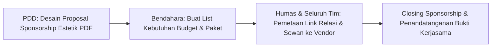

# 💰 Strategi Sponsorship & Anggaran Awal Tim NIRANTARA
**Panduan Pengadaan Atribut (Rompi 12 Pcs), Kas Awal, & Rencana Pendanaan Eksternal**

Dokumen ini disusun untuk memandu Bendahara (Fai & Zalfa) dan Sekretaris (Dinda & Veli) dalam merancang pendanaan awal tim, pengadaan seragam rompi, serta skema penjaringan dana sponsor dari luar kampus.

---

## 🎽 1. Estimasi Anggaran Pengadaan Atribut Awal (12 Pcs)

Sebagai identitas resmi saat survei ke Balai Desa dan kunjungan lapangan, tim membutuhkan atribut seragam:

| No | Item Pengadaan | Rincian & Spesifikasi | Estimasi Satuan | Vol | Total Estimasi |
|:---:|---|---|:---:|:---:|:---:|
| 1 | **Rompi Drill Tim NIRANTARA** | Bahan Nagata/American Drill, bordir logo Nirantara di dada kiri, logo UNY di dada kanan, tulisan punggung *“PLK UNY Mengabdi 2027 — Desa Wonosari Klaten”*. Termasuk 2 kantong depan. | Rp 85.000 | 12 pcs | **Rp 1.020.000** |
| 2 | **Lanyard & ID Card Gantungan** | Tali lanyard printing custom nama Nirantara + card holder transparan + ID card tim. | Rp 15.000 | 12 pcs | **Rp 180.000** |
| 3 | **Stempel Resmi Tim & Tinta** | Stempel *flash* otomatis tanpa bantalan untuk surat resmi, kuitansi, dan lembar disposisi desa. | Rp 50.000 | 1 pcs | **Rp 50.000** |
| 4 | **Spanduk / Banner Posko** | Banner outdoor bahan flexi 280 gr (Ukuran $3 \times 1$ meter) untuk penanda Posko Majegan. | Rp 50.000 | 1 pcs | **Rp 50.000** |
| 5 | **Kas Operasional Survei Lanjutan** | Transport bensin bersama 5 motor Jogja–Klaten PP + konsumsi survei Balai Desa. | Rp 40.000 | 5 motor | **Rp 200.000** |
| **TOTAL** | **Kebutuhan Dana Awal Fase Pre-PLK** | | | | **Rp 1.500.000** |

*Catatan Kuota 12 Pcs:*
* 10 Pcs untuk Anggota Tim (Fajar, Terry, Riski, Veli, Dinda, Fai, Intan, Zalfa, Vina, Sandra).
* 1 Pcs untuk Dosen Pembimbing Lapangan (DPL) saat agenda Monev ke posko Klaten.
* 1 Pcs cinderamata kehormatan untuk Kepala Desa Wonosari.

---

## 💵 2. Skema Iuran Kas Awal Tim (Self-Funding)

Sebelum dana bantuan kampus atau sponsor cair, kebutuhan awal (terutama DP konveksi rompi minimal 50%) ditopang melalui iuran kas mandiri:

* **Besaran Iuran Awal**: **Rp 150.000 per anggota** ($10 \times \text{Rp } 150.000 = \mathbf{\text{Rp } 1.500.000}$).
* **Skema Pembayaran (2 Termin agar Ringan)**:
  * **Termin 1 (DP Konveksi & Operasional)**: Rp 75.000 (Jatuh tempo: Akhir Oktober 2026).
  * **Termin 2 (Pelunasan Rompi & Banner)**: Rp 75.000 (Jatuh tempo: Pertengahan November 2026).
* **Rekening Penampungan Kas**: Rekening Bank Bendahara 1 (Fai - PADP) yang transparan dan dilaporkan mutasinya setiap pekan di Google Sheets master kas.

---

## 🤝 3. Strategi Penjaringan Sponsorship (Eksternal)

Sponsorship bertujuan untuk **menutup biaya program kerja pengabdian** (seperti pembelian bibit tanaman obat, tetes tebu molase untuk Eco-Enzyme, modul buku ajar SD, dan doorprize pelatihan warga) agar tidak membebani kantong mahasiswa.

### A. Sasaran Target Sponsor yang Realistis untuk KKN/PLK

| Kluster Sasaran | Contoh Target Mitra | Bentuk Bantuan yang Diajukan |
|:--- | :--- | :--- |
| **1. Mitra Pengadaan (In-Kind Discount)** | Vendor konveksi rompi / percetakan digital banner di Jogja. | Potongan harga rompi atau gratis banner posko dengan imbalan logo sponsor ditaruh di lengan rompi & feed medsos. |
| **2. Brand F&B / Minuman Kemasan** | Distributor air mineral lokal, brand teh kemasan, atau bakery roti. | *Free product* (kardus air mineral & snack) untuk konsumsi saat penyuluhan warga / pelatihan ibu-ibu PKK Wonosari. |
| **3. Sektor Agrikultur & Toko Tani** | Toko pertanian di daerah Klaten/Prambanan. | Bantuan bibit sayur/toga, media tanam, atau drum plastik untuk instalasi pengolahan kompos sampah kelompok tani. |
| **4. UMKM & Kedai Kuliner Lokal** | Kedai kopi, resto, atau usaha keluarga anggota tim di Jogja/Klaten. | Dana segar (Rp 200rb – Rp 500rb) dengan timbal balik promosi di story Instagram tim & logo di spanduk proker. |
| **5. Donatur Lepas & Ikatan Alumni** | Dosen-dosen muda UNY, alumni FT/FEB/FMIPA/FIP yang sudah bekerja, atau keluarga. | Donasi sukarela melalui skema *open donation* digital (QRIS yayasan/rekening tim). |

---

### B. Paket Kontraprestasi Sponsorship Sederhana

Buat paket yang tidak memberatkan operasional tim tetapi tetap menarik bagi sponsor:

1. **Paket Sponsor Platinum (Dana $\ge$ Rp 1.000.000):**
   * Pemasangan logo di rompi tim (lengan kanan/kiri).
   * Pemasangan logo besar di seluruh banner utama proker dan spanduk posko.
   * Dedicated post di Instagram @nirantara (Feed carousel ulasan profil brand).
   * Logo tampil di tayangan video *Aftermovie Sinematik PLK*.
2. **Paket Sponsor Gold (Dana Rp 500.000 – Rp 999.000):**
   * Pemasangan logo ukuran sedang di spanduk posko dan banner proker.
   * Story highlight Instagram tim selama periode PLK.
   * Logo di penutup video aftermovie.
3. **Paket Sponsor Silver / Produk (Barang / Konsumsi / Diskon):**
   * Pemasangan logo kecil di banner proker spesifik.
   * Dokumentasi penyerahan produk dan *tag* akun media sosial sponsor.

---

### C. Alur Kerja Divisi untuk Eksekusi Sponsorship

1. **PDD (Vina & Intan)**: Menyusun layout proposal sponsorship ringkas (maksimal 5–7 halaman PDF estetik Canva bertema alam & pertanian Desa Wonosari).
2. **Bendahara (Fai & Zalfa)**: Menghitung rincian item proker yang butuh pendanaan sponsor.
3. **Humas & Seluruh Tim (Terry dkk)**: Menyebarkan proposal ke jejaring kerabat, toko tani, vendor percetakan, dan UMKM.

---

← [[Panduan Workspace & Kolaborasi Tim]] | [[Notulensi Resmi First Gathering NIRANTARA]] | [[Home]]
