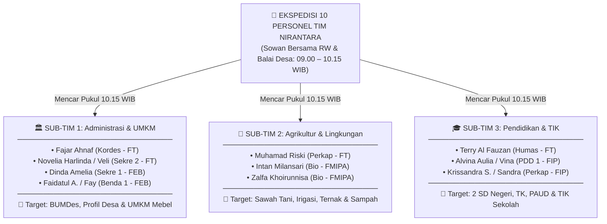

# 🚗 Panduan & Rundown Ekspedisi Survei Lapangan Sabtu — FULL TEAM (10/10 LENGKAP)
## Pemetaan Wilayah Desa Wonosari, Audit Posko Majegan, & Kunjungan Vendor Rompi

**Hari/Tanggal Pelaksanaan**: Sabtu, 24 Oktober 2026  
**Status Kehadiran**: **100% LENGKAP (10 dari 10 Anggota Tim NIRANTARA Ikut Semua)** 🟢  
**Titik Kumpul (Tikum)**: Food Court (FC) Fakultas Teknik UNY Karangmalang (Pukul 07.00 WIB)  
**Estimasi Waktu Kegiatan**: 07.00 – 17.00 WIB  

---

## 👥 Formasi 10 Personel & Pembagian 3 Sub-Tim Kerja

Dengan hadirnya seluruh 10 anggota dari 4 fakultas/prodi, survei lapangan dibagi menjadi **3 Sub-Tim Fungsional** agar pemetaan desa berjalan efisien, komprehensif, dan tepat sasaran:



> [!IMPORTANT]
> **ATURAN SOWAN AWAL (09.00 – 10.15 WIB): KOMPAK BARENG BER-10!**  
> Sesi sowan ke **Kepala RW 01 Dukuh Majegan** dan sowan resmi ke **Kantor Balai Desa Wonosari / Pak Lurah** dilakukan **BERSAMA-SAMA SELURUH 10 ANGGOTA (Full Team)** dengan mengenakan **Jas Almamater UNY**. Ini untuk menunjukkan kekompakan tim, kesopanan bertamu, perkenalan formasi 4 fakultas/prodi, serta bersama-sama menggali data monografi profil desa, data kependudukan, struktur BPD, dan kelembagaan desa.  
> **Baru setelah selesai sowan balai desa (pukul 10.15 WIB), tim MENCAR menjadi 3 Sub-Tim** untuk pemetaan wilayah sesuai keahlian bidang masing-masing.

### 🏛️ 1. Sub-Tim 1: Administrasi Desa, IT & Pemetaan Sentra UMKM
* **Personel (4 Orang)**: **Fajar Ahnaf Mahardika** (Ketua/FT), **Novelia Harlinda / Veli** (Sekretaris 2/FT), **Dinda Amelia Putri** (Sekretaris 1/FEB), **Faidatul Anugraheni M. / Fay** (Bendahara 1/FEB).
* **Fokus Tugas Lapangan (Saat Mencar Pukul 10.15 – 12.00 WIB)**:
  1. Mendalami unit usaha **BUMDes Wonosari** (omset, unit usaha aktif, potensi pengembangan digital/pembukuan).
  2. Melakukan wawancara dan pemetaan **Sentra UMKM Lokal** (pengrajin mebel kayu/pertukangan, industri kerajinan rumahan, toko kelontong, dan sentra kuliner desa).
  3. Mengidentifikasi kendala legalitas usaha (NIB), pembukuan keuangan kas, dan strategi promosi digital UMKM desa.

### 🌾 2. Sub-Tim 2: Agrikultur, Lingkungan Hidup, & Peternakan Warga
* **Personel (3 Orang)**: **Muhamad Riski** (Perkap 1/FT), **Intan Milansari** (PDD 2 & Koor Lingkungan/FMIPA), **Zalfa Khoirunnisa** (Bendahara 2/FMIPA).
* **Fokus Tugas Lapangan (Saat Mencar Pukul 10.15 – 12.00 WIB)**:
  1. Observasi hamparan sawah pertanian padi dan saluran irigasi milik **Kelompok Tani Setyo Makmur**.
  2. Mendata komoditas kebun warga serta mengidentifikasi keberadaan **Kelompok Wanita Tani (KWT)** atau PKK dasawisma.
  3. Mendata sebaran **ternak warga** (kandang sapi, kambing, peternakan unggas/bebek) dan pengelolaan limbah kotoran ternaknya.
  4. Melakukan audit titik pembuangan sampah liar desa, tempat penampungan sementara (TPS), serta mengukur kelayakan air sumur posko/warga.
  5. Menakar ketersediaan bahan organik lokal untuk rencana program pembuatan **Kompos Organik & Eco-Enzyme**.

### 🎓 3. Sub-Tim 3: Fasilitas Pendidikan, Sekolah, & TIK Desa
* **Personel (3 Orang)**: **Muhadzdzib Terry Al Fauzan** (Humas/FT), **Alvina Aulia Az Zahra / Vina** (PDD 1 & Koor Pendidikan/FIP), **Krissandra Siagian / Sandra** (Perkap 2/FIP).
* **Fokus Tugas Lapangan (Saat Mencar Pukul 10.15 – 12.00 WIB)**:
  1. Melakukan kunjungan observasi ke lembaga pendidikan formal dan non-formal:
     * **SD Negeri 1 Wonosari** & **SD Negeri 2 Wonosari**.
     * **TK Pertiwi**, **TK Aisyiyah**, dan **PAUD Pendem**.
  2. Mengecek ketersediaan fasilitas TIK sekolah (jumlah laptop, proyektor LCD, ketersediaan jaringan internet/WiFi, dan ruang kelas).
  3. Melakukan wawancara singkat dengan Kepala Sekolah atau Guru mengenai kurikulum tematik, kendala media pembelajaran, dan kegiatan ekstrakurikuler siswa.
  4. Mendokumentasikan foto lanskap, kondisi jalanan desa, dan gedung sekolah untuk arsip media publikasi PDD.

---

## ⏰ Rundown Detail Ekspedisi Sabtu, 24 Oktober 2026

| Waktu (WIB) | Durasi | Agenda / Aktivitas Utama | Keterangan & Lokasi | PIC / Penanggung Jawab |
|:---:|:---:|---|---|---|
| **07.00 – 07.30** | 30' | **Kumpul di Food Court (FC) FT UNY Karangmalang**<br>• Cek kelengkapan armada motor (5 motor) & helm SNI.<br>• Pembagian lembar instrumen observasi cetak & clipboard.<br>• Doa bersama dipimpin Ketua. | FC FT UNY Karangmalang | Fajar & Riski |
| **07.30 – 08.45** | 75' | **Perjalanan Konvoi Menuju Posko Klaten**<br>• Rute: UNY $\rightarrow$ Jl. Solo $\rightarrow$ Candi Prambanan $\rightarrow$ Klaten Kota $\rightarrow$ Kec. Trucuk $\rightarrow$ Dukuh Majegan, Wonosari.<br>• Kecepatan konvoi santai (40–50 km/jam), tertib lalu lintas. | Perjalanan Jogja – Klaten | Terry (Lead Rute) & Riski (Sweeper) |
| **08.45 – 09.00** | 15' | **Tiba di Posko Majegan & Istirahat Sejenak (*Resting*)**<br>• Menaruh barang bawaan tas/helm di rumah simbah Terry.<br>• Minum, rehidrasi, dan persiapan instrumen observasi. | Posko Rumah Simbah Terry | Terry (Tuan Rumah) |
| **09.00 – 09.30** | 30' | **Sowan Pertama: Silaturahmi ke Kepala RW 01 Dukuh Majegan (BERSAMA BER-10)**<br>• *Kulon nuwun* bersama seluruh 10 anggota kepada tokoh masyarakat sekitar posko.<br>• Meminta arahan singkat terkait karakteristik lingkungan warga & ketertiban posko. | Kediaman Pak RW 01 Majegan | **Seluruh 10 Anggota** (Dipandu Terry & Fajar) |
| **09.30 – 10.15** | 45' | **Sowan Kedua: Audiensi Balai Desa / Pak Lurah Wonosari (BERSAMA BER-10)**<br>• Audiensi resmi bersama Kepala Desa / Sekdes & Perangkat Desa (**Wajib Berjas Almet UNY**).<br>• Perkenalan formasi 10 anggota Nirantara dari 4 Fakultas (FT, FEB, FMIPA, FIP).<br>• Menggali bersama **monografi profil desa, data kependudukan, struktur BPD, dan kelembagaan desa**.<br>• Konfirmasi perizinan awal dan penerimaan PLK. | Kantor Balai Desa Wonosari | **Seluruh 10 Anggota** (Dipimpin Fajar & Dinda) |
| **10.15 – 12.00** | 105' | **Misi Lapangan: 3 Sub-Tim MENCAR Memetakan Potensi Desa**<br>*(Selesai dari balai desa, tim menyebar mumpung belum terik panas)*<br>• **Sub-Tim 1 (Fajar, Veli, Dinda, Fay)**: Pendalaman BUMDes & wawancara sentra pengrajin mebel/UMKM lokal.<br>• **Sub-Tim 2 (Riski, Intan, Zalfa)**: Observasi sawah tani Setyo Makmur, irigasi, kandang ternak sapi/kambing, kebun, & TPS sampah.<br>• **Sub-Tim 3 (Terry, Vina, Sandra)**: Observasi 2 SD Negeri, TK Pertiwi/Aisyiyah, PAUD, & fasilitas TIK sekolah. | Wilayah Tersebar Desa Wonosari | Terbagi Sesuai 3 Sub-Tim |
| **12.00 – 13.30** | 90' | **Target Selesai Lapangan, Kembali ke Posko & ISHOMA**<br>• ⚠️ **Agenda Khusus**: **Vina & Sandra (TP) mengerjakan UTS di posko** (disiapkan ruangan tenang, meja & WiFi).<br>• Sholat Dzuhur berjamaah di Masjid dekat posko.<br>• Makan siang bersama di posko / warung makan lokal desa. | Posko Majegan & Masjid Terdekat | Dinda (Konsumsi) & Terry |
| **13.30 – 15.00** | 90' | **Audit Fisik Posko & Rapat Pleno Internal Nirantara**<br>• **Audit Fisik Posko**: Mengukur $p \times l$ seluruh kamar (2 kamar mahasiswi, kamar mahasiswa, dapur, 2 kamar mandi, kelayakan stopkontak, air sumur).<br>• **Rapat Pleno Tim**: Rekapitulasi hasil temuan dari 3 sub-tim.<br>• Pematangan draf proposal proker dari data riil desa.<br>• Pembahasan strategi Oprec Kelompok Mitra Baru 1 Desa Wonosari. | Posko Majegan | Veli, Riski, & Fajar |
| **15.00 – 17.00** | 120' | **Kunjungan ke Vendor Rompi / Vest PLK (*Agenda Opsional/Fleksibel*)**<br>• Meluncur ke lokasi vendor konveksi rompi di Klaten/Jogja.<br>• Cek sampel bahan kain (drill/ripstop), cek bordir logo Nirantara & UNY, fitting ukuran baju (S s.d. XXL), dan negosiasi harga (budget 150k–200k). *(Catatan: Bersifat tidak wajib bagi yang lelah, namun jadi target utama kepanitiaan).* | Lokasi Vendor Rompi | Riski, Fai, & Tim |
| **17.00 – Selesai**| — | **Briefing Penutup & Perjalanan Pulang ke Yogyakarta**<br>• Doa penutup ekspedisi dan perjalanan konvoi pulang dengan tertib.<br>• Kembali ke Jogja sebelum malam hari. | Klaten $\rightarrow$ Jogja | Fajar & Terry |

---

## 🛵 Formasi Kendaraan 10 Orang (5 Sepeda Motor)

Untuk menjaga ketertiban konvoi di Jalan Raya Solo–Klaten, disarankan memasangkan armada kendaraan sebagai berikut:

| No | Unit Armada | Pengemudi (*Rider*) | Penumpang (*Boncenger*) | Keterangan & Tugas Armada |
|:---:|:---:|---|---|---|
| **1** | Motor 1 | **Fajar Ahnaf** (Kordes) | **Muhadzdzib Terry** (Humas) | **Lead Rute & Road Captain** (Memandu jalan utama) |
| **2** | Motor 2 | **Muhamad Riski** (Perkap 1) | **Intan Milansari** (PDD 2/Bio) | Membawa instrumen meteran rol & tas P3K |
| **3** | Motor 3 | **Novelia Harlinda (Veli)** | **Zalfa Khoirunnisa** | Membawa instrumen cetak & clipboard data |
| **4** | Motor 4 | **Dinda Amelia Putri** | **Faidatul Anugraheni** | Tim Kas & Administrasi Desa |
| **5** | Motor 5 | **Alvina Aulia (Vina)** | **Krissandra Siagian (Sandra)** | **Sweeper Rombongan** & Perlengkapan UTS |

*(Catatan: Pasangan kendaraan di atas dapat disesuaikan fleksibel dengan kepemilikan motor masing-masing anggota di hari H).*

---

## 🧰 Checklist Perlengkapan Wajib yang Harus Siap di Tas

- [ ] **Meteran Bangunan / Meteran Rol (Minimal 5 Meter)**: *Wajib dibawa Riski/Terry untuk ukur posko.*
- [ ] **Papan Ujian / Clipboard + 3 Bolpoin**: *Wajib dibawa Dinda/Veli untuk mencatat di jalan.*
- [ ] **Printout Instrumen Observasi**: Minimal 2–3 rangkap [[04 - Lembar Instrumen Observasi Lapangan (Print Ready)]].
- [ ] **Laptop / Tablet + Charger**: *Wajib dibawa oleh Vina & Sandra untuk pengerjaan UTS jam 12.00 WIB.*
- [ ] **Smartphone dengan Kamera Jernih & Memori Cukup**: Untuk dokumentasi sawah, ternak, sekolah, & posko.
- [ ] **Powerbank (Minimal 10.000 mAh)**: Mengantisipasi baterai low-batt saat GPS & foto.
- [ ] **Jas Hujan & Helm Standar SNI**: Wajib dibawa oleh masing-masing motor.
- [ ] **Jas Almamater UNY & Baju Berkerah Sopan**: Dipakai saat sowan ke Pak RW dan Balai Desa.
- [ ] **Uang Tunai Pecahan Kecil (Rp 50.000 – Rp 100.000)**: Untuk makan siang, bensin darurat, dan kas kecil.

---

## 📲 DRAF PESAN BROADCAST WHATSAPP RUNDOWN (Siap Share ke Grup)

Salin teks di bawah ini dan kirimkan langsung ke grup WhatsApp Tim NIRANTARA malam ini:

```text
📢 [RUNDOWN RESMI SURVEI LAPANGAN SABTU — FULL TEAM 10/10 NIRANTARA] 📢

Halo rekan-rekan Nirantara! 🌱✨
Alhamdulillah besok Sabtu, 24 Oktober 2026 kita FIX BERANGKAT FULL TEAM (10 Orang Lengkap)! 

Berikut adalah timeline rundown, pembagian tugas lapangan, dan teknis kegiatan besok:

⏰ TIMELINE & RUNDOWN KEGIATAN:
• 07.00 – 07.30 WIB: Kumpul di Food Court (FC) FT UNY Karangmalang (Cek kendaraan, pembagian instrumen, & doa bersama).
• 07.30 – 08.45 WIB: Berangkat konvoi santai Jogja ➡️ Klaten (via Jl. Solo).
• 08.45 – 09.00 WIB: Tiba di Posko Dukuh Majegan & istirahat sejenak (resting & drop barang).
• 09.00 – 09.30 WIB: Sowan silaturahmi ke Kepala RW 01 Dukuh Majegan (KOMPAK BARENG BER-10).
• 09.30 – 10.15 WIB: Audiensi resmi Balai Desa Wonosari / Sowan Pak Lurah (KOMPAK BARENG BER-10 pakai Almet UNY) ➡️ perkenalan tim & gali bersama monografi profil desa, data kependudukan, struktur BPD, & kelembagaan desa.
• 10.15 – 12.00 WIB: BARU MENCAR OBSERVASI LAPANGAN (Mumpung pagi biar belum panas!):
  - Sub-Tim 1 (Fajar, Veli, Dinda, Fay): Data BUMDes, profil desa, & sentra UMKM mebel/pertukangan.
  - Sub-Tim 2 (Riski, Intan, Zalfa): Hamparan sawah tani Setyo Makmur, irigasi, ternak warga, kebun, & titik TPS sampah.
  - Sub-Tim 3 (Terry, Vina, Sandra): 2 SD Negeri, TK Pertiwi/Aisyiyah, PAUD, lab/komputer sekolah, & foto lanskap.
• 12.00 – 13.30 WIB: TARGET SELESAI & KEMBALI KE POSKO:
  ⚠️ Vina & Sandra fokus ngerjain UTS di posko (disediakan ruangan tenang & WiFi).
  🍛 Sholat Dzuhur berjamaah & ISHOMA makan siang bersama.
• 13.30 – 15.00 WIB: AGENDA DI POSKO:
  - Mengukur detail fisik posko rumah simbah (kamar tidur, ruang tengah, dapur, colokan, air sumur).
  - Istirahat & Rapat Pleno Tim (bahas temuan proker & strategi oprec kelompok mitra 1 desa).
• 15.00 – 17.00 WIB: Kunjungan ke Vendor Rompi/Vest PLK (Cek bahan kain, bordir logo, fitting ukuran, & nego harga). *Agenda opsional/fleksibel bagi yang lelah, tapi target utama tim.*
• 17.00 WIB: Briefing penutup & perjalanan konvoi pulang ke Jogja.

🎒 CHECKLIST BARANG BAWAAN:
1. Baju berkerah sopan, bersepatu, dan WAJIB bawa JAS ALMAMATER UNY.
2. Helm SNI + Jas Hujan di masing-masing motor.
3. Meteran rol (Riski/Terry) & Clipboard + pulpen (Dinda/Veli).
4. Laptop + Charger (khusus Vina & Sandra untuk UTS).
5. Powerbank & HP memori kosong untuk dokumentasi.
6. Uang tunai secukupnya untuk makan siang & bensin.

Sampai jumpa besok pagi jam 07.00 WIB di FC FT UNY yaa! Jangan lupa sarapan dari kos dan pastikan bensin motor sudah aman. Semangat mengabdi! 🌱💪✨
```

---

← [[01 - Panduan Rapat Mandiri Tim (Tanpa Ketua)]] | [[04 - Lembar Instrumen Observasi Lapangan (Print Ready)]] | [[08 - Draf Broadcast WhatsApp Tim & Oprec Mitra Desa]] | [[Home]]
