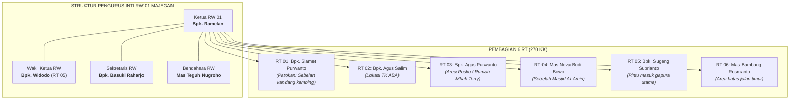
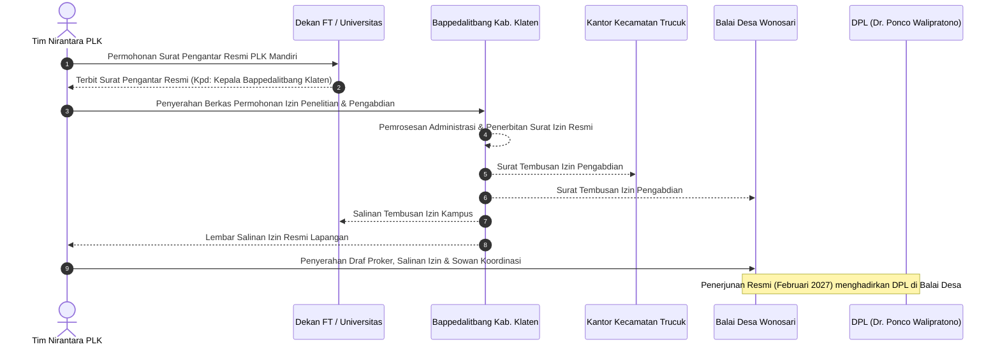

# 📋 NOTULENSI RESMI HASIL SURVEI LAPANGAN & AUDIT FISIK POSKO
## **Ekspedisi Pemetaan Wilayah, Audiensi Tokoh, Legalitas Birokrasi & Audit Rumah Posko**
**Dukuh Majegan, Desa Wonosari, Kecamatan Trucuk, Kabupaten Klaten, Jawa Tengah**  
*Tim PLK UNY Mandiri NIRANTARA 2027 — Formasi Lengkap 10 Anggota*

---

## 1. 📌 IDENTITAS & PARAMETER SURVEI

| Parameter | Data Lapangan & Keterangan Faktual |
| :--- | :--- |
| **Hari / Tanggal** | Sabtu, 24 Oktober 2026 |
| **Waktu Pelaksanaan** | Pukul 07.00 WIB (Kumpul di FT UNY) s.d. 16.30 WIB (Tiba kembali di Jogja) |
| **Lokasi Sasaran** | Dukuh Majegan (RW 01) & Kantor Balai Desa Wonosari, Kec. Trucuk, Kab. Klaten |
| **Kondisi Cuaca** | Mendung teduh berawan, jalan kering dan lancar |
| **Rute & Akses Tempuh** | **UNY (Jogja) ➔ Posko Majegan**: 34 km via Jl. Raya Jogja–Solo (waktu tempuh motor lancar: 40–50 menit).<br>**Posko Majegan ➔ Balai Desa Wonosari**: 3 km (waktu tempuh motor lancar: 8 menit). |
| **Akomodasi Posko** | Rumah keluarga / nenek dari Muhadzdzib Terry Al Fauzan (Humas Lapangan Tim). Status: Rumah kosong, aman, bersih, dan siap pakai. Tersedia rumah transit cadangan milik keluarga di area ruko. |
| **Tingkat Partisipasi** | **100% Hadir Lengkap (10 dari 10 Mahasiswa)** — 3 Laki-laki & 7 Perempuan. |

---

## 2. 👥 DELEGASI RESMI 10 SURVEYOR (STRUKTUR SUB-TIM)

| No | Nama Mahasiswa | NIM / Prodi | Fakultas | Jabatan Tim | Sub-Tim & Fokus Penugasan Lapangan |
| :---: | :--- | :---: | :---: | :--- | :--- |
| 1 | **Fajar Ahnaf Mahardika** | PTI | FT | Ketua (Kordes) | **Sub-Tim 1**: Lobi Birokrasi, Monografi & Pemetaan Wilayah |
| 2 | **Novelia Harlinda (Veli)** | PTI | FT | Sekretaris 2 | **Sub-Tim 1**: Notulensi, Rekap Wawancara & Tata Pamong |
| 3 | **Dinda Amelia Putri** | PADP | FEB | Sekretaris 1 | **Sub-Tim 1**: Draft Proposal, Administrasi Desa & UMKM |
| 4 | **Faidatul Anugraheni M.** | PADP | FEB | Bendahara 1 | **Sub-Tim 1**: Kas Posko, Pemetaan BUMDes & Potensi Warung |
| 5 | **Muhamad Riski** | PTI | FT | Perkap 1 | **Sub-Tim 2**: Pengukuran Posko, Logistik Armada & Irigasi |
| 6 | **Intan Milansari** | Biologi | FMIPA | PDD 2 | **Sub-Tim 2**: Koor. Lingkungan, Sampel Air & Masalah Sampah |
| 7 | **Zalfa Khoirunnisa** | Biologi | FMIPA | Bendahara 2 | **Sub-Tim 2**: Pengamatan Pertanian, Hama & Formula Kompos |
| 8 | **Muhadzdzib Terry Al Fauzan**| PTI | FT | Humas Lapangan| **Sub-Tim 3**: Protokoler Tokoh, Akses Posko & Legalitas Desa |
| 9 | **Alvina Aulia Az Zahra** | TP | FIP | PDD 1 | **Sub-Tim 3**: Koor. Pendidikan, Lembaga PAUD/TK & TIK |
| 10 | **Krissandra Siagian** | TP | FIP | Perkap 2 | **Sub-Tim 3**: Pemetaan TPA, Kebutuhan Posko & Media Ajar |

---

## 3. 🌟 RINGKASAN EKSEKUTIF TEMUAN LAPANGAN

1. **Penyambutan Sangat Terbuka & Suportif**:
   Pihak pemangku wilayah, baik Bapak Ramelan (Ketua RW 01 Majegan) maupun Bapak Adi (Kepala Desa Wonosari), menyambut Tim Nirantara dengan sangat hangat, ramah, dan memberikan izin prinsip pelaksanaan PLK Mandiri.
2. **Karakteristik Wilayah RW 01 Majegan**:
   RW 01 merupakan RW terluas dan terpadat di Desa Wonosari (membawahi 6 RT dan ±270 KK; sedangkan RW lain rata-rata hanya 3–4 RT). Mayoritas penduduk bermata pencaharian sebagai petani sawah dan buruh tani. Terdapat klaster pertukangan mebel kayu (termasuk bengkel keluarga Terry dan Mas Kabul).
3. **Pertanian & Irigasi**:
   Pola tanam sawah berjalan 3 kali setahun (Padi 2 kali, Palawija 1 kali seperti jagung/tembakau). Sumber air melimpah dan lancar (berasal dari saluran irigasi Umbul Cokro, sumur pompa, dan tadah hujan). Kualitas tanah dan air sangat baik tanpa indikasi polusi. Kendala utama petani adalah **alokasi subsidi pupuk Kartu Tani yang sangat minim** (petani terpaksa membeli pupuk non-subsidi seharga ±Rp 200.000,-/sak) serta serangan **hama tikus sawah dan sundep**.
4. **Isu Krusial Sampah & Formulasi Solusi Biologi**:
   Warga memiliki kebiasaan menahun membuang dan membakar sampah di pekarangan rumah serta di bibir bantaran kali/sungai desa. Desa Wonosari sebetulnya memiliki TPS, namun terkendala fasilitas angkut dan biaya operasional. **Keputusan Tim Nirantara**: Menghindari pendekatan utopis yang memaksa pemilahan sampah sistemik yang sulit merubah kebiasaan lama. Solusi konkret dan realistis difokuskan pada **Pelatihan Pembuatan Pupuk Kompos Organik Fermentasi** dan **Produksi Eco-Enzyme** dari limbah dapur/kebun warga.
5. **Potensi UMKM & Formulasi Solusi Teknologi (Informatika/PADP)**:
   Belum ada industri/pabrik besar di Majegan. UMKM warga didominasi oleh warung makan tradisional, toko kelontong rumahan, dan bengkel mebel. Sebagian besar warung warga belum memiliki visibilitas digital di Google Maps dan belum memiliki sistem pembayaran digital. Solusi proker: **Digitalisasi UMKM (Pemasangan Pin Google Maps Bisnis & Pembuatan QRIS)** serta promosi digital terpadu.
6. **Fasilitas Pendidikan RW 01**:
   Tidak ada sekolah formal tingkat dasar (SD) di dalam RW 01 (SD Negeri 1 dan 2 Wonosari berada di pusat kelurahan sejauh 2–3 km). Di RW 01 terdapat **TK ABA (Aisyiyah)** di RT 02 (±15 murid, guru pengasuh: Mbak Nunik) dan **TPA Al-Amin** yang aktif 3 kali seminggu.
7. **Kelayakan Posko Mandiri (100% Eksklusif Nirantara)**:
   Rumah nenek Terry di RT 03 Majegan sangat representatif dan berstatus rumah kosong mandiri (bebas drama eksternal). Air sumur jernih dan segar, koneksi WiFi berkecepatan 14 Mbps (ping 23 ms), sinyal seluler 4G penuh untuk 3 operator besar (Telkomsel, Indosat, XL/Axis), dan halaman depan berkanopi muat hingga 20 sepeda motor.
8. **Kepastian Alur Legalitas Birokrasi Kabupaten Klaten**:
   Bapak Kades Adi menegaskan bahwa perizinan resmi PLK Mandiri di Klaten wajib bermula dari **Surat Pengantar Kampus/Dekan yang ditujukan kepada Bappedalitbang Kabupaten Klaten**. Bappedalitbang kemudian menerbitkan surat izin resmi yang ditembuskan ke Kecamatan Trucuk dan Kantor Desa Wonosari.

---

## 4. 🎙️ HASIL AUDIENSI KETUA RW 01 DUKUH MAJEGAN

> **Narasumber**: Bapak Ramelan (Ketua RW 01 Dukuh Majegan)  
> **Kontak Resmi**: `0823-2335-3645`  
> **Waktu Pertemuan**: Pukul 10.00 – 11.45 WIB (Kediaman Ketua RW 01)  
> **Pewawancara**: Fajar Ahnaf M., Muhadzdzib Terry, Muhamad Riski, Novelia Harlinda, Dinda Amelia, Faidatul Anugraheni, Intan Milansari, Zalfa Khoirunnisa (Alvina & Krissandra izin pamit lebih awal untuk pengerjaan tugas akademik/UTS).



### A. Monografi & Demografi Singkat RW 01
- **Cakupan Wilayah**: Terdiri atas 6 RT. Merupakan RW paling padat dan luas dari total 8 RW yang ada di Desa Wonosari.
- **Jumlah Penduduk**: Tercatat sekitar **270 Kepala Keluarga (KK)**.
- **Mata Pencaharian**: Didominasi oleh petani pemilik lahan, buruh tani penggarap, dan tukang kayu / mebel. Tidak ada pabrik atau kawasan industri manufaktur di lingkungan RW.
- **Batas Wilayah**: Dipisahkan oleh jalan-jalan lingkungan dan gang desa (tidak ada pemisah sawah lebar antar-RW di dalam perkampungan).

### B. Kepemudaan, Kelembagaan & Kesehatan
- **Karang Taruna**:
  - Tingkat RW 01: **Karang Taruna "Bina Remaja"** — Ketua: Andi Kristanto & Mas Gempar.
  - Tingkat RT 06: **Karang Taruna "Bakti Remaja"** — Ketua: Mas Rizki.
- **Posyandu Integrasi Layanan Primer (ILP)**:
  - Pelaksanaan: Rutin setiap **tanggal 11 setiap bulannya**, bertempat di kediaman Bapak Ketua RW 01 (Bpk. Ramelan).
  - Sistem: Terpadu melayani balita, anak, remaja, usia produktif, hingga lansia dalam satu siklus layanan kesehatan.
- **PKK**:
  - Di tingkat RT dan RW 01 tidak ada kepengurusan PKK tersendiri. Kegiatan PKK dipusatkan secara terpadu di Kantor Balai Desa Wonosari.

### C. Dinamika Keagamaan & Pengajian Rutin
Dukuh Majegan memiliki kultur religius yang sangat kental dan aktif. Tim mahasiswa sangat dianjurkan membaur melalui agenda ketakmiran dan keagamaan:
1. **Masjid Al-Amin** (Terletak di samping kediaman keluarga Terry, perbatasan RT 03 dan RT 04):
   - Ketakmiran aktif dengan jadwal rutin teratur.
   - **Pengajian Bapak-Bapak "Al-Fajar"**: Rutin setiap malam Jumat.
   - **Pengajian Ibu-Ibu "Muslimat"**: Rutin setiap malam Senin dan malam Selasa.
   - **Kajian Ahad Pagi**: Kajian umum setiap hari Minggu pagi.
   - **Kajian Kitab**: Rutin setiap malam Sabtu.
2. **Kajian Kediaman Bapak RW**:
   - Pengajian akbar/umum rutin setiap malam Senin / malam Wage, dihadiri ±100 jamaah warga sekitar.

### D. Adab Lingkungan, Jam Malam & Gotong Royong
- **Norma Malam & Hiburan**: Kegiatan positif masyarakat diperbolehkan, namun segala bentuk hiburan musik/keramaian keras dibatasi maksimal hingga pukul **24.00 WIB**.
- **Jam Belajar Masyarakat**: Program jam belajar dan jam mengaji anak-anak sedang digagas oleh Bapak RW agar anak-anak tertib belajar di malam hari (sangat selaras dengan divisi TP).
- **Kerja Bakti Lingkungan**:
  - Tingkat RT: Tergantung kesepakatan masing-masing (misal: RT 02 mengadakan malam Minggu Pon dan kerja bakti pada Minggu pagi harinya).
  - Tingkat RW 01: Dilaksanakan secara berkala setiap 28–35 hari (sekitar 2 bulan sekali pada hari Minggu Pahing).
- **Pertemuan Rutin Pengurus RW**: Diadakan setiap **Selasa malam (Rabu Pahing)** di rumah Bapak RW, dihadiri oleh ±20 orang perwakilan pengurus RT 01–06 dan seksi-seksi. *(Catatan: Tim Nirantara dapat memanfaatkan forum ini untuk sosialisasi proker).*
- **Ronda Malam**: Saat ini belum ada pos ronda aktif berkala di Dukuh Majegan.

---

## 5. 🏛️ HASIL AUDIENSI KEPALA DESA WONOSARI (BIROKRASI & LEGALITAS)

> **Narasumber**: Bapak Adi (Kepala Desa / Lurah Wonosari)  
> **Kontak Resmi**: `0813-2100-1070`  
> **Waktu Pertemuan**: Pukul 13.00 WIB (Kediaman / Kantor Desa Wonosari)  
> **Pewawancara**: Muhadzdzib Terry Al Fauzan (Humas Lapangan) & Fajar Ahnaf M.



### A. Prosedur Legalitas Resmi PLK Mandiri di Kabupaten Klaten
Berdasarkan arahan langsung Bapak Lurah Adi, tahapan birokrasi legalitas pengabdian mandiri di Kabupaten Klaten adalah sebagai berikut:
1. **Surat Pengantar dari Universitas / Fakultas (Dekan)**:
   - Karena PLK berstatus **Mandiri** (bukan rombongan reguler LPPM/LP3P), permohonan surat pengantar diurus secara mandiri melalui fakultas/dekanat.
   - **Surat wajib ditujukan resmi kepada**:  
     `Yth. Kepala Bappedalitbang Kabupaten Klaten`  
     *(Badan Perencanaan Pembangunan Daerah, Penelitian dan Pengembangan Kabupaten Klaten)*.
2. **Penerbitan Izin Resmi dari Bappedalitbang**:
   - Tim mahasiswa membawa surat pengantar kampus ke Kantor Bappedalitbang Klaten.
   - Bappedalitbang menerbitkan Surat Izin Pelaksanaan Pengabdian/KKN dengan tembusan resmi ke:
     1. Arsip Perguruan Tinggi / Universitas Negeri Yogyakarta.
     2. Kantor Kecamatan Trucuk.
     3. Kantor Pemerintah Desa Wonosari.
3. **Pemberitahuan & Koordinasi ke Kantor Balai Desa Wonosari**:
   - Setelah surat Bappedalitbang terbit, tim mahasiswa menyerahkan tembusan berkas ke Balai Desa Wonosari.
   - Desa akan mencatat administrasi, dan tim langsung berkoordinasi teknis dengan Bapak RW 01 dan para Ketua RT (proses di tingkat bawah sangat mudah, terbuka, dan kondusif).

### B. Ketentuan Menginap Akhir Pekan (Weekend Execution)
- Bapak Kades Adi **mengizinkan penuh** pola pengabdian akhir pekan (Jumat sore s.d. Minggu malam) selama 4,5 bulan (Februari s.d. Juni).
- Warga desa sangat terbuka terhadap mahasiswa (*welcome*). Izin bermalam di rumah posko Majegan sah secara administratif dan tidak memerlukan izin rumit tambahan selain laporan rukun tetangga setempat.

### C. Prasyarat Utama dari Pemerintah Desa
1. **Draf Rencana Program Kerja (Proker)**:
   - Sebelum penerjunan resmi dimulai (Februari), tim Nirantara wajib menyerahkan dokumen draf program kerja yang akan dilaksanakan di Desa Wonosari.
2. **Kehadiran Dosen Pembimbing Lapangan (DPL)**:
   - Pada saat acara penerjunan resmi / *nuwun sewu* di balai desa, Bapak Kades meminta agar DPL dihadirkan untuk serah terima simbolis dan berkenalan langsung dengan jajaran perangkat desa.

### D. Rekomendasi Wilayah untuk Kelompok Kemitraan Ke-2
Sesuai aturan LPPM bahwa setiap desa binaan di Klaten idealnya menampung minimal 2 kelompok mahasiswa, Bapak Kades Adi memberikan arahan titik penempatan untuk kelompok mitra baru yang diajak Tim Nirantara:
- **Opsi Titik 1**: Tetap di Dukuh Majegan (menyewa rumah mandiri di lingkungan RW 01).
- **Opsi Titik 2 (Daerah Utara Desa Wonosari)**:
  1. **Dukuh Pendem**
  2. **Dukuh Jedis**
  3. **Dukuh Brangkal (Berangkelan)**
  4. **Dukuh Muteran**
  5. **Dukuh Tonggalan Lor (Tonggedungan Lor)**

---

## 6. 🌾 PEMETAAN SEKTOR PERTANIAN, PETERNAKAN & LINGKUNGAN (SUB-TIM 2)

### A. Pertanian, Irigasi & Masalah Pupuk
- **Karakteristik Lahan**: Sawah beririgasi teknis sangat subur, tanah gembur, dan air jernih mengalir lancar.
- **Pola Tanam Setahun**: Panen 3 kali:
  - **Musim Hujan 1 (Jan/Feb – April/Mei)**: Padi sawah.
  - **Musim Hujan 2 / Transisi**: Padi sawah.
  - **Musim Kemarau**: Palawija (jagung hibrida atau tembakau).
- **Suplai Pengairan**: Tiga jalur: Saluran irigasi teknis Waduk/Umbul Cokro, sumur pantek/pompa diesel, dan curah hujan.
- **Kendala Pupuk**:
  - Petani memiliki Kartu Tani untuk membeli pupuk subsidi (Urea ~Rp 90.000–92.000,- dan Phonska ~Rp 92.000,- per sak).
  - Alokasi subsidi pemerintah sangat terbatas dan tidak mencukupi untuk kebutuhan 3 kali musim tanam setahun.
  - Petani terpaksa membeli pupuk non-subsidi di pasaran dengan harga tinggi mencapai **Rp 200.000,- s.d. Rp 250.000,- per sak**, yang sangat membebani biaya produksi petani.
- **Hama Dominan**:
  - **Tikus Sawah (*Rattus argentiventer*)**: Menjadi momok nomor satu dan paling merusak bulir padi.
  - **Hama Sundep/Beluk (Penggerek Batang)**: Sesekali muncul saat masa vegetatif tanaman.

### B. Peternakan Warga
- Sebagian warga memelihara kambing secara perorangan di pekarangan belakang rumah.
- Sistem pengelolaan masih tradisional: rumput dicari harian atau ternak digembalakan (*diangon/diumbar*).
- Terdapat peternakan unggas rakyat (ayam kampung dan bebek petelur/pedaging) skala kecil sebagai usaha sampingan warga.
- *Potensi*: Bapak RW Ramelan memiliki rekam jejak berhasil beternak kambing modern berbasis pakan fermentasi silase (kandang berkapasitas 20–60 ekor). Hal ini dapat menjadi rujukan materi edukasi fermentasi pakan ternak.

### C. Kelompok Wanita Tani (KWT) & Pemanfaatan Pekarangan
- Terdapat kelompok KWT di wilayah selatan kampung, namun saat ini dalam kondisi **vakum/non-aktif**.
- Kegiatan sebelumnya hanya sebatas penjualan hasil cabai/kacang musiman, belum menyentuh budidaya terpadu.
- Kebiasaan menanam sayuran (kangkung, cabai, seledri, terong) di pekarangan rumah belum membudaya di warga RW 01.

### D. Manajemen Sampah: Temuan Masalah & Formulasi Aksi Divisi Biologi
- **Realitas Lapangan**: Mayoritas warga membakar tumpukan sampah (anorganik maupun organik) di pekarangan rumah dan di pinggiran tanggul kali/sungai desa. Warga enggan membuang ke TPS desa karena kendala biaya angkut dan kebiasaan lama.
- **Evaluasi & Keputusan Strategis Tim**:
  > [!NOTE]
  > Mengubah kebiasaan warga menahun untuk memilah sampah dari hulu (rumah tangga) dalam kurun waktu PLK 4,5 bulan akhir pekan dinilai **sangat tidak realistis dan berisiko gagal total**.
- **Solusi Aksi Nyata (Divisi Biologi - Intan & Zalfa)**:
  1. **Pembuatan Pupuk Kompos Organik Fermentasi**: Mengolah sisa limbah organik dedaunan pekarangan dan limbah pertanian menjadi kompos bernutrisi tinggi, sekaligus mengurangi pembelian pupuk non-subsidi yang mahal.
  2. **Pelatihan Produksi Eco-Enzyme Rumahan**: Mengedukasi ibu-ibu warga mengolah sisa kulit buah dan sayuran dapur menjadi cairan multiguna (disinfektan alami, pembersih lantai, dan pupuk cair penyubur tanaman).
  3. **Pemanfaatan Wadah Bekas (Galon/Ember)**: Sosialisasi budidaya sayuran keluarga dengan memanfaatkan wadah plastik bekas tanpa menambah beban biaya warga.

---

## 7. 💼 PEMETAAN UMKM, EKONOMI DESA & TIK (SUB-TIM 1 & 3)

### A. Kondisi UMKM & Sentra Produksi
- **Karakter Usaha**: Belum ada sentra UMKM berbadan hukum atau industri formal di Dukuh Majegan. Usaha yang berjalan didominasi oleh warung kelontong tradisional, warung makan skala rumahan, dan bengkel pertukangan kayu/mebel (keluarga Terry dan Mas Kabul).
- **Kebutuhan Mendesak**:
  1. Pencatatan identitas lokasi usaha di peta digital (*Google Maps*).
  2. Fasilitasi pembayaran non-tunai (*QRIS*) untuk memperluas akses pasar dan memudahkan transaksi warga maupun pendatang.
  3. Desain identitas visual (plang warung, banner, stiker produk) agar lebih higienis dan profesional.

### B. Aksi Nyata Divisi Teknologi (PTI) & Administrasi (PADP)
- **Pembuatan Titik Usaha Google Maps**: Menandai seluruh warung warga dan bengkel mebel di RW 01 pada Google Maps agar terverifikasi publik.
- **Pendaftaran QRIS UMKM**: Membantu pembukaan rekening merchant QRIS bagi pemilik warung yang berminat.
- **Promosi Digital Media Sosial**: Memanfaatkan akun Instagram dan TikTok Tim Nirantara untuk mengekspos produk UMKM lokal Klaten. *(Catatan: Saat ini pengikut medsos tim masih puluhan, perlu akselerasi konten dan engagement berkelanjutan).*

---

## 8. 🏫 PEMETAAN LEMBAGA PENDIDIKAN & SARANA BELAJAR (SUB-TIM 3)

### A. Fasilitas Pendidikan di Lingkungan Sasaran
- **Pendidikan Usia Dini**:
  - **TK ABA (Aisyiyah Bustanul Athfal) Majegan**: Terletak di RT 02 Dukuh Majegan.
  - Jumlah Murid: Sekitar 15 anak.
  - Guru Pengasuh: Ibu/Mbak Nunik.
- **Pendidikan Keagamaan Non-Formal**:
  - **TPA Masjid Al-Amin**: Berjalan aktif 3 kali dalam sepekan (sore hari) untuk santri usia PAUD hingga SD.
- **Pendidikan Dasar Formal (SD)**:
  - Tidak terdapat gedung SD di dalam wilayah Dukuh Majegan.
  - **SD Negeri 1 Wonosari** dan **SD Negeri 2 Wonosari** berlokasi di pusat Desa Wonosari (berjarak ±2,5–3 km dari Dukuh Majegan).

### B. Aksi Nyata Divisi Pendidikan (Teknologi Pendidikan - Vina & Sandra)
1. **Revitalisasi Media Pembelajaran Interaktif di TK ABA**:
   Membantu Mbak Nunik dengan modul ajar visual, alat peraga edukatif berbasis alam/daur ulang, dan *ice breaking* kreatif.
2. **Penguatan Literasi & Media Ajar Santri TPA Al-Amin**:
   Mengintegrasikan media visual interaktif dan literasi cerita islami untuk menunjang kegiatan mengaji sore.
3. **Dukungan Rintisan Jam Belajar Anak RW 01**:
   Membuka bimbingan belajar akhir pekan di posko/masjid guna merealisasikan gagasan Bapak RW terkait jam belajar warga.

---

## 9. 🏠 HASIL AUDIT FISIK KELAYAKAN POSKO MANDIRI

> **Lokasi Posko**: Rumah Keluarga / Nenek Muhadzdzib Terry Al Fauzan  
> **Alamat**: RT 03 Dukuh Majegan, Desa Wonosari, Trucuk, Klaten  
> **Status**: **100% Eksklusif Dihuni Tim Nirantara** (Kapasitas: 10 Orang — 3 Putra & 7 Putri).  
> **Petugas Ukur**: Muhamad Riski & Muhadzdzib Terry. **Pencatat**: Novelia Harlinda & Dinda Amelia.

```
+---------------------------------------------------------------------------------+
|                        HALAMAN DEPAN / PARKIR KANOPi                           |
|                       (Muat s/d 20 Sepeda Motor Aman)                           |
+---------------------------------------------------------------------------------+
|          RUANG TAMU DEPAN           |                AREA DEPAN                 |
|            (3,20 x 3,00 m)          |              (3,60 x 3,00 m)              |
|         [Penerimaan Tamu Warga]     |                                           |
+-------------------------------------+-------------------------------------------+
|                                                                                 |
|                            RUANG TENGAH UTAMA                                   |
|                             (5,60 x 3,30 m)                                     |
|                      [Pleno Tim, Diskusi & Briefing]                            |
|                                                                                 |
+-----------------------+-------------------------+-------------------------------+
|     KAMAR TIDUR 1     |      KAMAR TIDUR 2      |         KAMAR TIDUR 3         |
|    (2,90 x 3,20 m)    |     (2,80 x 3,30 m)     |         (Kamar Mbah)          |
|    [Kamar 4 Putri]    |     [Kamar 3 Putri]     |        [Kamar 3 Putra]        |
+-----------------------+-------------------------+-------------------------------+
|      MUSHOLA POSKO    |       DAPUR POSKO       |  KM 1 (Kloset)  |  KM 2 (Bak) |
|     (2,20 x 1,60 m)   |     (Bersih & Luas)     |  [Air Sumur]    |  [Perlu Kuras]
+-----------------------+-------------------------+-----------------+-------------+
```

### A. Dimensi Ruang & Rencana Alokasi Hunian

| Ruangan Posko | Dimensi Fisik | Luas Efektif | Kondisi Fisik | Rencana Alokasi & Penggunaan |
| :--- | :---: | :---: | :--- | :--- |
| **Kamar Tidur Besar 1** | 2,90 × 3,20 m | ± 9,28 m² | Bersih, sirkulasi baik, 1 colokan | **Mahasiswi Putri (4 Orang)**: Veli, Dinda, Fay, Vina |
| **Kamar Tidur Besar 2** | 2,80 × 3,30 m | ± 9,24 m² | Bersih, privasi tinggi, 1 colokan | **Mahasiswi Putri (3 Orang)**: Intan, Zalfa, Sandra |
| **Kamar Tidur Kecil** | 2,50 × 3,00 m | ± 7,50 m² | Bersih (Kamar milik Mbah) | **Mahasiswa Putra (3 Orang)**: Fajar, Terry, Riski |
| **Ruang Tamu Depan** | 3,20 × 3,00 m | ± 9,60 m² | Rapi, ventilasi baik, 1 colokan | Area penerimaan tamu warga, RT/RW, dan mitra desa |
| **Ruang Tengah (Besar)**| 5,60 × 3,30 m | ± 18,48 m² | Lapang, nyaman, 1 colokan | Pusat rapat pleno tim, briefing harian, dan koding/desain |
| **Mushola Posko** | 2,20 × 1,60 m | ± 3,52 m² | Sangat bersih dan suci | Tempat salat berjamaah internal posko |
| **Dapur Posko** | 3,00 × 2,50 m | ± 7,50 m² | Cukup luas, siap pakai | Pengolahan makanan piket posko dan air minum |
| **Kamar Mandi 1** | 1,80 × 1,50 m | ± 2,70 m² | Kloset jongkok, air sumur lancar | Mandi mahasiswi |
| **Kamar Mandi 2** | 1,80 × 1,50 m | ± 2,70 m² | Kloset jongkok, bak perlu dikuras | Mandi mahasiswa / cadangan cuci |
| **Halaman Depan** | 8,00 × 5,00 m | ± 40,00 m² | Berkanopi teduh, pagar aman | Parkir muat hingga 20 unit sepeda motor |

### B. Fasilitas Air, Listrik, dan Sinyal Komunikasi
- **Sumber Air Bersih**: Menggunakan air sumur gali dengan pompa listrik. Kondisi air sangat jernih, segar, debit melimpah, dan tidak berbau.
- **Kelistrikan**: Sistem pascabayar (PLN reguler), instalasi aman.
- **Konektivitas Internet**: Sudah terpasang WiFi IndiHome dengan kecepatan terukur **14 Mbps (Ping 23 ms)** — sangat memadai untuk koordinasi online, unggah laporan, dan koding web desa.
- **Sinyal Seluler Lapangan**:
  - **Telkomsel**: 4G Penuh (4–5 bar).
  - **Indosat Ooredoo**: 4G Penuh (4–5 bar).
  - **XL / Axis**: 4G Penuh (4–5 bar).

### C. Daftar Kebutuhan Logistik & Inventaris Posko Majegan

> [!IMPORTANT]
> **Timeline Renovasi & Pengadaan Posko**:  
> Rumah posko milik Mbah Terry dijadwalkan akan menjalani **renovasi fisik pada bulan Desember 2026 s.d. Januari 2027**.  
> Oleh karena itu, seluruh barang kebutuhan posko yang dianggarkan **akan dibeli menjelang penerjunan (antara akhir Januari hingga awal Februari 2027)** agar barang tetap bersih, higienis, dan tidak rusak/berdebu akibat proses pengerjaan renovasi.

#### 1. Kebutuhan Posko yang Dianggarkan (Kas Operasional Posko):
| No | Nama Barang / Kebutuhan | Jumlah / Estimasi | Peruntukan & Keterangan | Status Pengadaan |
| :---: | :--- | :---: | :--- | :---: |
| 1 | Pembersih Toilet (Porstex/WPC) | 1–2 Botol | Sanitasi & pembersihan KM 1 dan KM 2 | ⏳ Dianggarkan (Beli Akhir Jan/Feb) |
| 2 | Alat Pel Lantai | 1 Set | Kebersihan harian lantai ruang posko | ⏳ Dianggarkan (Beli Akhir Jan/Feb) |
| 3 | Sapu Lantai | 2 Buah | Kebersihan ruang tamu, kamar, & teras | ⏳ Dianggarkan (Beli Akhir Jan/Feb) |
| 4 | Serok Sampah (Pengki) | 1–2 Buah | Alat bantu pembersihan posko | ⏳ Dianggarkan (Beli Akhir Jan/Feb) |
| 5 | Gorden Pintu / Jendela | 1 Set | Privasi kamar mahasiswi & ruang utama | ⏳ Dianggarkan (Beli Akhir Jan/Feb) |
| 6 | Trashbag (Plastik Sampah Besar) | 1–2 Pak | Pengelolaan sampah posko agar rapi | ⏳ Dianggarkan (Beli Akhir Jan/Feb) |
| 7 | Sikat WC | 2 Buah | Pembersihan kerak kamar mandi 1 & 2 | ⏳ Dianggarkan (Beli Akhir Jan/Feb) |
| 8 | Galon Air Minum | 2 Buah | Wadah air minum isi ulang posko | ⏳ Dianggarkan (Beli Akhir Jan/Feb) |
| 9 | Pump Air Galon (Elektrik/Manual) | 2 Buah | Pompa galon untuk ruang tengah & dapur | ⏳ Dianggarkan (Beli Akhir Jan/Feb) |

#### 2. Barang / Fasilitas yang Dibawa Mandiri oleh Anggota:
| No | Nama Barang | Jumlah / Spesifikasi | Penanggung Jawab / Pemilik | Keterangan |
| :---: | :--- | :---: | :--- | :--- |
| 1 | **Karpet Bulu Ruang Tengah** | 1–2 Lembar (Ukuran besar) | **Novelia Harlinda (Veli)** & **Intan Milansari** | Dibawa dari Jogja saat penerjunan untuk alas duduk rapat pleno & ruang santai |

---

## 10. 🚀 SPRINT AGENDA MINGGU DEPAN (IMMEDIATE ACTION PLAN)

Untuk menindaklanjuti temuan lapangan, seluruh anggota tim diwajibkan mengeksekusi *action items* sesuai bidang tugasnya masing-masing:

| No | Divisi / Tim Kerja | Penanggung Jawab | Target Eksekusi Minggu Depan | Output yang Dihasilkan |
| :---: | :--- | :--- | :--- | :--- |
| 1 | **Divisi PTI (Lobi DPL)** | Fajar, Terry, Riski, Veli | Sowan dan audiensi resmi ke **Bpk. Dr. Ponco Walipratono, S.Pd.T., M.Pd.** (Dosen DPTEI FT UNY) | Kesediaan resmi beliau menjadi DPL Tim Nirantara |
| 2 | **Humas Lapangan** | Muhadzdzib Terry Al Fauzan | Koordinasi lanjutan ke Kantor Desa Wonosari menanyakan format teknis surat pengantar Bappedalitbang | Draf format surat pengantar resmi Dekan FT ke Bappedalitbang |
| 3 | **Oprec Mitra Kelompok 2** | Vina, Sandra, Dinda, Fay, Intan, Zalfa | Menyebarkan broadcast oprec kemitraan desa (Opsi Mandiri / 1 Desa Wonosari) ke angkatan 2024 | Terjaring kandidat kelompok ke-2 untuk Desa Wonosari |
| 4 | **Divisi Lingkungan (Bio)**| Intan Milansari & Zalfa Khoirunnisa | Riset formulasi bahan & takaran pupuk kompos fermentasi dan produksi eco-enzyme dari sampah lokal | SOP Panduan Pembuatan Kompos & Eco-Enzyme siap uji |
| 5 | **Sekretariat Posko** | Dinda Amelia & Novelia Harlinda | Rekapitulasi dokumen hasil survei, finalisasi notulensi, dan integrasi instrumen observasi | Arsip digital notulensi final & pembaruan database vault |
| 6 | **Kebendaharaan Tim** | Faidatul Anugraheni & Zalfa Khoirunnisa | Membuat template pembukuan kas bulanan, sistem tracking iuran, dan standar kuitansi SPJ | Spreadsheet Keuangan Kas Posko Nirantara 2027 |
| 7 | **Perlengkapan Posko** | Muhamad Riski & Krissandra Siagian | Pendataan dan inventarisasi alat posko yang perlu dibeli/dibawa dari Jogja (tikar, dispenser, kabel roll) | Checklist Perlengkapan & Logistik Posko Klaten |
| 8 | **PDD & Branding** | Alvina Aulia & Intan Milansari | Produksi konten dokumentasi reels/tiktok survei 24 Okt & pengunggahan di medsos tim | Konten publikasi survei & peningkatan followers akun |

---

## 11. 📞 BUKU TELEPON & KONTAK PENTING WONOSARI

| No | Nama Pemangku Kepentingan | Jabatan / Peran | Nomor WhatsApp / HP | Keterangan / Catatan |
| :---: | :--- | :--- | :---: | :--- |
| 1 | **Bapak Ramelan** | Ketua RW 01 Dukuh Majegan | `0823-2335-3645` | Tokoh utama lingkungan posko |
| 2 | **Bapak Adi** | Kepala Desa / Lurah Wonosari | `0813-2100-1070` | Pimpinan wilayah Desa Wonosari |
| 3 | **Dr. Ponco Walipratono, S.Pd.T., M.Pd.**| Calon DPL (Dosen DPTEI FT UNY)| *(Arsip Departemen)* | Target sowan & lobi dosen pembimbing |
| 4 | **Andi Kristanto** | Ketua Karang Taruna RW 01 | — | Koordinasi pemuda Bina Remaja |
| 5 | **Mbak Nunik** | Guru Pengasuh TK ABA Majegan | — | Mitra proker pendidikan & PAUD |
| 6 | **Mas Terry (Keluarga Pemilik Posko)**| Humas Lapangan Nirantara | *(Grup Internal)* | Penanggung jawab teknis rumah posko |

---

*Notulensi ini disusun secara resmi oleh Sekretariat Tim NIRANTARA PLK UNY 2027 berdasarkan transkrip rekaman suara lapangan dan catatan hasil observasi tim tanggal 24 Oktober 2026.*