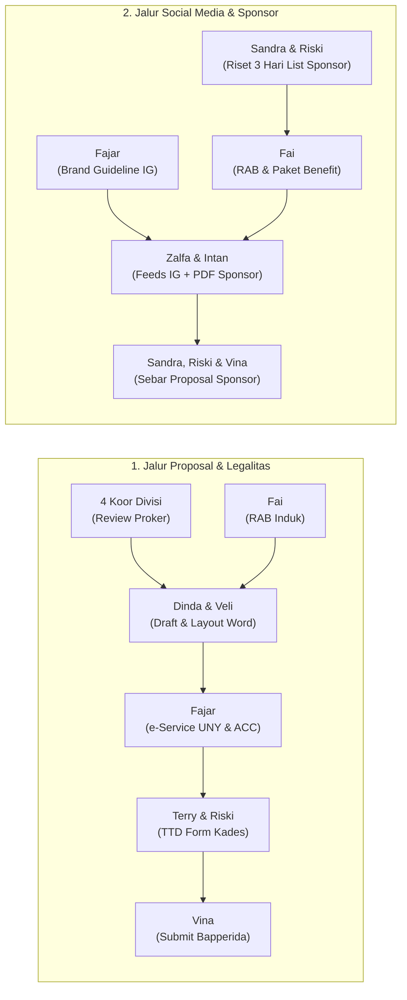

# 🚀 MASTER SPRINT 2 MINGGU & PEMBAGIAN JOBDESC TIM NIRANTARA
## **Rencana Eksekusi Terpadu (23 November – 6 Desember 2026)**
*Sudut Pandang Satu Kelompok — Adil, Terukur, & Saling Terhubung Antar-Kepanitiaan*

---

> [!IMPORTANT]
> **TARGET UTAMA SPRINT 14 HARI (23 NOV – 6 DES 2026):**
> Dalam 2 minggu ke depan, Tim Nirantara (10/10) menuntaskan **4 Milestone Kritis** secara paralel agar awal Desember seluruh legalitas aman dan mesin pendanaan + branding tim sudah berjalan:
> 1. ✅ **Proposal KKN (Bab I–IV)** selesai dalam format PDF rapi (jalur cepat *copy-paste* dari riset `03 - Fase PLK`).
> 2. ✅ **Persuratan UNY (e-Service) & Bapperida Klaten** resmi terkirim lengkap 4 syarat (`siip.bappedaklt@gmail.com`).
> 3. ✅ **Database & Proposal Sponsorship** siap sebar ke target Jogja–Klaten (berbekal riset 3 hari pertama).
> 4. ✅ **Instagram Tim Nirantara Aktif** dengan guideline visual konsisten & minimal 3–4 postingan perdana tayang.

---

## 📂 NAVIGASI CEPAT 4 GUIDELINE DETAIL SPRINT INI

Buka dokumen panduan spesifik sesuai tanggung jawab masing-masing bidang:
1. 🎨 **[01 - Guideline Social Media & Branding Instagram](file:///d:/KULIAH/UNY%20PLK/Tim%20PLK/02%20-%20Fase%20Pre-PLK/06%20-%20Sprint%202%20Minggu%20&%20Guideline%20Eksekusi%20(23%20Nov%20-%206%20Des)/01%20-%20Guideline%20Social%20Media%20&%20Branding%20Instagram.md)** — *PIC: Zalfa, Intan, & Fajar (Support Visual Guideline)*
2. 🤝 **[02 - Guideline Sponsorship & Hunting Mitra](file:///d:/KULIAH/UNY%20PLK/Tim%20PLK/02%20-%20Fase%20Pre-PLK/06%20-%20Sprint%202%20Minggu%20&%20Guideline%20Eksekusi%20(23%20Nov%20-%206%20Des)/02%20-%20Guideline%20Sponsorship%20&%20Hunting%20Mitra.md)** — *PIC: Riski, Sandra, Fai, & PDD*
3. 📑 **[03 - Guideline Penyusunan & Submit Proposal KKN](file:///d:/KULIAH/UNY%20PLK/Tim%20PLK/02%20-%20Fase%20Pre-PLK/06%20-%20Sprint%202%20Minggu%20&%20Guideline%20Eksekusi%20(23%20Nov%20-%206%20Des)/03%20-%20Guideline%20Penyusunan%20&%20Submit%20Proposal%20KKN.md)** — *PIC: Dinda, Veli, Fai, & 4 Koor Divisi*
4. 🏛️ **[04 - Guideline Humas, Persuratan UNY & Bapperida Klaten](file:///d:/KULIAH/UNY%20PLK/Tim%20PLK/02%20-%20Fase%20Pre-PLK/06%20-%20Sprint%202%20Minggu%20&%20Guideline%20Eksekusi%20(23%20Nov%20-%206%20Des)/04%20-%20Guideline%20Humas,%20Persuratan%20UNY%20&%20Bapperida%20Klaten.md)** — *PIC: Terry, Vina, Riski, Dinda, & Fajar*

---

## 🗓️ MASTER GANTT CHART 2 MINGGU (23 NOVEMBER – 6 DESEMBER 2026)

*Keterangan Simbol:* `🟦` Persiapan / Riset | `🟧` Eksekusi / Produksi | `🟩` Finalisasi / Submit / Tayang

| No | Tugas / Deliverable Utama | PIC Utama | Support | Sen 23 | Sel 24 | Rab 25 | Kam 26 | Jum 27 | Sab 28 | Min 29 | Sen 30 | Sel 1 | Rab 2 | Kam 3 | Jum 4 | Sab 5 | Min 6 |
|:---:|---|---|---|:---:|:---:|:---:|:---:|:---:|:---:|:---:|:---:|:---:|:---:|:---:|:---:|:---:|:---:|
| **1** | **Koleksi Scan 10 KTM & Audit Kas Nov** | Veli & Fai | Seluruh Tim | 🟧 | 🟩 | | | | | | | | | | | | |
| **2** | **Submit Revisi Surat e-Service UNY (Izin KKN)** | Fajar | Dinda | 🟧 | 🟩 | | | | | | | | | | | | |
| **3** | **Riset 3 Hari: List Toko/IG/CSR Open Sponsor** | Sandra & Riski | Fai | 🟦 | 🟦 | 🟩 | | | | | | | | | | | |
| **4** | **Desain Brand Guideline & Template Feeds IG** | Fajar & Zalfa | Intan | 🟦 | 🟧 | 🟩 | | | | | | | | | | | |
| **5** | **Kompilasi Draft Proposal KKN (Bab I–IV)** | Dinda & Veli | 4 Koor Div | 🟦 | 🟧 | 🟧 | 🟧 | 🟩 | | | | | | | | | |
| **6** | **Susun RAB Induk KKN & Paket Sponsor** | Fai | Sandra, Riski | | 🟦 | 🟧 | 🟩 | | | | | | | | | | |
| **7** | **Konfirmasi WA Bu Novi & Siapkan Form Desa** | Vina | Terry | | 🟦 | 🟧 | 🟩 | | | | | | | | | | |
| **8** | **Sowan Kades Wonosari (TTD Form Lokasi)** | Terry & Riski | Fajar | | | | | 🟧 | 🟩 | | | | | | | | |
| **9** | **Produksi & Upload IG Post 1 & 2 (Logo + Tim)** | Zalfa & Intan | Fajar | | | | 🟧 | 🟧 | 🟩 | | | | | | | | |
| **10** | **Review Final Proposal KKN + Export PDF** | Veli & Dinda | Fajar | | | | | | 🟧 | 🟩 | | | | | | | |
| **11** | **SUBMIT 4 BERKAS IZIN KE BAPPERIDA KLATEN** | Vina & Fajar | Terry, Dinda | | | | | | | | 🟩 | | | | | | |
| **12** | **Desain Proposal Sponsorship (PDF Estetik)** | Zalfa & Intan | Fai, Sandra | | | | | | | 🟦 | 🟧 | 🟧 | 🟩 | | | | |
| **13** | **Upload IG Post 3 & 4 (Survei + 4 Pilar Proker)** | Intan & Zalfa | Seluruh Tim | | | | | | | | | 🟧 | 🟩 | | 🟧 | 🟩 | |
| **14** | **Sebar Proposal Sponsor Batch 1 (DM/Email/WA)** | Sandra & Riski | Vina, Fai | | | | | | | | | | | 🟧 | 🟧 | 🟧 | 🟩 |
| **15** | **Follow-up Rekomendasi Bapperida & Kas Des** | Vina & Fai | Terry | | | | | | | | | | 🟦 | 🟧 | 🟧 | 🟩 | 🟩 |

---

## 🔄 ALUR KOLABORASI ANTAR-BIDANG (WORKFLOW TERPADU)

---

## 👥 PEMBAGIAN JOBDESC RATA 10 ANGGOTA (PETA INPUT – PROSES – OUTPUT)

Setiap anggota memiliki peran jelas selama 2 minggu ini. Prinsip tim: **saling menopang (*cross-functional*)** — bidang Perlengkapan yang fase logistik lapangannya belum aktif membantu langsung akselerasi **Sponsorship & Mobilitas Humas**, sedangkan Ketua turun langsung mendukung **Guideline Visual PDD**.

---

### 1. 👑 KETUA TIM (KORDES) — Fajar Ahnaf Mahardika (PTI)
| Dimensi Kerja | Rincian Operasional 2 Minggu (23 Nov – 6 Des) |
|---|---|
| **Tugas Utama 2 Minggu Ini** | 1. Submit revisi surat **Izin KKN** di portal `eservice.uny.ac.id` (H1–H2). 2. Membuat **Design Guideline Instagram** (palet warna, font, layout grid, gaya visual Nirantara) bersama PDD (H1–H3). 3. Quality Control (QC) naskah final Proposal KKN & Proposal Sponsorship sebelum disebar. 4. Mengawal konsultasi dosen/calon DPL & menjaga ritme kerja 10 anggota lewat *check-in* ringan tiap Rabu & Minggu. |
| **Butuh Apa (Input)** | • 9 NIM anggota & alamat resmi Bapperida (sudah ada di cheatsheet e-Service). • Logo Nirantara master & foto-foto survei di Google Drive. • Draft final Proposal KKN & Sponsorship untuk dicek. |
| **Ambil Data Dari Siapa** | • **Veli**: Link Drive 10 KTM & file final layout Proposal. • **Fai**: Final RAB & status kas bulanan. • **Vina**: Update respon dari Bu Novi Bapperida & hasil PIC TP. |
| **Kerja Sama Dengan Siapa** | • **Zalfa & Intan (PDD)**: Menyusun guideline visual IG. • **Dinda & Veli (Sekre)**: Penyelesaian e-Service & Proposal. • **Terry & Riski**: Koordinasi sowan Kades Wonosari. |
| **Kontak Siapa** | • **Internal**: Seluruh 9 anggota tim. • **Eksternal**: Admin Akademik FT/e-Service UNY & Dr. Sigit / Dr. Ponco (bila diperlukan). |
| **Kirim Hasil Ke Siapa** | • Surat e-Service PDF ➔ dikirim ke **Vina (Humas 2)** & **Veli (Arsip Drive)**. • File Brand Guideline IG ➔ dikirim ke **Zalfa & Intan (PDD)**. |

---

### 2. 📝 SEKRETARIS 1 — Dinda Amelia Putri (PADP)
| Dimensi Kerja | Rincian Operasional 2 Minggu (23 Nov – 6 Des) |
|---|---|
| **Tugas Utama 2 Minggu Ini** | 1. Mengompilasi **Draft Proposal KKN** (Bab I Pendahuluan, Bab II Proker 4 Divisi, Bab III Metode) dengan cara *copy-paste* & menyelaraskan bahasa dari folder `03 - Fase PLK` ke Google Docs (H1–H5). 2. Menyiapkan template **Surat Permohonan Sponsor** & **Surat Persetujuan Lokasi Desa** (`bit.ly/Srt_Persetujuan_Magang_KKN`). 3. Mencatat notulensi singkat progres mingguan. |
| **Butuh Apa (Input)** | • Materi riset 4 divisi dari vault (`03 - Fase PLK`). • Koreksi ringan proker dari 4 Koor Divisi. • Tabel RAB dari Fai (Bendahara). |
| **Ambil Data Dari Siapa** | • **4 Koor Divisi (Veli, Fai, Intan, Vina)**: Konfirmasi isi proker divisi masing-masing. • **Fai**: Tabel RAB Bab IV. • **Vina**: Template form persetujuan lokasi dari Bapperida. |
| **Kerja Sama Dengan Siapa** | • **Veli (Sekre 2)**: Pembagian naskah vs layouting Word. • **Fajar**: Validasi redaksi surat e-Service & proposal. • **Vina**: Kelengkapan surat pengantar Bapperida. |
| **Kontak Siapa** | • **Internal**: Veli, Fai, Vina, & 4 Koor Divisi. |
| **Kirim Hasil Ke Siapa** | • Naskah lengkap Proposal KKN (Google Docs) ➔ diserahkan ke **Veli** untuk layout final (maks. Jumat 27 Nov). • Form Persetujuan Lokasi terisi ➔ dikirim ke **Terry & Riski** untuk dicetak & dimintakan TTD Kades. |

---

### 3. 🗂️ SEKRETARIS 2 — Novelia Harlinda / Veli (PTI)
| Dimensi Kerja | Rincian Operasional 2 Minggu (23 Nov – 6 Des) |
|---|---|
| **Tugas Utama 2 Minggu Ini** | 1. Mengumpulkan & merapikan **Scan 10 KTM Anggota** menjadi 1 file PDF rapi (maks. Selasa 24 Nov). 2. Melakukan **Layouting Final Proposal KKN** (margin 4-4-3-3, Times New Roman 12, daftar isi, cover, lembar pengesahan) & export PDF siap submit (H5–H7). 3. Menata kerapian folder Google Drive tim (`01_Surat_Menyurat`, `07_PROPOSAL`, `KTM`) & mengawal pencatatan jam kerja Pre-PLK di Master Logbook 272 Jam. 4. Review sub-bab Divisi Teknologi & IT (sebagai Koor Divisi IT). |
| **Butuh Apa (Input)** | • File foto/scan KTM dari 10 anggota. • Naskah Proposal KKN dari Dinda & RAB dari Fai. • Daftar aktivitas 2 minggu untuk dimasukkan ke Logbook Pre-PLK. |
| **Ambil Data Dari Siapa** | • **Seluruh 10 Anggota**: Foto/scan KTM. • **Dinda**: Naskah Google Docs Proposal KKN. • **Fai**: Tabel RAB fix. |
| **Kerja Sama Dengan Siapa** | • **Dinda (Sekre 1)**: Duet penyusunan proposal. • **Fajar, Terry, Riski**: Review sub-bab proker Divisi IT. |
| **Kontak Siapa** | • **Internal**: Seluruh 10 anggota (pengingat setor KTM & logbook). |
| **Kirim Hasil Ke Siapa** | • Bundle PDF 10 KTM + PDF Proposal KKN Final ➔ dikirim ke **Vina (Humas 2)** & **Fajar** (maks. Minggu 29 Nov) untuk submit Bapperida. |

---

### 4. 💰 BENDAHARA TUNGGAL — Faidatul Anugraheni M. / Fai (PADP)
| Dimensi Kerja | Rincian Operasional 2 Minggu (23 Nov – 6 Des) |
|---|---|
| **Tugas Utama 2 Minggu Ini** | 1. Mengaudit & menagih pelunasan **Kas November (Rp 50.000/orang)** + merilis nomor rekening / QRIS resmi 1 pintu + mengingatkan jadwal Kas Desember (tgl 5–10 Des). 2. Menyusun **RAB Induk Proposal KKN** (Bab IV) & **RAB Kebutuhan Sponsorship** (memisahkan mana yang ditutup kas, dana UNY, dan sponsor) (H2–H4). 3. Merumuskan **Paket Benefit Sponsor** (Platinum/Gold/Silver/In-Kind) agar tim sponsor punya patokan negosiasi. 4. Mencairkan & mencatat biaya operasional riil (print proposal, materai, subsidi bensin perjalanan dinas ke Klaten). 5. Review sub-bab Divisi Administrasi & UMKM (sebagai Koor Divisi PADP). |
| **Butuh Apa (Input)** | • List estimasi kebutuhan alat/bahan dari 4 divisi & daftar perlengkapan posko/rompi dari Perkap (Riski & Sandra). • Bukti transfer kas anggota & foto nota belanja operasional. |
| **Ambil Data Dari Siapa** | • **Sandra & Riski (Perkap)**: Estimasi harga rompi, banner, ATK, & list kebutuhan alat proker. • **4 Koor Divisi**: Rincian bahan proker (komposter, APE, modul UMKM, dll.). • **Seluruh 10 Anggota**: Bukti transfer kas bulanan. |
| **Kerja Sama Dengan Siapa** | • **Dinda & Veli**: Memasukkan tabel RAB ke Proposal KKN. • **Zalfa & Intan (PDD)**: Memasukkan tabel paket sponsor ke Proposal Sponsorship PDF. • **Sandra & Riski**: Menentukan barang/dana apa saja yang dicari ke sponsor. |
| **Kontak Siapa** | • **Internal**: Seluruh 10 anggota (penagihan kas & transparansi saldo). • **Eksternal**: Tidak wajib, kecuali verifikasi pembayaran vendor/sponsor masuk rekening. |
| **Kirim Hasil Ke Siapa** | • Tabel RAB Bab IV ➔ dikirim ke **Dinda & Veli** (maks. Kamis 26 Nov). • Daftar Paket Sponsor & Kebutuhan Dana/Barang ➔ dikirim ke **Zalfa (desain PDF Sponsor)**, **Sandra**, & **Riski** (maks. Kamis 26 Nov). • Laporan Saldo Kas Transparan ➔ share di Grup WA Tim tiap akhir pekan. |

---

### 5. 🏡 HUMAS 1 (LAPANGAN & DESA) — Muhadzdzib Terry Al Fauzan (PTI)
| Dimensi Kerja | Rincian Operasional 2 Minggu (23 Nov – 6 Des) |
|---|---|
| **Tugas Utama 2 Minggu Ini** | 1. Menjaga komunikasi hangat dengan **Pak Kades Wonosari (Bpk. Adi)** & **Ketua RW 01 Majegan (Bpk. Ramelan)**. 2. Mengurus **Tanda Tangan & Cap Basah** Formulir Persetujuan Lokasi KKN dari Bpk. Kades Wonosari (dijadwalkan Jumat 27 Nov / Sabtu 28 Nov bersama Riski/Fajar). 3. Mengecek kondisi awal rumah posko Majegan & menginventarisasi potensi toko/kios tani lokal sekitar Klaten–Trucuk yang berpeluang jadi sponsor lokal. 4. Membantu review teknis Website Desa & Google Maps untuk Proposal Bab II. |
| **Butuh Apa (Input)** | • Lembar cetak **Form Persetujuan Lokasi KKN** yang sudah diisi data tim. • Pendamping perjalanan/sowan (Riski atau Fajar) agar tidak sendirian saat bertemu perangkat desa. • Subsidi bensin/operasional dari kas tim bila ada perjalanan dinas. |
| **Ambil Data Dari Siapa** | • **Dinda & Vina**: File Form Persetujuan Lokasi KKN siap cetak. • **Fai**: Dana operasional cetak/materai/transport. |
| **Kerja Sama Dengan Siapa** | • **Riski (Perkap 1)**: Partner pendamping sowan ke Balai Desa Wonosari. • **Vina (Humas 2)**: Sinkronisasi berkas desa dengan syarat Bapperida Klaten. |
| **Kontak Siapa** | • **Eksternal**: Kepala Desa Wonosari (Bpk. Adi: `0813-2100-1070`) & Ketua RW 01 (Bpk. Ramelan: `0823-2335-3645`). • **Internal**: Vina, Riski, Fajar. |
| **Kirim Hasil Ke Siapa** | • Scan/foto **Form Persetujuan Lokasi ber-TTD & stempel basah Kades** ➔ dikirim ke **Vina (Humas 2)** & **Veli (Arsip)** (maks. Sabtu 28 Nov). |

---

### 6. 🏛️ HUMAS 2 (KEDINASAN & ONLINE) — Alvina Aulia Az Zahra / Vina (TP)
| Dimensi Kerja | Rincian Operasional 2 Minggu (23 Nov – 6 Des) |
|---|---|
| **Tugas Utama 2 Minggu Ini** | 1. Menjadi penghubung resmi *online* dengan **Ibu Novi (Subkor KKN Bapperida Klaten)** via WhatsApp untuk memverifikasi kelengkapan syarat izin (H2–H4). 2. Mengirimkan **Email Permohonan Izin KKN** beserta 4 lampiran lengkap ke `siip.bappedaklt@gmail.com` & memantau penerbitan Surat Rekomendasi Bapperida (Senin 30 Nov – 6 Des). 3. Memastikan hasil konsultasi **PIC Prodi TP (FIP)** bersama Sandra sudah dicatat & masuk matriks tim. 4. Membantu pengiriman email/DM formal Proposal Sponsorship ke instansi besar (Bank Klaten, AQUA Klaten, Telkom, BAZNAS) di Minggu ke-2. 5. Review sub-bab Divisi Pendidikan & Media Ajar (sebagai Koor Divisi TP). |
| **Butuh Apa (Input)** | • 4 Berkas Lengkap Bapperida: (1) Surat e-Service UNY, (2) PDF 10 KTM, (3) PDF Proposal KKN Final, (4) Scan Form Persetujuan Lokasi ber-TTD Kades. • PDF Proposal Sponsorship & daftar email instansi besar (dari Sandra/Riski). |
| **Ambil Data Dari Siapa** | • **Fajar**: Surat e-Service UNY PDF. • **Veli**: PDF 10 KTM & PDF Proposal KKN Final. • **Terry**: Scan Form Persetujuan Lokasi ber-TTD Kades. • **Zalfa & Sandra**: PDF Proposal Sponsorship & kontak email instansi. |
| **Kerja Sama Dengan Siapa** | • **Terry (Humas 1)**: Sinkronisasi izin desa ➔ kabupaten. • **Dinda & Veli (Sekre)**: Kelengkapan lampiran surat. • **Sandra (TP)**: Koordinasi PIC TP & sebar proposal sponsor instansi. |
| **Kontak Siapa** | • **Eksternal**: Ibu Novi Bapperida Klaten (`0812-9141-9151`), Mas Rizal Bapperida (`0822-2615-5554`), PIC Prodi TP FIP, & Admin Email CSR/BUMD. • **Internal**: Terry, Fajar, Dinda, Veli, Sandra. |
| **Kirim Hasil Ke Siapa** | • Bukti kirim email Bapperida & file **Surat Rekomendasi Resmi Bapperida Klaten** (setelah terbit) ➔ dikirim ke **Fajar**, **Terry** (untuk ditembuskan ke Kades), & **Veli** (Arsip Drive). |

---

### 7. 🎨 PDD 1 (DESAIN & VISUAL) — Zalfa Khoirunnisa (Biologi)
| Dimensi Kerja | Rincian Operasional 2 Minggu (23 Nov – 6 Des) |
|---|---|
| **Tugas Utama 2 Minggu Ini** | 1. Menyusun **Template Desain Canva** mengikuti *Brand Guideline* yang dirancang bersama Fajar (H1–H3). 2. Mendesain **4 Konten Feeds Instagram Perdana** (Logo Reveal, Meet The Team, Survei Wonosari, 4 Pilar Proker) selama 2 minggu ini. 3. Mendesain **Proposal Sponsorship versi PDF Estetik (5–7 halaman di Canva)** yang visualnya profesional dan siap dikirim ke brand/CSR (H7–H10). |
| **Butuh Apa (Input)** | • Brand Guideline visual (warna, tipografi, style grid) dari Fajar. • Foto-foto survei 24 Okt (folder Drive `03_Dokumentasi/oktober - 24 - survey/`) & foto profil 10 anggota. • Teks copywriting konten IG dari Intan & tabel RAB/Paket Benefit dari Fai. |
| **Ambil Data Dari Siapa** | • **Fajar**: Brand Guideline IG & aset logo. • **Intan**: Brief teks/caption tiap slide konten IG & foto terpilih. • **Fai & Sandra**: Isi paket benefit & daftar kebutuhan untuk Proposal Sponsorship. |
| **Kerja Sama Dengan Siapa** | • **Intan (PDD 2)**: Duet produksi konten IG & Proposal Sponsorship. • **Fajar**: Review kesesuaian desain dengan guideline. |
| **Kontak Siapa** | • **Internal**: Fajar, Intan, Fai, & seluruh anggota (minta foto profil rapi buat Meet The Team). |
| **Kirim Hasil Ke Siapa** | • File desain siap unggah IG ➔ ke **Intan** (untuk diupload + caption). • File **Proposal Sponsorship Estetik PDF** ➔ dikirim ke **Sandra, Riski, Vina, & Fajar** (maks. Rabu 2 Des). |

---

### 8. 📸 PDD 2 (KONTEN, DOKUMENTASI & COPYWRITING) — Intan Milansari (Biologi)
| Dimensi Kerja | Rincian Operasional 2 Minggu (23 Nov – 6 Des) |
|---|---|
| **Tugas Utama 2 Minggu Ini** | 1. Mengelola **Content Calendar & Akun Instagram** Nirantara (jadwal posting, copywriting caption profesional, hashtag, bio profil, dan highlight story). 2. Mengkurasi foto-foto terbaik dari survei 24 Okt & foto profil 10 anggota agar siap didesain Zalfa. 3. Menyusun **Copywriting Ringkas (Naskah Jualan)** untuk Proposal Sponsorship (mengapa brand harus dukung Nirantara di Wonosari). 4. Review sub-bab Divisi Lingkungan & Kesehatan (sebagai Koor Divisi Biologi). |
| **Butuh Apa (Input)** | • Akses akun Instagram tim & folder dokumentasi foto di Google Drive. • Data profil singkat 10 anggota & ringkasan 4 pilar proker. • Desain visual final dari Zalfa. |
| **Ambil Data Dari Siapa** | • **Zalfa**: Aset grafis/feeds final. • **4 Koor Divisi**: Poin penting tiap divisi untuk konten "4 Pilar Proker". • **Fai**: Informasi rekening/QRIS open donasi (untuk Post #5 nanti). |
| **Kerja Sama Dengan Siapa** | • **Zalfa (PDD 1)**: Produksi rutin konten IG & Proposal Sponsorship. • **Fajar**: Penyelarasan tone & branding akun. • **Sandra & Riski**: Menyelaraskan jadwal tayang IG agar saat proposal sponsor masuk (Minggu ke-2), profil IG sudah terisi rapi. |
| **Kontak Siapa** | • **Internal**: Zalfa, Fajar, Sandra, Riski, & seluruh tim. • **Eksternal**: DM/komentar masuk di Instagram Nirantara. |
| **Kirim Hasil Ke Siapa** | • Brief teks slide konten & naskah Proposal Sponsorship ➔ dikirim ke **Zalfa**. • Link postingan IG tayang ➔ share ke Grup WA Tim agar semua anggota bantu *repost* ke IG Story masing-masing. |

---

### 9. 🚚 PERKAP 1 (LOGISTIK, ARMADA & HUNTING SPONSOR LOKAL) — Muhamad Riski (PTI)
| Dimensi Kerja | Rincian Operasional 2 Minggu (23 Nov – 6 Des) |
|---|---|
| **Tugas Utama 2 Minggu Ini** | *Karena pengadaan fisik posko baru mulai Januari, di sprint 2 minggu ini Riski fokus ke 3 misi kritis:* 1. **Riset 3 Hari Pertama (23–25 Nov):** Mengumpulkan data **vendor konveksi rompi, percetakan banner, toko pertanian Klaten–Prambanan, & distributor AMDK/retail** yang menerima sponsorship/subsidi KKN (lengkap dengan kontak WA/IG/alamat). 2. **Wingman / Pendamping Humas Lapangan:** Mendampingi **Terry** sowan ke Balai Desa Wonosari (Jumat 27 / Sabtu 28 Nov) untuk TTD Form Persetujuan Lokasi Kades (bensin di-cover kas tim). 3. **Eksekusi Sebar Proposal Batch 1 (Minggu ke-2):** Menghubungi & menindaklanjuti target sponsor sektor konveksi, percetakan, dan toko lokal bersama Sandra. |
| **Butuh Apa (Input)** | • Template Spreadsheet Database Target Sponsor (di Guideline 02). • Estimasi jumlah rompi (10 pcs) & banner posko/proker. • PDF Proposal Sponsorship final (dari Zalfa) di Minggu ke-2. |
| **Ambil Data Dari Siapa** | • **Fai**: Batas budget rompi & paket benefit sponsor. • **Zalfa & Intan**: PDF Proposal Sponsorship final (Rabu 2 Des). • **Terry**: Jadwal pasti bertemu Pak Kades Wonosari. |
| **Kerja Sama Dengan Siapa** | • **Sandra (Perkap 2)**: Duet riset & eksekusi hunting sponsorship. • **Terry (Humas 1)**: Duet sowan lapangan ke Desa Wonosari. • **Fai (Bendahara)**: Sinkronisasi harga vendor & kebutuhan logistik. |
| **Kontak Siapa** | • **Eksternal**: Vendor konveksi (misal Diamond Konveksi Jogja), percetakan, toko tani Klaten, distributor air mineral. • **Internal**: Sandra, Terry, Fai, Fajar. |
| **Kirim Hasil Ke Siapa** | • **Spreadsheet Database Target Sponsor (Sektor Vendor/Lokal)** ➔ dikirim ke **Fai, Sandra, & Fajar** (maks. Rabu 25 Nov). • Laporan progres follow-up sponsor Batch 1 ➔ update di Grup WA Tim (Minggu 6 Des). |

---

### 10. 📦 PERKAP 2 (OPERASIONAL & KOORDINATOR DATABASE SPONSORSHIP) — Krissandra Siagian / Sandra (TP)
| Dimensi Kerja | Rincian Operasional 2 Minggu (23 Nov – 6 Des) |
|---|---|
| **Tugas Utama 2 Minggu Ini** | *Karena logistik acara lapangan belum berjalan, di sprint 2 minggu ini Sandra memegang peran strategis:* 1. **Riset 3 Hari Pertama (23–25 Nov):** Mencari lewat Google & Instagram daftar **akun IG, perusahaan CSR Jogja–Klaten (AQUA Klaten, Bank Klaten, Solo Abadi, BAZNAS, Bank Jateng), toko buku (Togamas/penerbit), & brand F&B** yang terbuka untuk sponsorship/donasi KKN, lengkap dengan syarat pengajuan, email/WA, & *link form* mereka. 2. **Rekap Kebutuhan Barang Proker:** Mendata barang spesifik yang bisa diminta dalam bentuk *in-kind* (buku TK ABA, drum komposter, botol EM4, snack/air mineral acara, ATK). 3. **Eksekusi Sebar Proposal Batch 1 (Minggu ke-2):** Mengirim proposal sponsor (via DM IG, WA, dan Form Online) & mencatat statusnya di *Tracker Sponsorship*. 4. Mendampingi **Vina** memastikan follow-up konsultasi PIC TP FIP tuntas. |
| **Butuh Apa (Input)** | • Daftar kebutuhan barang dari 4 Koor Divisi. • PDF Proposal Sponsorship final (dari Zalfa) & paket benefit (dari Fai). |
| **Ambil Data Dari Siapa** | • **4 Koor Divisi**: List barang/media yang dibutuhkan tiap divisi. • **Fai**: Paket benefit sponsor. • **Zalfa & Intan**: PDF Proposal Sponsorship final (Rabu 2 Des). |
| **Kerja Sama Dengan Siapa** | • **Riski (Perkap 1)**: Duet riset & distribusi proposal sponsor. • **Vina (Humas 2)**: Membagi tugas kontak sponsor (Sandra via IG/WA/Form, Vina via Email instansi resmi). • **Fai (Bendahara)**: Menentukan prioritas barang/dana yang diajukan. |
| **Kontak Siapa** | • **Eksternal**: Admin IG brand/toko, kontak CSR perusahaan, Toko Buku/Penerbit, PIC TP FIP. • **Internal**: Riski, Fai, Vina, Zalfa, 4 Koor Divisi. |
| **Kirim Hasil Ke Siapa** | • **Spreadsheet Master Database Sponsor & Kebutuhan Barang** (minimal 15–20 target valid!) ➔ dikirim ke **Fai, Riski, Vina, & Fajar** (maks. Rabu 25 Nov). • Update **Tracker Status Sponsor** (Terkirim / Follow-Up / ACC / Tolak) ➔ lapor di Grup WA Tim (Minggu 6 Des). |

---

## 📊 CHECKLIST KONTROL KETUA (EVALUASI MINGGU 1 & MINGGU 2)

| Checkpoint | Tanggal | Indikator Keberhasilan (Definition of Done) |
|---|---|---|
| **Check-in 1 (Tengah Minggu 1)** | Rabu, 25 Nov 2026 | [ ] 10 KTM terkumpul (Veli) [ ] Surat e-Service UNY tersubmit (Fajar) [ ] Database minimal 15–20 target sponsor selesai (Sandra & Riski) [ ] Brand Guideline IG jadi (Fajar & Zalfa) |
| **Check-in 2 (Akhir Minggu 1)** | Minggu, 29 Nov 2026 | [ ] PDF Proposal KKN Bab I–IV selesai & rapi (Dinda & Veli) [ ] Form Lokasi sudah ber-TTD Kades Wonosari (Terry & Riski) [ ] IG Post 1 & 2 sudah tayang (Intan & Zalfa) [ ] Kas November 10/10 terdata (Fai) |
| **Check-in 3 (Akhir Minggu 2)** | Minggu, 6 Des 2026 | [ ] 4 Berkas Izin KKN sudah dikirim ke Bapperida & difollow-up Bu Novi (Vina) [ ] PDF Proposal Sponsorship estetik jadi (Zalfa & Intan) [ ] Minimal 10–15 proposal sponsor Batch 1 sudah disebar (Sandra, Riski, Vina) [ ] IG Post 3 & 4 sudah tayang (Intan & Zalfa) |

---
← [[PETA CARI FILE (Cheat Sheet Direktori)]] | [[Home]]
