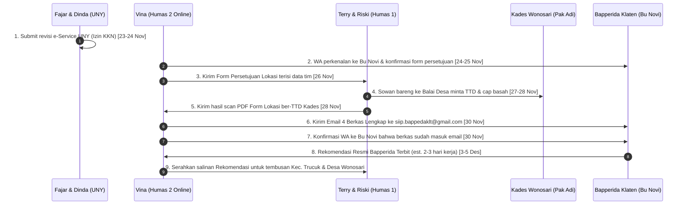

# 🏛️ GUIDELINE HUMAS, PERSURATAN UNY & BAPPERIDA KLATEN
## **Pembagian Peran Humas Lapangan vs Online & SOP Tuntas 4 Syarat Izin (23 Nov – 6 Des 2026)**
*Humas 1 (Lapangan): **Terry** (didampingi **Riski**) | Humas 2 (Online/Dinas): **Vina** | Kampus & Berkas: **Fajar, Dinda, Veli***

---

> [!IMPORTANT]
> **PRINSIP PEMBAGIAN PERAN HUMAS TIM NIRANTARA:**
> Agar pembagian kerja adil, realistis terhadap jarak Jogja–Klaten, dan tidak membebani satu orang saja:
> 1. **Humas 1 — Lapangan & Kemitraan Desa (Terry, didampingi Riski/Fajar saat sowan):** Fokus menjaga hubungan dengan Kepala Desa Wonosari (Bpk. Adi), Ketua RW 01 (Bpk. Ramelan), warga Majegan, dan urusan TTD basah di Balai Desa. *Jadwal sowan diatur terencana (Jumat sore / Sabtu) dan uang bensin perjalanan dinas ditanggung kas tim.*
> 2. **Humas 2 — Kedinasan & Komunikasi Online (Vina):** Fokus komunikasi daring dari Jogja dengan **Ibu Novi (Subkor KKN Bapperida Klaten)**, pengiriman email resmi perizinan, pemantauan disposisi, koordinasi PIC TP, serta dukungan humas di Klaten saat akhir pekan (*weekend*).

---

## 1. 📋 CHECKLIST 4 BERKAS WAJIB BAPPERIDA KLATEN (TARGET SUBMIT: SENIN, 30 NOV)

Berdasarkan arahan **Mas Rizal** & **Ibu Novi** (Bapperida Klaten), seluruh 4 berkas ini wajib terkumpul sebelum **Minggu, 29 Nov 2026 malam**:

| No | Syarat Wajib Bapperida | PIC Pengadaan | Cara Eksekusi & Rujukan | Deadline | Status |
|:---:|---|---|---|---|:---:|
| **1** | **Surat Pengantar Permohonan Izin KKN dari UNY** | **Fajar** & **Dinda** | Ajukan ulang di `eservice.uny.ac.id` (bukan "Izin Observasi", tetapi **"Permohonan Izin KKN / PLK"**). Teks siap salin ada di [`Panduan & Isian Form e-Service UNY`](file:///d:/KULIAH/UNY%20PLK/Tim%20PLK/02%20-%20Fase%20Pre-PLK/Panduan%20&%20Isian%20Form%20e-Service%20UNY%20(Izin%20Bappedalitbang%20Klaten).md). | **Sel, 24 Nov** *(submit web)* | [ ] |
| **2** | **Scan Kartu Tanda Mahasiswa (KTM) 10 Anggota** | **Veli** (kumpul) & **10 Anggota** | Semua anggota kirim foto/scan KTM yang terang & terbaca di Grup WA/Drive ➔ Veli gabungkan jadi 1 file `KTM_10_Anggota_Nirantara.pdf`. | **Sel, 24 Nov** | [ ] |
| **3** | **Proposal KKN Lengkap (Bab I–IV)** | **Dinda** & **Veli** | Mengikuti jalur cepat pada [`03 - Guideline Penyusunan & Submit Proposal KKN`](file:///d:/KULIAH/UNY%20PLK/Tim%20PLK/02%20-%20Fase%20Pre-PLK/06%20-%20Sprint%202%20Minggu%20&%20Guideline%20Eksekusi%20(23%20Nov%20-%206%20Des)/03%20-%20Guideline%20Penyusunan%20&%20Submit%20Proposal%20KKN.md). | **Min, 29 Nov** | [ ] |
| **4** | **Formulir Persetujuan Lokasi KKN (TTD Kades)** | **Vina** (unduh), **Dinda** (isi), **Terry & Riski** (TTD Kades) | Unduh dari [`bit.ly/Srt_Persetujuan_Magang_KKN`](https://bit.ly/Srt_Persetujuan_Magang_KKN) ➔ isi data 10 anggota & lokasi Desa Wonosari ➔ cetak 2 rangkap ➔ sowan ke Bpk. Adi (Kades Wonosari) Jumat 27 / Sabtu 28 Nov untuk tanda tangan & cap basah ➔ scan PDF. | **Sab, 28 Nov** | [ ] |

---

## 2. 📞 BUKU KONTAK RESMI (SIMPAN DI HP PENGURUS)

| Pihak / Jabatan | Nama Kontak | Nomor WA / Email Resmi | PIC Penghubung |
|---|---|---|---|
| **Subkor KKN Bapperida Klaten** | Ibu Novi (Sri Nuryani, SE) | `0812-9141-9151` | **Vina (Humas 2)** |
| **Admin Pelayanan Izin Bapperida** | Mas Rizal | `0822-2615-5554` | **Vina / Terry** |
| **Email Pengajuan Izin Bapperida** | Pelayanan Izin SIIP Klaten | `siip.bappedaklt@gmail.com` | **Vina & Fajar** |
| **Kepala Desa Wonosari, Trucuk** | Bapak Adi | `0813-2100-1070` | **Terry (Humas 1)** |
| **Ketua RW 01 Dukuh Majegan** | Bapak Ramelan | `0823-2335-3645` | **Terry (Humas 1)** |

---

## 3. 🔄 ALUR EKSEKUSI PERSURATAN DARI AWAL SAMPAI REKOMENDASI TERBIT



---

## 4. 💬 TEMPLATE CHAT & EMAIL SIAP PAKAI

### A. Chat WhatsApp Awal ke Ibu Novi Bapperida (Dikirim oleh Vina — Sel/Rab 24–25 Nov)
```text
Assalamu'alaikum / Selamat pagi, Ibu Novi (Subkor KKN Bapperida Kabupaten Klaten). 
Mohon maaf mengganggu waktu Ibu.

Perkenalkan saya Alvina Aulia dari Tim PLK/KKN Mandiri UNY (Tim Nirantara — 10 mahasiswa lintas 4 fakultas). Sebelumnya rekan kami telah berkoordinasi dengan Mas Rizal terkait rencana pelaksanaan KKN Mandiri kami selama 4,5 bulan (periode Semester Genap 2027) di Desa Wonosari, Kecamatan Trucuk, dan diarahkan untuk berkoordinasi dengan Ibu.

Saat ini kami sedang melengkapi 4 berkas persyaratan sesuai panduan Bapperida (Surat Pengantar KKN dari UNY, Scan 10 KTM, Proposal KKN, dan Form Persetujuan Lokasi dari Kepala Desa Wonosari). 

Izin bertanya Bu, apakah ada ketentuan tambahan lain yang perlu kami lampirkan sebelum seluruh berkas kami kirimkan ke email siip.bappedaklt@gmail.com pada akhir bulan ini?

Terima kasih banyak atas bantuan dan arahan Ibu. 🙏
```

### B. Template Email Pengajuan Resmi ke `siip.bappedaklt@gmail.com` (Senin, 30 Nov)
* **Subjek Email:** `Permohonan Izin KKN Mandiri - Universitas Negeri Yogyakarta - Desa Wonosari Trucuk - Tim Nirantara`
* **Lampiran (4 File PDF):**
  1. `01_Surat_Pengantar_KKN_UNY_Nirantara.pdf`
  2. `02_Scan_KTM_10_Anggota_Nirantara.pdf`
  3. `03_Proposal_KKN_Tim_Nirantara_Wonosari.pdf`
  4. `04_Form_Persetujuan_Lokasi_Kades_Wonosari.pdf`
* **Body Email:** Gunakan template lengkap yang sudah tersedia pada [`Panduan & Prosedur Perizinan KKN Bapperida Klaten.md`](file:///d:/KULIAH/UNY%20PLK/Tim%20PLK/02%20-%20Fase%20Pre-PLK/04%20-%20Integrasi%20Kelompok%20&%20Survei%20Klaten/bapedalitbang/Panduan%20&%20Prosedur%20Perizinan%20KKN%20Bapperida%20Klaten.md).

### C. Pengingat SOP Perjalanan Dinas ke Klaten (Terry & Riski)
* Sowan ke Bpk. Kades Wonosari dijadwalkan **Jumat sore (27 Nov) atau Sabtu pagi (28 Nov)** agar tidak bentrok kuliah weekday.
* Setelah selesai sowan, kirim foto nota/struk bensin (atau klaim flat bensin PP sesuai kesepakatan) ke **Faidatul (Bendahara)** agar biaya transport di-cover kas kelompok.

---
← [[00 - MASTER SPRINT 2 MINGGU & PEMBAGIAN JOBDESC TIM NIRANTARA]] | [[01 - Guideline Social Media & Branding Instagram]]
