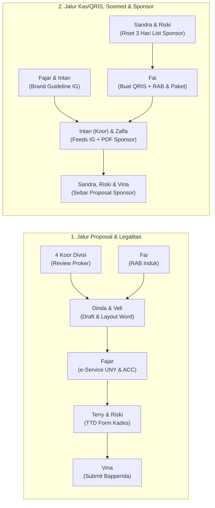

# 🚀 MASTER SPRINT 2 MINGGU & PEMBAGIAN JOBDESC TIM NIRANTARA
## **Rencana Eksekusi Terpadu (25 November – 8 Desember 2026)**
*Sudut Pandang Satu Kelompok — Adil, Terukur, & Saling Terhubung Antar-Kepanitiaan*

---

> [!IMPORTANT]
> **TARGET UTAMA SPRINT 14 HARI (25 NOV – 8 DES 2026):**
> Dalam 2 minggu ke depan, Tim Nirantara (10/10) menuntaskan **5 Milestone Kritis** secara paralel agar awal Desember seluruh legalitas aman, sistem kas/QRIS siap, dan mesin pendanaan + branding tim berjalan:
> 1. ✅ **Rekening Kas & QRIS Resmi Tim** dibuat oleh Bendahara untuk kelancaran iuran kas, donasi publik, & sponsor.
> 2. ✅ **Proposal KKN (Bab I–IV)** selesai dalam format PDF rapi (jalur cepat *copy-paste* dari riset `03 - Fase PLK`).
> 3. ✅ **Persuratan UNY (e-Service) & Bapperida Klaten** resmi terkirim lengkap 4 syarat (`siip.bappedaklt@gmail.com`).
> 4. ✅ **Database & Proposal Sponsorship (+ QRIS)** siap sebar ke target Jogja–Klaten (berbekal riset 3 hari pertama).
> 5. ✅ **Instagram Tim Nirantara Aktif** dengan guideline visual konsisten & 4 postingan perdana tayang.

---

## 📂 NAVIGASI CEPAT 4 GUIDELINE DETAIL SPRINT INI

Buka dokumen panduan spesifik sesuai tanggung jawab masing-masing bidang:
1. 🎨 **[01 - Guideline Social Media & Branding Instagram](file:///d:/KULIAH/UNY%20PLK/Tim%20PLK/02%20-%20Fase%20Pre-PLK/06%20-%20Sprint%202%20Minggu%20&%20Guideline%20Eksekusi%20(25%20Nov%20-%208%20Des)/01%20-%20Guideline%20Social%20Media%20&%20Branding%20Instagram.md)** — *Main Koor PDD: Intan | Support PDD: Zalfa | Support Visual Guideline: Fajar*
2. 🤝 **[02 - Guideline Sponsorship & Hunting Mitra](file:///d:/KULIAH/UNY%20PLK/Tim%20PLK/02%20-%20Fase%20Pre-PLK/06%20-%20Sprint%202%20Minggu%20&%20Guideline%20Eksekusi%20(25%20Nov%20-%208%20Des)/02%20-%20Guideline%20Sponsorship%20&%20Hunting%20Mitra.md)** — *PIC: Riski, Sandra, Fai, & PDD*
3. 📑 **[03 - Guideline Penyusunan & Submit Proposal KKN](file:///d:/KULIAH/UNY%20PLK/Tim%20PLK/02%20-%20Fase%20Pre-PLK/06%20-%20Sprint%202%20Minggu%20&%20Guideline%20Eksekusi%20(25%20Nov%20-%208%20Des)/03%20-%20Guideline%20Penyusunan%20&%20Submit%20Proposal%20KKN.md)** — *PIC: Dinda, Veli, Fai, & 4 Koor Divisi*
4. 🏛️ **[04 - Guideline Humas, Persuratan UNY & Bapperida Klaten](file:///d:/KULIAH/UNY%20PLK/Tim%20PLK/02%20-%20Fase%20Pre-PLK/06%20-%20Sprint%202%20Minggu%20&%20Guideline%20Eksekusi%20(25%20Nov%20-%208%20Des)/04%20-%20Guideline%20Humas,%20Persuratan%20UNY%20&%20Bapperida%20Klaten.md)** — *PIC: Terry, Vina, Riski, Dinda, & Fajar*

---

## 🗓️ MASTER GANTT CHART 2 MINGGU (25 NOVEMBER – 8 DESEMBER 2026)

*Keterangan Simbol:* `🟦` Persiapan / Riset | `🟧` Eksekusi / Produksi | `🟩` Finalisasi / Submit / Tayang

| No | Tugas / Deliverable Utama | PIC Utama | Support | Rab 25 | Kam 26 | Jum 27 | Sab 28 | Min 29 | Sen 30 | Sel 1 | Rab 2 | Kam 3 | Jum 4 | Sab 5 | Min 6 | Sen 7 | Sel 8 |
|:---:|---|---|---|:---:|:---:|:---:|:---:|:---:|:---:|:---:|:---:|:---:|:---:|:---:|:---:|:---:|:---:|
| **1** | **Bikin QRIS / Rek Resmi Kas & Audit Kas Nov** | Fai | Seluruh Tim | 🟧 | 🟩 | | | | | | | | | | | | |
| **2** | **Koleksi Scan 10 KTM Anggota (PDF)** | Veli | Seluruh Tim | 🟧 | 🟩 | | | | | | | | | | | | |
| **3** | **Submit Revisi Surat e-Service UNY (Izin KKN)** | Fajar | Dinda | 🟧 | 🟩 | | | | | | | | | | | | |
| **4** | **Riset 3 Hari: List Toko/IG/CSR Open Sponsor** | Sandra & Riski | Fai | 🟦 | 🟦 | 🟩 | | | | | | | | | | | |
| **5** | **Desain Brand Guideline & Template Feeds IG** | Fajar & Intan | Zalfa | 🟦 | 🟧 | 🟩 | | | | | | | | | | | |
| **6** | **Kompilasi Draft Proposal KKN (Bab I–IV)** | Dinda & Veli | 4 Koor Div | 🟦 | 🟧 | 🟧 | 🟩 | | | | | | | | | | |
| **7** | **Susun RAB Induk, Paket Sponsor & Kirim QRIS** | Fai | Sandra, Riski | | 🟦 | 🟧 | 🟩 | | | | | | | | | | |
| **8** | **Konfirmasi WA Bu Novi & Siapkan Form Desa** | Vina & Dinda | Terry | | 🟦 | 🟧 | 🟩 | | | | | | | | | | |
| **9** | **Produksi & Upload IG Post #1 & #2 (Logo + Tim)** | Intan | Zalfa, Fajar | | | 🟦 | 🟧 | 🟩 | | | | | | | | | |
| **10** | **Sowan Kades Wonosari (TTD & Cap Form Lokasi)** | Terry & Riski | Fajar | | | | 🟧 | 🟧 | 🟩 | | | | | | | | |
| **11** | **Review Final Proposal KKN + Export PDF** | Veli & Dinda | Fajar | | | | | 🟧 | 🟩 | | | | | | | | |
| **12** | **SUBMIT 4 BERKAS IZIN KE BAPPERIDA KLATEN** | Vina & Fajar | Terry, Dinda | | | | | | | 🟩 | | | | | | | |
| **13** | **Desain Proposal Sponsor PDF (+ Tempel QRIS)** | Intan | Zalfa, Fai, Sandra | | | | | 🟦 | 🟧 | 🟧 | 🟩 | | | | | | |
| **14** | **Upload IG Post #3 & #4 (Survei + 4 Pilar Proker)** | Intan | Zalfa, Tim | | | | | | | | 🟩 | | | 🟩 | | | |
| **15** | **Sebar Proposal Sponsor Batch 1 (DM/WA/Email)** | Sandra & Riski | Vina, Fai | | | | | | | | | 🟧 | 🟧 | 🟧 | 🟧 | 🟧 | 🟩 |
| **16** | **Follow-up Izin Bapperida & Tagih Kas Des (5–10)** | Vina & Fai | Terry | | | | | | | | | | 🟦 | 🟧 | 🟧 | 🟧 | 🟩 |

---

## 🔄 ALUR KOLABORASI ANTAR-BIDANG (WORKFLOW TERPADU)

---

## 👥 PEMBAGIAN JOBDESC RATA 10 ANGGOTA (PETA INPUT – PROSES – OUTPUT)

Setiap anggota memiliki peran jelas selama 2 minggu ini. Prinsip tim: **saling menopang (*cross-functional*)** — bidang Perlengkapan yang fase logistik poskonya belum aktif membantu langsung akselerasi **Sponsorship & Mobilitas Humas**, Bendahara mengaktifkan **Rekening & QRIS 1 Pintu**, sedangkan Ketua turun langsung mendukung **Guideline Visual PDD**.

---

### 1. 👑 KETUA TIM (KORDES) — Fajar Ahnaf Mahardika (PTI)
| Dimensi Kerja | Rincian Operasional 2 Minggu (25 Nov – 8 Des) |
|---|---|
| **Tugas Utama 2 Minggu Ini** | 1. Submit revisi surat **Izin KKN** di portal `eservice.uny.ac.id` (Rab 25 – Kam 26 Nov). 2. Membuat **Design Guideline Instagram** (palet warna, font, layout grid, gaya visual Nirantara) bersama **Intan (Koor PDD)** dengan support **Zalfa** (Rab 25 – Jum 27 Nov). 3. Quality Control (QC) naskah final Proposal KKN & Proposal Sponsorship sebelum disebar. 4. Mengawal konsultasi dosen/calon DPL & menjaga ritme kerja 10 anggota lewat *check-in* ringan tiap Jumat, Senin, & Selasa akhir sprint. |
| **Butuh Apa (Input)** | • 9 NIM anggota & alamat resmi Bapperida (sudah ada di cheatsheet e-Service). • Logo Nirantara master & foto-foto survei di Google Drive. • Draft final Proposal KKN & Sponsorship untuk dicek. |
| **Ambil Data Dari Siapa** | • **Veli**: Link Drive 10 KTM & file final layout Proposal. • **Fai**: Final RAB, no rek/QRIS resmi, & status kas bulanan. • **Vina**: Update respon dari Bu Novi Bapperida & hasil PIC TP. |
| **Kerja Sama Dengan Siapa** | • **Intan (Koor PDD) & Zalfa (Support PDD)**: Menyusun guideline visual IG. • **Dinda & Veli (Sekre)**: Penyelesaian e-Service & Proposal. • **Terry & Riski**: Koordinasi sowan Kades Wonosari. |
| **Kontak Siapa** | • **Internal**: Seluruh 9 anggota tim. • **Eksternal**: Admin Akademik FT/e-Service UNY & Dr. Sigit / Dr. Ponco (bila diperlukan). |
| **Kirim Hasil Ke Siapa** | • Surat e-Service PDF ➔ dikirim ke **Vina (Humas 2)** & **Veli (Arsip Drive)**. • File Brand Guideline IG ➔ dikirim ke **Intan (Koor PDD)** & **Zalfa (Support PDD)**. |

---

### 2. 📝 SEKRETARIS 1 — Dinda Amelia Putri (PADP)
| Dimensi Kerja | Rincian Operasional 2 Minggu (25 Nov – 8 Des) |
|---|---|
| **Tugas Utama 2 Minggu Ini** | 1. Mengompilasi **Draft Proposal KKN** (Bab I Pendahuluan, Bab II Proker 4 Divisi, Bab III Metode) dengan cara *copy-paste* & menyelaraskan bahasa dari folder `03 - Fase PLK` ke Google Docs (Rab 25 – Sab 28 Nov). 2. Menyiapkan template **Surat Permohonan Sponsor** & mengisi **Formulir Persetujuan Lokasi Desa** (`bit.ly/Srt_Persetujuan_Magang_KKN`). 3. Mencatat notulensi singkat progres mingguan. |
| **Butuh Apa (Input)** | • Materi riset 4 divisi dari vault (`03 - Fase PLK`). • Koreksi ringan proker dari 4 Koor Divisi. • Tabel RAB dari Fai (Bendahara). |
| **Ambil Data Dari Siapa** | • **4 Koor Divisi (Veli, Fai, Intan, Vina)**: Konfirmasi isi proker divisi masing-masing. • **Fai**: Tabel RAB Bab IV. • **Vina**: Template form persetujuan lokasi dari Bapperida. |
| **Kerja Sama Dengan Siapa** | • **Veli (Sekre 2)**: Pembagian naskah vs layouting Word. • **Fajar**: Validasi redaksi surat e-Service & proposal. • **Vina**: Kelengkapan surat pengantar Bapperida. |
| **Kontak Siapa** | • **Internal**: Veli, Fai, Vina, & 4 Koor Divisi. |
| **Kirim Hasil Ke Siapa** | • Naskah lengkap Proposal KKN (Google Docs) ➔ diserahkan ke **Veli** untuk layout final (maks. Sab 28 Nov). • Form Persetujuan Lokasi terisi ➔ dikirim ke **Terry & Riski** (maks. Jum 27 Nov) untuk dicetak & dimintakan TTD Kades. |

---

### 3. 🗂️ SEKRETARIS 2 — Novelia Harlinda / Veli (PTI)
| Dimensi Kerja | Rincian Operasional 2 Minggu (25 Nov – 8 Des) |
|---|---|
| **Tugas Utama 2 Minggu Ini** | 1. Mengumpulkan & merapikan **Scan 10 KTM Anggota** menjadi 1 file PDF rapi (maks. Kam 26 Nov). 2. Melakukan **Layouting Final Proposal KKN** (margin 4-4-3-3, Times New Roman 12, daftar isi, cover, lembar pengesahan) & export PDF siap submit (Min 29 – Sen 30 Nov). 3. Menata kerapian folder Google Drive tim (`01_Surat_Menyurat`, `07_PROPOSAL`, `KTM`) & mengawal pencatatan jam kerja Pre-PLK di Master Logbook 272 Jam. 4. Review sub-bab Divisi Teknologi & IT (sebagai Koor Divisi IT). |
| **Butuh Apa (Input)** | • File foto/scan KTM dari 10 anggota. • Naskah Proposal KKN dari Dinda & RAB dari Fai. • Daftar aktivitas 2 minggu untuk dimasukkan ke Logbook Pre-PLK. |
| **Ambil Data Dari Siapa** | • **Seluruh 10 Anggota**: Foto/scan KTM. • **Dinda**: Naskah Google Docs Proposal KKN. • **Fai**: Tabel RAB fix. |
| **Kerja Sama Dengan Siapa** | • **Dinda (Sekre 1)**: Duet penyusunan proposal. • **Fajar, Terry, Riski**: Review sub-bab proker Divisi IT. |
| **Kontak Siapa** | • **Internal**: Seluruh 10 anggota (pengingat setor KTM & logbook). |
| **Kirim Hasil Ke Siapa** | • PDF 10 KTM (Kam 26 Nov) & PDF Proposal KKN Final (maks. Sen 30 Nov) ➔ dikirim ke **Vina (Humas 2)** & **Fajar** untuk submit Bapperida. |

---

### 4. 💰 BENDAHARA TUNGGAL — Faidatul Anugraheni M. / Fai (PADP)
| Dimensi Kerja | Rincian Operasional 2 Minggu (25 Nov – 8 Des) |
|---|---|
| **Tugas Utama 2 Minggu Ini** | 1. **Membuat Rekening Bank / QRIS Statis Resmi Kas Tim Nirantara** (Rab 25 – Kam 26 Nov) untuk pembayaran kas 1 pintu, donasi publik, & penerimaan dana sponsor. 2. Mengaudit pelunasan **Kas November (Rp 50.000/orang)** serta membuka & mengingatkan penarikan **Kas Desember (5–10 Des)**. 3. Menyusun **RAB Induk Proposal KKN** (Bab IV) & **RAB + Paket Benefit Sponsor** (Platinum/Gold/Silver/In-Kind) (Kam 26 – Sab 28 Nov). 4. Mencairkan & mencatat biaya operasional riil (print proposal, materai, subsidi bensin perjalanan dinas ke Klaten). 5. Review sub-bab Divisi Administrasi & UMKM (sebagai Koor Divisi PADP). |
| **Butuh Apa (Input)** | • List estimasi kebutuhan alat/bahan dari 4 divisi & daftar perlengkapan posko/rompi dari Perkap (Riski & Sandra). • Bukti transfer kas anggota & foto nota belanja operasional. |
| **Ambil Data Dari Siapa** | • **Sandra & Riski (Perkap)**: Estimasi harga rompi, banner, ATK, & list kebutuhan barang proker. • **4 Koor Divisi**: Rincian bahan proker (komposter, APE, modul UMKM, dll.). • **Seluruh 10 Anggota**: Bukti transfer kas bulanan. |
| **Kerja Sama Dengan Siapa** | • **Dinda & Veli**: Memasukkan tabel RAB ke Proposal KKN. • **Intan (Koor PDD) & Zalfa (Support PDD)**: Menempelkan gambar **QRIS & No. Rek** + tabel paket sponsor ke Proposal Sponsorship PDF & Feeds Open Donation. • **Sandra & Riski**: Menentukan barang/dana apa saja yang dicari ke sponsor. |
| **Kontak Siapa** | • **Internal**: Seluruh 10 anggota (share QRIS/No. Rek, penagihan kas, & transparansi saldo). • **Eksternal**: CS Bank/Merchant penyedia QRIS (bila perlu aktivasi QRIS statis), serta verifikasi dana sponsor masuk. |
| **Kirim Hasil Ke Siapa** | • **Gambar QRIS & No. Rek Resmi** ➔ share ke **Grup WA Tim** (maks. Kam 26 Nov) & ke **Intan/Zalfa (PDD)** (maks. Sab 28 Nov). • Tabel RAB Bab IV ➔ dikirim ke **Dinda & Veli** (maks. Sab 28 Nov). • Daftar Paket Sponsor & Kebutuhan Dana/Barang ➔ dikirim ke **Intan**, **Zalfa**, **Sandra**, & **Riski** (maks. Sab 28 Nov). |

---

### 5. 🏡 HUMAS 1 (LAPANGAN & DESA) — Muhadzdzib Terry Al Fauzan (PTI)
| Dimensi Kerja | Rincian Operasional 2 Minggu (25 Nov – 8 Des) |
|---|---|
| **Tugas Utama 2 Minggu Ini** | 1. Menjaga komunikasi hangat dengan **Pak Kades Wonosari (Bpk. Adi)** & **Ketua RW 01 Majegan (Bpk. Ramelan)**. 2. Mengurus **Tanda Tangan & Cap Basah** Formulir Persetujuan Lokasi KKN dari Bpk. Kades Wonosari (dijadwalkan Sab 28 – Sen 30 Nov bersama Riski/Fajar). 3. Mengecek kondisi awal rumah posko Majegan & menginventarisasi potensi toko/kios tani lokal sekitar Klaten–Trucuk yang berpeluang jadi sponsor lokal. 4. Membantu review teknis Website Desa & Google Maps untuk Proposal Bab II. |
| **Butuh Apa (Input)** | • Lembar cetak **Form Persetujuan Lokasi KKN** yang sudah diisi data tim. • Pendamping perjalanan/sowan (Riski atau Fajar) agar tidak sendirian saat bertemu perangkat desa. • Subsidi bensin/operasional dari kas tim bila ada perjalanan dinas. |
| **Ambil Data Dari Siapa** | • **Dinda & Vina**: File Form Persetujuan Lokasi KKN siap cetak. • **Fai**: Dana operasional cetak/materai/transport. |
| **Kerja Sama Dengan Siapa** | • **Riski (Perkap 1)**: Partner pendamping sowan ke Balai Desa Wonosari. • **Vina (Humas 2)**: Sinkronisasi berkas desa dengan syarat Bapperida Klaten. |
| **Kontak Siapa** | • **Eksternal**: Kepala Desa Wonosari (Bpk. Adi: `0813-2100-1070`) & Ketua RW 01 (Bpk. Ramelan: `0823-2335-3645`). • **Internal**: Vina, Riski, Fajar. |
| **Kirim Hasil Ke Siapa** | • Scan/foto **Form Persetujuan Lokasi ber-TTD & stempel basah Kades** ➔ dikirim ke **Vina (Humas 2)** & **Veli (Arsip)** (maks. Sen 30 Nov). |

---

### 6. 🏛️ HUMAS 2 (KEDINASAN & ONLINE) — Alvina Aulia Az Zahra / Vina (TP)
| Dimensi Kerja | Rincian Operasional 2 Minggu (25 Nov – 8 Des) |
|---|---|
| **Tugas Utama 2 Minggu Ini** | 1. Menjadi penghubung resmi *online* dengan **Ibu Novi (Subkor KKN Bapperida Klaten)** via WhatsApp untuk memverifikasi kelengkapan syarat izin (Kam 26 – Sab 28 Nov). 2. Mengirimkan **Email Permohonan Izin KKN** beserta 4 lampiran lengkap ke `siip.bappedaklt@gmail.com` (**Sel 1 Des**) & memantau penerbitan Surat Rekomendasi Bapperida hingga **Sel 8 Des**. 3. Memastikan hasil konsultasi **PIC Prodi TP (FIP)** bersama Sandra sudah dicatat & masuk matriks tim. 4. Membantu pengiriman email/DM formal Proposal Sponsorship ke instansi besar (Bank Klaten, AQUA Klaten, Telkom, BAZNAS) di Minggu ke-2 (Kam 3 – Sel 8 Des). 5. Review sub-bab Divisi Pendidikan & Media Ajar (sebagai Koor Divisi TP). |
| **Butuh Apa (Input)** | • 4 Berkas Lengkap Bapperida: (1) Surat e-Service UNY, (2) PDF 10 KTM, (3) PDF Proposal KKN Final, (4) Scan Form Persetujuan Lokasi ber-TTD Kades. • PDF Proposal Sponsorship & daftar email instansi besar (dari Sandra/Riski). |
| **Ambil Data Dari Siapa** | • **Fajar**: Surat e-Service UNY PDF. • **Veli**: PDF 10 KTM & PDF Proposal KKN Final. • **Terry**: Scan Form Persetujuan Lokasi ber-TTD Kades. • **Zalfa & Sandra**: PDF Proposal Sponsorship & kontak email instansi. |
| **Kerja Sama Dengan Siapa** | • **Terry (Humas 1)**: Sinkronisasi izin desa ➔ kabupaten. • **Dinda & Veli (Sekre)**: Kelengkapan lampiran surat. • **Sandra (TP)**: Koordinasi PIC TP & sebar proposal sponsor instansi. |
| **Kontak Siapa** | • **Eksternal**: Ibu Novi Bapperida Klaten (`0812-9141-9151`), Mas Rizal Bapperida (`0822-2615-5554`), PIC Prodi TP FIP, & Admin Email CSR/BUMD. • **Internal**: Terry, Fajar, Dinda, Veli, Sandra. |
| **Kirim Hasil Ke Siapa** | • Bukti kirim email Bapperida & file **Surat Rekomendasi Resmi Bapperida Klaten** (setelah terbit) ➔ dikirim ke **Fajar**, **Terry** (untuk ditembuskan ke Kades), & **Veli** (Arsip Drive). |

---

### 7. 📸 KOOR PDD (MAIN PIC — KONTEN, DOKUMENTASI & BRANDING) — Intan Milansari (Biologi)
| Dimensi Kerja | Rincian Operasional 2 Minggu (25 Nov – 8 Des) |
|---|---|
| **Tugas Utama 2 Minggu Ini** | 1. Mengkoordinasikan pembuatan **Brand Guideline & Template Feeds IG** bersama **Fajar** dan didukung **Zalfa** (Rab 25 – Jum 27 Nov). 2. Mengelola **Content Calendar & Akun Instagram** Nirantara (jadwal posting 28 Nov – 5 Des, copywriting caption profesional, hashtag, bio profil, & highlight story). 3. Mengkurasi foto survei 24 Okt & foto profil 10 anggota, serta memimpin produksi **Proposal Sponsorship PDF Estetik** bersama **Zalfa** (29 Nov – 2 Des). 4. Review sub-bab Divisi Lingkungan & Kesehatan (sebagai Koor Divisi Biologi). |
| **Butuh Apa (Input)** | • Akses akun Instagram tim, Brand Guideline dari Fajar, & stok foto di Google Drive. • Ringkasan 4 pilar proker dari Koor Divisi & aset **QRIS/No. Rek** dari Fai. • Hasil eksekusi desain grafis final dari Zalfa. |
| **Ambil Data Dari Siapa** | • **Fajar**: Brand Guideline IG & review visual. • **Zalfa (Support PDD)**: Aset grafis/feeds final Canva. • **4 Koor Divisi**: Poin penting tiap divisi untuk konten "4 Pilar Proker". • **Fai**: Gambar QRIS/No. Rek & paket benefit sponsor. |
| **Kerja Sama Dengan Siapa** | • **Zalfa (Support PDD)**: Duet produksi konten IG & Proposal Sponsorship. • **Fajar**: Penyusunan guideline visual & tone akun. • **Sandra & Riski**: Menyelaraskan jadwal tayang IG agar saat proposal sponsor masuk (3–8 Des), profil IG sudah terisi rapi. |
| **Kontak Siapa** | • **Internal**: Zalfa, Fajar, Sandra, Riski, Fai, & seluruh tim. • **Eksternal**: DM/komentar masuk di Instagram Nirantara. |
| **Kirim Hasil Ke Siapa** | • Brief teks slide konten & naskah Proposal Sponsorship ➔ dikirim ke **Zalfa**. • File **Proposal Sponsorship PDF Final** ➔ dikirim ke **Sandra, Riski, Vina, & Fajar** (maks. Rab 2 Des). • Link postingan IG tayang ➔ share ke Grup WA Tim agar semua anggota bantu *repost* ke IG Story. |

---

### 8. 🎨 SUPPORT PDD (DESAIN GRAFIS & VISUAL) — Zalfa Khoirunnisa (Biologi)
| Dimensi Kerja | Rincian Operasional 2 Minggu (25 Nov – 8 Des) |
|---|---|
| **Tugas Utama 2 Minggu Ini** | 1. Mendukung **Fajar & Intan (Koor PDD)** menyiapkan **Template Desain Canva** sesuai *Brand Guideline* (Rab 25 – Jum 27 Nov). 2. Mengeksekusi desain **4 Konten Feeds Instagram Perdana** (Logo Reveal, Meet The Team, Survei Wonosari, 4 Pilar Proker) berdasarkan brief konten dari Intan. 3. Membantu layouting desain **Proposal Sponsorship versi PDF Estetik (5–7 halaman di Canva)** lengkap dengan **QRIS & No. Rek resmi** dari Fai (Min 29 Nov – Rab 2 Des). |
| **Butuh Apa (Input)** | • Brand Guideline visual (warna, tipografi, style grid) dari Fajar & Intan. • Foto terpilih & brief teks/copywriting tiap slide dari Intan. • Tabel paket benefit & **gambar QRIS** dari Fai. |
| **Ambil Data Dari Siapa** | • **Intan (Koor PDD)**: Brief teks/caption tiap slide konten IG, foto terpilih, & arahan layout. • **Fajar**: Brand Guideline IG & aset logo. • **Fai & Sandra**: Isi paket benefit, **gambar QRIS**, & daftar kebutuhan untuk Proposal Sponsorship. |
| **Kerja Sama Dengan Siapa** | • **Intan (Koor PDD)**: Partner utama produksi konten IG & Proposal Sponsorship. • **Fajar**: Review kesesuaian desain dengan guideline. |
| **Kontak Siapa** | • **Internal**: Intan, Fajar, Fai, & seluruh anggota (kumpul foto profil untuk Meet The Team). |
| **Kirim Hasil Ke Siapa** | • File desain feeds siap unggah IG & draf desain Proposal Sponsorship PDF ➔ diserahkan ke **Intan (Koor PDD)** untuk finalisasi & distribusi. |

---

### 9. 🚚 PERKAP 1 (LOGISTIK, ARMADA & HUNTING SPONSOR LOKAL) — Muhamad Riski (PTI)
| Dimensi Kerja | Rincian Operasional 2 Minggu (25 Nov – 8 Des) |
|---|---|
| **Tugas Utama 2 Minggu Ini** | *Karena pengadaan fisik posko baru mulai Januari, di sprint 2 minggu ini Riski fokus ke 3 misi kritis:* 1. **Riset 3 Hari Pertama (Rab 25 – Jum 27 Nov):** Mengumpulkan data **vendor konveksi rompi, percetakan banner, toko pertanian Klaten–Prambanan, & distributor AMDK/retail** yang menerima sponsorship/subsidi KKN (lengkap dengan kontak WA/IG/alamat). 2. **Wingman / Pendamping Humas Lapangan:** Mendampingi **Terry** sowan ke Balai Desa Wonosari (Sab 28 – Sen 30 Nov) untuk TTD Form Persetujuan Lokasi Kades (bensin di-cover kas tim). 3. **Eksekusi Sebar Proposal Batch 1 (Kam 3 – Sel 8 Des):** Menghubungi & menindaklanjuti target sponsor sektor konveksi, percetakan, dan toko lokal bersama Sandra. |
| **Butuh Apa (Input)** | • Template Spreadsheet Database Target Sponsor (di Guideline 02). • Estimasi jumlah rompi (10 pcs) & banner posko/proker. • PDF Proposal Sponsorship final (dari Zalfa) di Minggu ke-2. |
| **Ambil Data Dari Siapa** | • **Fai**: Batas budget rompi, QRIS/No. Rek, & paket benefit sponsor. • **Intan & Zalfa (PDD)**: PDF Proposal Sponsorship final (Rab 2 Des). • **Terry**: Jadwal pasti bertemu Pak Kades Wonosari. |
| **Kerja Sama Dengan Siapa** | • **Sandra (Perkap 2)**: Duet riset & eksekusi hunting sponsorship. • **Terry (Humas 1)**: Duet sowan lapangan ke Desa Wonosari. • **Fai (Bendahara)**: Sinkronisasi harga vendor & kebutuhan logistik. |
| **Kontak Siapa** | • **Eksternal**: Vendor konveksi (misal Diamond Konveksi Jogja), percetakan, toko tani Klaten, distributor air mineral. • **Internal**: Sandra, Terry, Fai, Fajar. |
| **Kirim Hasil Ke Siapa** | • **Spreadsheet Database Target Sponsor (Sektor Vendor/Lokal)** ➔ dikirim ke **Fai, Sandra, & Fajar** (maks. Jum 27 Nov). • Laporan progres follow-up sponsor Batch 1 ➔ update di Grup WA Tim (Sel 8 Des). |

---

### 10. 📦 PERKAP 2 (OPERASIONAL & KOORDINATOR DATABASE SPONSORSHIP) — Krissandra Siagian / Sandra (TP)
| Dimensi Kerja | Rincian Operasional 2 Minggu (25 Nov – 8 Des) |
|---|---|
| **Tugas Utama 2 Minggu Ini** | *Karena logistik acara lapangan belum berjalan, di sprint 2 minggu ini Sandra memegang peran strategis:* 1. **Riset 3 Hari Pertama (Rab 25 – Jum 27 Nov):** Mencari lewat Google & Instagram daftar **akun IG, perusahaan CSR Jogja–Klaten (AQUA Klaten, Bank Klaten, Solo Abadi, BAZNAS, Bank Jateng), toko buku (Togamas/penerbit), & brand F&B** yang terbuka untuk sponsorship/donasi KKN, lengkap dengan syarat pengajuan, email/WA, & *link form* mereka. 2. **Rekap Kebutuhan Barang Proker:** Mendata barang spesifik yang bisa diminta dalam bentuk *in-kind* (buku TK ABA, drum komposter, botol EM4, snack/air mineral acara, ATK). 3. **Eksekusi Sebar Proposal Batch 1 (Kam 3 – Sel 8 Des):** Mengirim proposal sponsor (via DM IG, WA, dan Form Online) & mencatat statusnya di *Tracker Sponsorship*. 4. Mendampingi **Vina** memastikan follow-up konsultasi PIC TP FIP tuntas. |
| **Butuh Apa (Input)** | • Daftar kebutuhan barang dari 4 Koor Divisi. • PDF Proposal Sponsorship final (dari Zalfa) & paket benefit (dari Fai). |
| **Ambil Data Dari Siapa** | • **4 Koor Divisi**: List barang/media yang dibutuhkan tiap divisi. • **Fai**: Paket benefit sponsor & QRIS. • **Intan & Zalfa (PDD)**: PDF Proposal Sponsorship final (Rab 2 Des). |
| **Kerja Sama Dengan Siapa** | • **Riski (Perkap 1)**: Duet riset & distribusi proposal sponsor. • **Vina (Humas 2)**: Membagi tugas kontak sponsor (Sandra via IG/WA/Form, Vina via Email instansi resmi). • **Fai (Bendahara)**: Menentukan prioritas barang/dana yang diajukan. |
| **Kontak Siapa** | • **Eksternal**: Admin IG brand/toko, kontak CSR perusahaan, Toko Buku/Penerbit, PIC TP FIP. • **Internal**: Riski, Fai, Vina, Zalfa, 4 Koor Divisi. |
| **Kirim Hasil Ke Siapa** | • **Spreadsheet Master Database Sponsor & Kebutuhan Barang** (minimal 15–20 target valid!) ➔ dikirim ke **Fai, Riski, Vina, & Fajar** (maks. Jum 27 Nov). • Update **Tracker Status Sponsor** (Terkirim / Follow-Up / ACC / Tolak) ➔ lapor di Grup WA Tim (Sel 8 Des). |

---

## 📊 CHECKLIST KONTROL KETUA (EVALUASI SPRINT 25 NOV – 8 DES 2026)

| Checkpoint | Tanggal | Indikator Keberhasilan (Definition of Done) |
|---|---|---|
| **Check-in 1 (Akhir Riset 3 Hari)** | Jumat, 27 Nov 2026 | [ ] Rekening / QRIS resmi kas tim jadi & di-share ke tim (Fai) [ ] 10 KTM terkumpul jadi 1 PDF (Veli) [ ] Surat e-Service UNY tersubmit (Fajar) [ ] Database minimal 15–20 target sponsor selesai (Sandra & Riski) [ ] Brand Guideline IG jadi (Fajar & Intan, support Zalfa) |
| **Check-in 2 (Akhir Pemberkasan)** | Senin, 30 Nov 2026 | [ ] PDF Proposal KKN Bab I–IV selesai & rapi (Dinda & Veli) [ ] Form Lokasi sudah ber-TTD Kades Wonosari (Terry & Riski) [ ] IG Post #1 & #2 sudah tayang (Intan & Zalfa) [ ] Kas November 10/10 terdata (Fai) |
| **Check-in 3 (Akhir Sprint 2 Minggu)** | Selasa, 8 Des 2026 | [ ] 4 Berkas Izin KKN sudah dikirim ke Bapperida (1 Des) & difollow-up Bu Novi (Vina) [ ] PDF Proposal Sponsorship (+ QRIS) estetik jadi (Zalfa & Intan) [ ] Minimal 10–15 proposal sponsor Batch 1 sudah disebar (Sandra, Riski, Vina) [ ] IG Post #3 & #4 sudah tayang (Intan & Zalfa) [ ] Kas Desember (periode 5–10 Des) mulai masuk ke QRIS/Rekening Fai |

---
← [[PETA CARI FILE (Cheat Sheet Direktori)]] | [[Home]]
