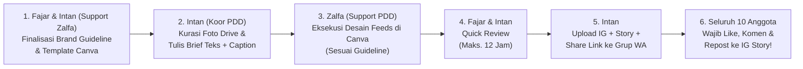

# 🎨 GUIDELINE SOCIAL MEDIA & BRANDING INSTAGRAM NIRANTARA
## **Panduan Aktivasi Akun, Visual Identity, & Rencana Konten 2 Minggu (25 Nov – 8 Des 2026)**
*Main Koor PDD: **Intan Milansari (PDD 1)** | Support PDD (Desain): **Zalfa Khoirunnisa (PDD 2)** | Support Visual Guideline: **Fajar Ahnaf M.***

---

> [!IMPORTANT]
> **MENGAPA INSTAGRAM HARUS AKTIF SEKARANG (25 NOV – 8 DES 2026)?**
> 1. **Kredibilitas di Mata Sponsor & CSR:** Sebelum menyetujui proposal sponsor, pihak brand/perusahaan pasti mengecek akun Instagram kelompok. Akun yang aktif, rapi, dan estetik menaikkan peluang ACC secara drastis.
> 2. **Portofolio Resmi Kampus & DPL:** Menjadi bukti otentik bahwa tim sudah bekerja nyata sejak tahap Pre-PLK (masuk dokumentasi luaran UNY Mengabdi).
> 3. **Daya Tarik Kolaborasi:** Memudahkan *open donation* buku bacaan TK ABA Majegan & dana via QRIS resmi tim.

---

## 1. 🧭 IDENTITAS & BRAND GUIDELINE (DISUSUN FAJAR + INTAN, SUPPORT ZALFA: 25–27 NOV)

Fajar bersama Intan (Koor PDD) dan dibantu Zalfa menetapkan panduan visual baku di **H1–H3 (Rab 25 – Jum 27 Nov)** agar seluruh feeds konsisten dan tidak berubah-ubah gayanya:

| Elemen Brand | Ketentuan Standar Tim NIRANTARA |
|---|---|
| **Nama & Slogan** | **NIRANTARA** — *"Menanam Asa, Menumbuhkan Arti"* 🌱 |
| **Nuansa Warna (*Color Palette*)** | *Earth Tone & Organic Growth* (diselaraskan dengan file `logo nirantara.png`): • **Primary:** Hijau Daun / *Forest Green* (melambangkan pertanian, alam & pertumbuhan Wonosari) • **Secondary:** Krem Hangat / *Warm Cream* (latar belakang bersih & ramah dibaca) • **Accent:** Kuning Emas / *Terracotta* (penekanan judul & tombol CTA) |
| **Tipografi (*Font*)** | Maksimal 2 jenis font di Canva: • **Judul (*Heading*):** Sans-Serif tebal/modern atau Serif elegan (tegas & mudah dibaca di layar HP) • **Isi (*Body Text*):** Sans-Serif bersih (*Poppins / Plus Jakarta Sans / Inter*) |
| **Gaya Bahasa (*Tone of Voice*)** | Hangat, profesional, informatif, tidak kaku, dan berorientasi dampak nyata untuk warga Desa Wonosari. |
| **Format Bio Instagram** | `🌱 Tim PLK UNY Mengabdi 2027`   `📍 Desa Wonosari, Kec. Trucuk, Klaten`   `✨ "Menanam Asa, Menumbuhkan Arti"`   `🤝 Kolaborasi & Sponsorship: DM / nirantara.plk.uny@gmail.com` |
| **Story Highlights Wajib** | `1. About Us` \| `2. Survei` \| `3. Proker` \| `4. Sponsorship` \| `5. Wonosari` |

---

## 2. 📅 CONTENT CALENDAR 2 MINGGU (4 FEEDS PERDANA + STORY)

Cukup **2 postingan per minggu** agar PDD tetap ringan di tengah kuliah, namun akun langsung terlihat hidup sebelum Proposal Sponsorship disebar (mulai **Kam 3 Des**):

| No | Judul Konten | Format | Bahan / Aset yang Dibutuhkan | PIC Konten & Desain | Target Tayang |
|:---:|---|---|---|---|---|
| **1** | **Logo Reveal & Filosofi Nirantara** | 3-Slide Carousel / Single Visual Estetik | Master `LOGO NIRANTARA` (`03_PDD_DAN_BRANDING/01_Aset_Logo_Identity/`) | Teks: **Intan** Desain: **Zalfa** (ikut guideline **Fajar**) | **Sabtu, 28 Nov 2026** |
| **2** | **Meet The Team: 10 Anggota, 4 Fakultas** | Carousel 5 Slide (Cover + FT, FEB, FMIPA, FIP) | Foto profil rapi 10 anggota + nama & prodi (dikumpulkan di grup WA maks. Jum 27 Nov) | Kumpul Foto & Caption: **Intan** Desain: **Zalfa** | **Minggu, 29 Nov 2026** |
| **3** | **Jejak Awal: Survei & Audiensi Desa Wonosari** | Carousel Foto + Reels Pendek (opsional) | 38+ stok foto & video survei 24 Okt di Drive (`oktober - 24 - survey/`) | Kurasi Foto & Caption: **Intan** Layout: **Zalfa** | **Rabu, 2 Des 2026** |
| **4** | **4 Pilar Karya Nirantara untuk Wonosari** | Infografis Carousel 6 Slide (Cover + 4 Divisi + CTA Sponsor) | Ringkasan proker dari 4 Koor Divisi (IT/UMKM, Adm/NIB, Kompos/Eco-Enzyme, TK/TPA) | Teks: **Intan** (ambil dari 4 Koor) Desain: **Zalfa** | **Sabtu, 5 Des 2026** |

*(Catatan: Konten **Post #5 Open Sponsorship & Donasi Buku TK ABA via QRIS** disiapkan untuk tayang di minggu berikutnya, Selasa/Rabu 8–9 Desember 2026).*

---

## 3. 🔄 WORKFLOW PRODUKSI KONTEN (SOP PDD)

### Aturan Main agar Cepat & Anti-Ribet:
1. **Satu Link Canva Tim:** Semua desain dibuat di 1 folder Canva bersama agar Intan, Zalfa, dan Fajar bisa melihat/revisi langsung tanpa kirim-kirim file berat.
2. **Aturan Repost 10 Anggota:** Setiap kali Intan membagikan tautan postingan baru di Grup WA, seluruh 10 anggota wajib *like*, komentar positif, dan *repost* ke IG Story masing-masing dalam 24 jam agar *reach* akun naik alami sebelum dicek sponsor.
3. **Standar Hashtag Wajib:** `#NirantaraUNY #PLKUNY2027 #UNYMengabdi #DesaWonosari #TrucukKlaten #KKNUNY #PengabdianMasyarakat`

---

## 4. 🤝 SINERGI PDD DENGAN TIM SPONSORSHIP & BENDAHARA

Selain mengelola Instagram, pada **Min 29 Nov – Rab 2 Des 2026** tim PDD (**Intan selaku Koor PDD** bersama **Zalfa**) merancang **Proposal Sponsorship versi PDF Estetik (5–7 halaman di Canva)**:
* **Input dari Fai (Bendahara):** Tabel RAB ringkas, 3 Paket Benefit Sponsor (Platinum, Gold, Silver/In-Kind), serta **Gambar QRIS & Nomor Rekening Resmi Kas Tim** (agar donatur/sponsor dapat langsung bertransaksi dengan mudah).
* **Input dari Sandra & Riski (Perkap):** Daftar kebutuhan barang *in-kind* (rompi, banner, buku TK, air mineral, drum komposter).
* **Tugas Intan:** Merangkai kalimat ajakan kolaborasi yang meyakinkan (*value proposition*).
* **Tugas Zalfa:** Mendesain layout PDF yang bersih, modern, dan dilengkapi foto asli survei Desa Wonosari agar siap disebar mulai **Kamis, 3 Desember 2026**.

---
← [[00 - MASTER SPRINT 2 MINGGU & PEMBAGIAN JOBDESC TIM NIRANTARA]] | [[02 - Guideline Sponsorship & Hunting Mitra]]
