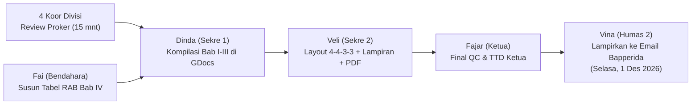

# 📑 GUIDELINE PENYUSUNAN & SUBMIT PROPOSAL KKN (JALUR CEPAT)
## **Strategi Anti-Macet Menyelesaikan Proposal Bab I–IV dalam 6 Hari (25 – 30 Nov 2026)**
*Lead Penyusun: **Dinda Amelia (Sekre 1)** & **Novelia Harlinda / Veli (Sekre 2)** | RAB: **Faidatul (Bendahara)** | QC: **Fajar***

---

> [!TIP]
> **PRINSIP JALUR CEPAT (JANGAN KETIK DARI NOL!):**
> Seluruh analisis ilmiah, metode *Participatory Action Research (PAR)*, akar masalah *5 Whys*, rincian 13 program kerja, dan konversi 280 jam **SUDAH TERSEDIA LENGKAP** di folder [`Tim PLK/03 - Fase PLK/`](file:///d:/KULIAH/UNY%20PLK/Tim%20PLK/03%20-%20Fase%20PLK/Matriks%20Analisis%20Ilmiah%20&%20Integrasi%20Proker.md).
> Di tengah kesibukan tugas kuliah, tugas tim **bukan mengarang dari kertas kosong**, melainkan **memindahkan, merapikan, dan memvalidasi** materi yang sudah ada ke dalam 1 dokumen Google Docs standar UNY!

---

## 1. 📋 PEMBAGIAN KERJA BAB I – IV (DEADLINE FINAL PDF: SENIN, 30 NOV 2026)

| Bagian Proposal | Sumber Materi Siap Copas (Vault) | PIC Utama | Support / Reviewer | Tenggat |
|---|---|---|---|---|
| **Halaman Sampul, Pengesahan & Daftar Isi** | [`Sistematika & Panduan Penyusunan Proposal PLK`](file:///d:/KULIAH/UNY%20PLK/Tim%20PLK/02%20-%20Fase%20Pre-PLK/Sistematika%20&%20Panduan%20Penyusunan%20Proposal%20PLK.md) | **Veli** (Sekre 2) | Fajar | Sab, 28 Nov |
| **Bab I: Pendahuluan & Analisis Situasi Desa** | Notulensi Survei 24 Okt & [`Matriks Analisis Ilmiah`](file:///d:/KULIAH/UNY%20PLK/Tim%20PLK/03%20-%20Fase%20PLK/Matriks%20Analisis%20Ilmiah%20&%20Integrasi%20Proker.md) | **Dinda** (Sekre 1) | Terry (cek nama dukuh/tokoh) | Jum, 27 Nov |
| **Bab II: Rencana Proker — Divisi Teknologi & IT** | [`Proker & Analisis Ilmiah Divisi Teknologi`](file:///d:/KULIAH/UNY%20PLK/Tim%20PLK/03%20-%20Fase%20PLK/01%20-%20Divisi%20Teknologi%20&%20IT/Proker%20&%20Analisis%20Ilmiah%20Divisi%20Teknologi.md) | **Dinda** (salin) | **Veli** (Koor IT) + Fajar, Terry, Riski *(cek 15 mnt)* | Sab, 28 Nov |
| **Bab II: Rencana Proker — Divisi Adm & UMKM** | [`Proker & Analisis Ilmiah Divisi Adm & UMKM`](file:///d:/KULIAH/UNY%20PLK/Tim%20PLK/03%20-%20Fase%20PLK/02%20-%20Divisi%20Administrasi%20&%20UMKM/Proker%20&%20Analisis%20Ilmiah%20Divisi%20Administrasi%20&%20UMKM.md) | **Dinda** (salin) | **Fai** (Koor PADP) *(cek 15 mnt)* | Sab, 28 Nov |
| **Bab II: Rencana Proker — Divisi Lingkungan** | [`Proker & Analisis Ilmiah Divisi Lingkungan`](file:///d:/KULIAH/UNY%20PLK/Tim%20PLK/03%20-%20Fase%20PLK/03%20-%20Divisi%20Lingkungan%20&%20Kesehatan/Proker%20&%20Analisis%20Ilmiah%20Divisi%20Lingkungan%20&%20Kesehatan.md) | **Dinda** (salin) | **Intan** (Koor Bio) + Zalfa *(cek 15 mnt)* | Sab, 28 Nov |
| **Bab II: Rencana Proker — Divisi Pendidikan** | [`Proker & Analisis Ilmiah Divisi Pendidikan`](file:///d:/KULIAH/UNY%20PLK/Tim%20PLK/03%20-%20Fase%20PLK/04%20-%20Divisi%20Pendidikan%20&%20Media%20Ajar/Proker%20&%20Analisis%20Ilmiah%20Divisi%20Pendidikan%20&%20Media%20Ajar.md) | **Dinda** (salin) | **Vina** (Koor TP) + Sandra *(cek 15 mnt)* | Sab, 28 Nov |
| **Bab III: Metode Pelaksanaan & Matriks 280 Jam** | [`Matriks Analisis Ilmiah`](file:///d:/KULIAH/UNY%20PLK/Tim%20PLK/03%20-%20Fase%20PLK/Matriks%20Analisis%20Ilmiah%20&%20Integrasi%20Proker.md) & [`Draft Simulasi 272 Jam`](file:///d:/KULIAH/UNY%20PLK/Tim%20PLK/02%20-%20Fase%20Pre-PLK/02%20-%20DPL%20&%20Konsultasi%20Akademik/Draft%20Simulasi%20272%20Jam%20Kerja.md) | **Dinda** & **Veli** | Fajar | Min, 29 Nov |
| **Bab IV: Rencana Anggaran Biaya (RAB) & Jadwal** | [`Strategi Sponsorship & Anggaran Awal`](file:///d:/KULIAH/UNY%20PLK/Tim%20PLK/02%20-%20Fase%20Pre-PLK/03%20-%20Anggaran%20&%20Sponsorship/Strategi%20Sponsorship%20&%20Anggaran%20Awal%20Tim.md) | **Fai** (Bendahara) | Sandra & Riski (input harga) | Sab, 28 Nov |
| **Lampiran (Biodata 10 Anggota + Peta Desa)** | [`Database Profil Anggota Tim`](file:///d:/KULIAH/UNY%20PLK/Tim%20PLK/02%20-%20Fase%20Pre-PLK/01%20-%20Tata%20Kelola%20Tim%20&%20First%20Gathering/Database%20Profil%20Anggota%20Tim.md) *(NIM, Prodi, Peran)* | **Veli** (Sekre 2) | — | Min, 29 Nov |
| **Layout Final Word & Export PDF Siap Submit** | Google Docs Master ➔ Download `.docx` ➔ Rapikan di MS Word | **Veli** (Sekre 2) | **Dinda** & **Fajar** (QC Final) | **Sen, 30 Nov** |

---

## 2. 📏 CHECKLIST STANDAR FORMAT PROPOSAL (QC OLEH VELI & FAJAR)

Sebelum di-export ke PDF untuk dikirim ke **Bapperida Klaten (Selasa, 1 Des)**, pastikan seluruh poin ini terpenuhi:
- [ ] **Ukuran Kertas & Margin:** A4 — Kiri `4 cm`, Atas `4 cm`, Kanan `3 cm`, Bawah `3 cm` (4-4-3-3).
- [ ] **Font & Spasi:** Times New Roman ukuran `12 pt`, spasi `1,5`, rata kanan-kiri (*Justify*).
- [ ] **Identitas Anggota Valid:** Nama & NIM ke-10 anggota 100% sesuai (pastikan NIM Novelia Harlinda `24050530045` sudah benar!).
- [ ] **Lokasi Konsisten:** *Dukuh Majegan (RW 01), Desa Wonosari, Kecamatan Trucuk, Kabupaten Klaten, Provinsi Jawa Tengah*.
- [ ] **Periode Kegiatan:** Semester Genap 2026/2027 (Estimasi 4,5 bulan / Februari – Juni 2027, sistem *stay weekend* & target min. 272 jam).
- [ ] **Lembar Pengesahan:** Minimal mencantumkan kolom tanda tangan Ketua Kelompok (Fajar Ahnaf Mahardika), mengetahui Kepala Desa Wonosari / DPL (untuk pengajuan Bapperida awal, TTD Ketua Kelompok + stempel/logo UNY sudah cukup jika DPL resmi belum di-plot sistem).
- [ ] **Ukuran File PDF:** Disimpan rapi di Google Drive `01_KESEKRETARIATAN/07_PROPOSAL/Proposal_KKN_PLK_Tim_Nirantara_Wonosari_Klaten.pdf` (ukuran < 5 MB).

---

## 3. 🔄 ALUR SERAH TERIMA PROPOSAL

---
← [[00 - MASTER SPRINT 2 MINGGU & PEMBAGIAN JOBDESC TIM NIRANTARA]] | [[04 - Guideline Humas, Persuratan UNY & Bapperida Klaten]]
