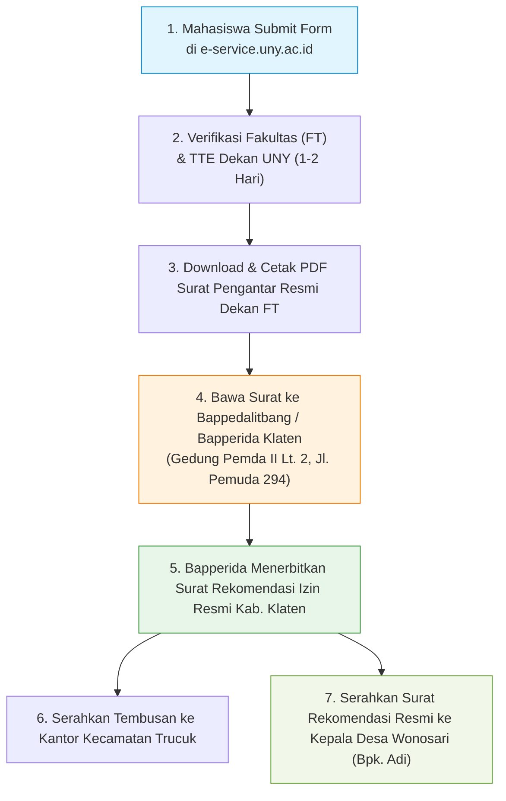

# 📑 Panduan & Cheatsheet Isian Form E-Service UNY
### Permohonan Surat Pengantar Izin Observasi ke Bappedalitbang / Bapperida Kabupaten Klaten
**Tim NIRANTARA — PLK UNY Mengabdi 2027 (Desa Wonosari, Trucuk, Klaten)**

---

## 📋 1. Cheatsheet Form Isian E-Service UNY (Tinggal Copy-Paste)

Gunakan tabel di bawah ini untuk mengisi laman formulir di portal **`eservice.uny.ac.id`** menu **Permohonan Izin ➔ Observasi**:

| Nama Kolom Form | Nilai Isian Baku (Silakan Copy-Paste Langsung) | Keterangan / Catatan Teknis |
|---|---|---|
| **Tugas matakuliah \*** | `Pembelajaran Luar Kampus (PLK) UNY Mengabdi` | *Gunakan nama baku resmi kampus (bukan "Pendidikan Luar Kampus").* |
| **Tujuan/Judul observasi \*** | `Observasi Lapangan dan Permohonan Rekomendasi Pelaksanaan Program Pembelajaran Luar Kampus (PLK) UNY Mengabdi 2027 di Desa Wonosari, Kecamatan Trucuk, Kabupaten Klaten` | *Bahasa baku formal instansi pemerintahan, jelas mencakup lokasi desa, kecamatan, dan kabupaten.* |
| **Nama dan Alamat Penerima \*** | **Bupati Klaten**<br>**cq. Kepala Badan Perencanaan Pembangunan, Riset dan Inovasi Daerah (Bapperida) Kabupaten Klaten**<br>**Gedung Pemda II Lantai 2, Jl. Pemuda No. 294, Klaten Tengah, Kab. Klaten, Jawa Tengah 57424** | *Wajib menggunakan format hierarki `cq.` sesuai kotak peringatan merah di e-Service.*<br>*(Bapperida adalah nomenklatur resmi Bappedalitbang saat ini).* |
| **Tanggal mulai observasi \*** | `01/11/2026` *(atau tanggal hari ini saat submit)* | *Format tanggal di sistem web e-service menggunakan date picker.* |
| **Tanggal selesai observasi \*** | `31/01/2027` *(Rekomendasi 3 Bulan)* | *Mencakup seluruh masa survei lanjutan, pematangan proker, hingga pra-penerjunan.* |
| **Anggota** | Masukkan 9 NIM anggota (lihat daftar tabel NIM di Bagian 2). | *Akun pengusul login (**Fajar Ahnaf Mahardika**) otomatis tercatat sebagai ketua, tidak perlu dimasukkan lagi.* |

---

> [!IMPORTANT]
> ### ⚠️ Perhatikan Format Penulisan Penerima (Sesuai Contoh Merah E-Service)
> Sistem e-Service UNY mensyaratkan penulisan instansi daerah menggunakan hierarki pimpinan wilayah (**Bupati**) dengan tembusan pejabat teknis terkait (**cq.**). 
> 
> **Teks Lengkap untuk Kolom "Nama dan Alamat Penerima":**
> ```text
> Bupati Klaten
> cq. Kepala Badan Perencanaan Pembangunan, Riset dan Inovasi Daerah (Bapperida) Kabupaten Klaten
> Gedung Pemda II Lantai 2, Jl. Pemuda No. 294, Klaten Tengah, Kab. Klaten, Jawa Tengah 57424
> ```
> *(Opsi Cadangan jika instansi setempat masih memakai kop lama):*
> ```text
> Bupati Klaten
> cq. Kepala Badan Perencanaan Pembangunan Daerah, Penelitian dan Pengembangan (Bappedalitbang) Kabupaten Klaten
> Gedung Pemda II Lantai 2, Jl. Pemuda No. 294, Klaten Tengah, Kab. Klaten, Jawa Tengah 57424
> ```

---

## 👥 2. Daftar 9 NIM Anggota untuk Kolom "Anggota"

Karena pengusul adalah **Fajar Ahnaf Mahardika** (`24050530030`), sistem e-Service menyatakan: *"Pengusul tidak perlu memasukkan NIM lagi"*. 

Cari dan pilih **9 NIM anggota kelompok** berikut di kolom pencarian **`:: Pilih Mahasiswa ::`**:

| No | NIM Anggota *(Copy Ini)* | Nama Lengkap Mahasiswa | Program Studi | Fakultas |
|:--:|:---:|:---|:---|:---:|
| **1** | `24050530052` | **Muhadzdzib Terry Al Fauzan** | Pendidikan Teknik Informatika | FT |
| **2** | `24050530029` | **Muhamad Riski** | Pendidikan Teknik Informatika | FT |
| **3** | **`24050530045`** | **Novelia Harlinda** | Pendidikan Teknik Informatika | FT |
| **4** | `24080330053` | **Dinda Amelia Putri** | Pendidikan Administrasi Perkantoran | FEB |
| **5** | `24080330078` | **Faidatul Anugraheni M.** | Pendidikan Administrasi Perkantoran | FEB |
| **6** | `24030830059` | **Intan Milansari** | Biologi | FMIPA |
| **7** | `24030830068` | **Zalfa Khoirunnisa** | Biologi | FMIPA |
| **8** | `24010530018` | **Alvina Aulia Az Zahra** | Teknologi Pendidikan | FIP |
| **9** | `24010530004` | **Krissandra Siagian** | Teknologi Pendidikan | FIP |

> [!TIP]
> **Trik Cepat**: Copy satu per satu angka NIM di atas, paste ke kotak pencarian anggota, lalu klik nama yang muncul hingga kesembilan nama anggota masuk ke daftar anggota observasi.

---

## 🔄 3. Alur & Prosedur Birokrasi: Dari E-Service Hingga Balai Desa

Berikut adalah alur lengkap perjalanan surat agar perizinan tim Nirantara 100% sah dan berkekuatan hukum di Kabupaten Klaten:



### Rincian Langkah Lapangan:

1. **Pengajuan di E-Service UNY**:
   - Ketua tim (Fajar) mengisi data form sesuai tabel Bagian 1 & 2 di atas.
   - Klik tombol **Submit**.
2. **Penerbitan Surat Fakultas**:
   - Proses persetujuan oleh Admin Layanan Akademik FT dan penandatanganan elektronik (TTE) oleh Dekan / Wakil Dekan FT biasanya memakan waktu **1–2 hari kerja**.
   - Pantau status permohonan di menu *Riwayat Permohonan Izin*. Setelah status berubah menjadi *Selesai/Disetujui*, download berkas PDF surat dinas resmi bertanda tangan barcode digital.
   - Cetak surat tersebut rangkap 2–3 lembar (berwarna).
3. **Pengurusan Rekomendasi di Bapperida / Bappedalitbang Klaten**:
   - Lokasi: **Gedung Pemda II Lantai 2, Jl. Pemuda No. 294, Klaten** (samping alun-alun / kompleks Pemkab Klaten).
   - Kontak Pelayanan: `(0272) 321046` | Email: `bapperida@klaten.go.id`.
   - Berkas yang dibawa delegasi tim:
     1. Surat Pengantar Dekan dari e-Service UNY (asli cetak).
     2. Fotokopi KTP & KTM Ketua Tim (Fajar) dan perwakilan anggota.
     3. Proposal Ringkas / *Executive Summary* Program Pengabdian Desa Wonosari (bisa diambil dari Bab I–III [[Matriks Analisis Ilmiah & Integrasi Proker]]).
     4. Mengisi formulir permohonan rekomendasi penelitian/pengabdian di loket pelayanan Bapperida.
4. **Penerbitan Surat Rekomendasi Resmi Kabupaten Klaten**:
   - Bapperida menerbitkan surat izin resmi penelitian/observasi/pengabdian dengan nomor register Kabupaten Klaten.
   - Surat ini memuat tembusan resmi ke:
     * Camat Trucuk
     * Kepala Desa Wonosari
5. **Penyerahan ke Kelurahan / Balai Desa Wonosari**:
   - Sesuai arahan Kepala Desa Wonosari (**Bapak Adi: `0813-2100-1070`**) pada survei tanggal 24 Oktober 2026:
     > *"Nanti alurnya izin resmi dari kampus dimasukkan ke Bappedalitbang Klaten dulu mas, nanti dari Bappedalitbang tembusannya ke kecamatan Trucuk dan ke Balai Desa Wonosari. Kalau surat dari Bappedalitbang sudah keluar dan diserahkan ke desa, legalitas tim sudah 100% aman dan resmi tercatat di pemerintah desa."*
   - Delegasi tim menyerahkan surat rekomendasi Bappedalitbang tersebut ke kantor Balai Desa Wonosari.

---

## 📁 4. Rujukan Dokumen Terkait
- [[Database Profil Anggota Tim]] — Data lengkap induk 10 anggota & K3
- [[Copy of NOTULENSI (PLK NIRANTARA 27)_SURVEI_24 OKT 26.docx|Notulensi Master Survei Klaten 24 Okt]] — Transkrip audiensi Kades Wonosari & RW 01 Majegan
- [[Matriks Analisis Ilmiah & Integrasi Proker]] — Rincian 12 program kerja ilmiah & analisis 5 Whys
- [[Roadmap Tahap 2 - Eksekusi Pre-PLK]] — Timeline master tahapan Pre-PLK

---
← [[Home]] | [[README]]
