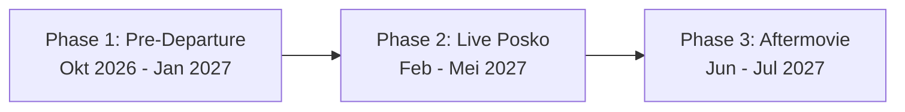

# 🚀 Panduan & Lembar Kerja First Gathering (TM-TP) Tim PLK UNY 2027
**Hari/Tanggal Pertemuan**: Rabu, 14 Oktober 2026  
**Agenda**: Ta'aruf 10 Anggota, Voting Pengurus Inti & Matrix, Brainstorming Nama Tim & Proker Wonosari Klaten

> 💡 **Petunjuk untuk Notulis/Sekretaris (Dinda/Veli):**  
> Buka file ini di laptop saat TM berlangsung. Isi langsung kolom-kolom `[ ]`, tabel voting, dan hasil diskusi di setiap bagian. Selesai rapat, file ini langsung menjadi **Notulensi Resmi Pembentukan Tim**!

---

## ⏰ Rundown & Alur TM-TP (Total: 90–120 Menit)

| Waktu | Durasi | Agenda Utama | Output yang Harus Terkunci |
|:---:|:---:|---|---|
| **Sesi 1** | 20 Menit | Ice Breaking & Ta'aruf Santai 10 Orang | Kenal karakter, domisili, & kebiasaan tiap anggota. |
| **Sesi 2** | 20 Menit | Voting & Finalisasi Struktur Matrix (Posko + Proker) | Formasi 10 peran posko & koordinator proker FIX. |
| **Sesi 3** | 15 Menit | Voting Nama Tim, Branding, & Filosofi | Nama resmi tim untuk proposal & akun medsos tim. |
| **Sesi 4** | 30 Menit | Bedah Masalah Wonosari Klaten & Validasi Proker 4 Prodi | Peta proker terintegrasi (PTI, PADP, Bio, TP). |
| **Sesi 5** | 15 Menit | Pengisian Lembar Data Kebutuhan AI Agent & Action Items | Data kurikulum/skill terkumpul untuk bahan proposal. |
| **Sesi 6** | 15 Menit | Estimasi Biaya Awal & Atribut (Rompi 12 pcs, Lanyard, Vendor) | Kesepakatan iuran awal, termin DP, & ukuran rompi. |

---

## 🗳️ SESI 2: Voting & Penetapan Struktur Matrix Tim

Struktur Matrix mewajibkan setiap anggota memegang **1 Peran Posko (Operasional)** DAN **1 Peran Proker (Fungsional)**.

### A. Voting Ketua Tim (Kordes)
* **Kandidat 1**: Fajar Ahnaf Mahardika (PTI) — *Petahana Inisiator*
* **Kandidat Alternatif**: *(Buka ruang jika ada yang bersedia mencalonkan/dicalonkan)*: `....................`
* **Hasil Keputusan / Mufakat**: Ketua Terpilih = `[ Fajar Ahnaf Mahardika / .................... ]`

---

### B. Lembar Pengesahan Peran Matrix (10 Anggota)

Silakan konfirmasi kesediaan masing-masing anggota:

| No | Nama Anggota | Prodi | Peran Operasional Posko (Pilih 1) | Peran Divisi Proker (Pilih 1) | Tanda Tangan / Status |
|:-:|---|---|---|---|:---:|
| 1 | **Fajar** | PTI (FT) | Ketua (Kordes) | Supervisi & Lobi Eksternal | `[ ACC / Revisi ]` |
| 2 | **Dinda** | PADP (FEB) | Sekretaris Utama (Proposal & LPJ) | Tim Divisi Administrasi & UMKM | `[ ACC / Revisi ]` |
| 3 | **Faidatul (Fai)** | PADP (FEB) | Bendahara Utama (Kas & RAB) | Koor. Divisi Administrasi & UMKM | `[ ACC / Revisi ]` |
| 4 | **Terry** | PTI (FT) | Humas Lapangan / Perkap (Klaten) | Tim Divisi Teknologi & IT | `[ ACC / Revisi ]` |
| 5 | **Riski** | PTI (FT) | PDD Dokumentasi & Publikasi | Tim Divisi Teknologi & IT | `[ ACC / Revisi ]` |
| 6 | **Veli** | PTI (FT) | Sekre 2 / Konsumsi Posko | Koor. Divisi Teknologi & IT | `[ ACC / Revisi ]` |
| 7 | **Intan** | Biologi (FMIPA) | Konsumsi Utama (Logistik Makan) | Koor. Divisi Lingkungan & Kesehatan | `[ ACC / Revisi ]` |
| 8 | **Zalfa** | Biologi (FMIPA) | Konsumsi 2 / Bendahara Pendamping | Tim Divisi Lingkungan & Sampah | `[ ACC / Revisi ]` |
| 9 | **Alvina (Vina)** | TP (FIP) | PDD Media & Desain (Canva/Konten) | Koor. Divisi Pendidikan & Media Ajar | `[ ACC / Revisi ]` |
| 10 | **Sandra** | TP (FIP) | Perkap & Logistik Operasional | Tim Divisi Pendidikan & Media Ajar | `[ ACC / Revisi ]` |

*Catatan Perubahan Role (Jika Ada Masukan saat TM):*  
> `Tulis di sini jika ada tukar peran antar anggota...`

---

## 🏷️ SESI 3: Voting Nama Tim, Identitas, & Blueprint Branding Medsos KKN

Nama tim akan menjadi **identitas resmi** di Cover Proposal UNY, spanduk posko, stempel administrasi, kemeja PDH, hingga akun media sosial (@Instagram & @TikTok).

---

### A. Pilihan Opsi Nama Tim (Hasil Kurasi Memori & Karakter Tim)

#### 🏛️ Kategori 1: Bahasa Sansekerta & Filosofis (Khas Tradisi Mahasiswa UNY)
Memberikan kesan mendalam, terpelajar, berwibawa, dan sangat santun saat sowan ke Kepala Desa dan perangkat:
1. **Nirantara** (🔥 *Kandidat Terkuat — Aset Master Vektor Siap: `LOGO NIRANTARA.ai`*)
   * *Makna (Sansekerta: निरन्तर)*: **Berkesinambungan, tanpa jeda/tanpa putus, abadi, dan menyatu tanpa sekat.**
   * *Filosofi*: Melambangkan program pengabdian yang tidak berhenti saat mahasiswa pulang, melainkan memberi dampak positif berkelanjutan (*sustainable impact*) bagi warga Desa Wonosari, sekaligus menyatukan 10 mahasiswa dari 4 fakultas berbeda dalam satu ikatan harmonis tanpa sekat birokrasi.
2. **DasaKarya**
   * *Makna*: *Dasa* = 10 anggota lengkap, *Karya* = karya nyata dan perbuatan baik. Melambangkan 10 mahasiswa dari 4 fakultas yang bersatu menciptakan karya pengabdian abadi bagi Desa Wonosari.
3. **Abhipraya**
   * *Makna*: Memiliki harapan, cita-cita, dan tujuan luhur. Menggambarkan tekad tim menjadi pembawa harapan baru bagi kemajuan desa.
4. **Navastara**
   * *Makna*: Bintang fajar yang baru. Filosofinya: Menjadi penerang dan pembawa perubahan positif di tengah masyarakat Dukuh Majegan.
5. **Nawasena**
   * *Makna*: Melangkah bersama menuju masa depan yang cerah dan penuh keberdayaan.
6. **Samasta**
   * *Makna*: Menyatukan seluruh elemen semesta. Melambangkan peleburan 4 latar belakang keilmuan menjadi satu harmoni pengabdian.

#### ⚡ Kategori 2: Modern, Sains & Interdisipliner (Khas Sinergi IT, Bisnis, MIPA, & Edukasi)
Terdengar dinamis, cerdas, inovatif, dan relevan dengan era digital:
6. **DecaCore** (⭐ *Evolusi 10 Orang*)
   * *Makna*: Diadaptasi dari istilah prosesor modern (10 inti prosesor). Menggambarkan 10 pemikiran cerdas dan tangguh dari FT, FEB, FMIPA, dan FIP yang bekerja simultan memecahkan masalah desa.
7. **Synapse (Sinapsis)**
   * *Makna*: Titik temu antar sel saraf yang mentransmisikan sinyal. Filosofinya: Tim PLK menjadi simpul pertemuan antara inovasi kampus dengan denyut nadi warga Wonosari.
8. **Nexus Wonosari**
   * *Makna*: *Nexus* berarti titik pusat koneksi dan kolaborasi interdisipliner.
9. **Usulan Alternatif dari Forum TM**: `........................................`

* **Hasil Voting Nama Tim Terpilih**: `[ ........................................ ]`
* **Tagline / Slogan Tim**: `[ ........................................ ]` *(Contoh: "Satu Tekad, Nyata Mengabdi!")*
* **Filosofi Singkat Tim (1 Kalimat)**: `[ ................................................................................ ]`

---

### B. Infrastruktur Digital & Akun Resmi Tim

Untuk tertib administrasi dan publikasi terpusat, tim menyepakati pembuatan akun resmi:

| Media / Platform | Usulan Handle / Username | PIC Pengelola | Status Eksekusi |
|---|---|---|:---:|
| **Google Workspace / Gmail** | `plkuny.[namatim]@gmail.com` | Sekretaris & PDD | `[ ] Dibuat` |
| **Instagram Resmi** | `@plkuny.[namatim]` atau `@[namatim].wonosari` | Vina & Riski (PDD) | `[ ] Dibuat` |
| **TikTok Tim** | `@[namatim].plkuny` | Vina & Riski (PDD) | `[ ] Dibuat` |
| **Google Drive Master** | Folder bersama di akun Gmail tim (Kapasitas Proposal & Foto) | Dinda (Sekretaris) | `[ ] Dibuat` |

---

### C. Blueprint Konten Media Sosial (Ala KKN Hits/Aesthetic)

Biar akun tim terlihat hidup dan profesional sejak fase persiapan hingga penarikan:

1. **Phase 1: Pre-Departure & Branding (Oktober 2026 – Januari 2027)**
   * 🎬 **Teaser Video & Logo Reveal**: Feeds carousel filosofi logo tim + palet warna (Biru FT, Kuning FEB, Hijau FMIPA, Ungu FIP).
   * 📸 **Meet The Team (Member Reveal)**: Postingan 10 slide estetik foto anggota (Nama, Prodi, Role Posko & Proker, fun fact/quotes).
   * 📝 **Road to Wonosari**: Dokumentasi survei lokasi, sowan Kades, dan suasana rapat pleno di Jogja.
2. **Phase 2: Field Execution & Daily Life (Februari – Mei 2027)**
   * 🍳 **Posko Life (Reels/TikTok)**: *A day in my life* di posko Klaten, vlog belanja ke pasar, keseruan masak bareng.
   * 🌟 **Proker Highlights**: Dokumentasi aksi nyata (pelatihan eco-enzyme ibu PKK, kelas literasi SD, pembukuan UMKM, web desa).
   * 🤝 **Wonosari Stories**: Wawancara warga lokal, profil pengrajin mebel, dan kearifan lokal Dukuh Majegan.
3. **Phase 3: Farewell & Legacy (Juni – Juli 2027)**
   * 🎥 **Aftermovie Sinematik PLK**: Video rekap perjalanan 4 bulan pengabdian.
   * 📦 **Digital Booklet / Majalah Desa**: Laporan publikasi digital kenang-kenangan untuk Balai Desa.

* **Kesepakatan Sesi Foto Bersama 10 Anggota (Member Reveal)**:
  * Waktu/Tempat Foto: `[ Saat TM-TP Hari Rabu / Studio Foto / Kampus UNY ]`
  * Dresscode: `[ Baju Bebas Rapi / Kemeja Putih / Almamater UNY ]`

---

## 🎯 SESI 4: Bedah Temuan Wonosari Klaten & Pancingan Proker

> **Fakta Lapangan Dukuh Majegan, Wonosari (Survei Terry & Pak Maryadi BPD)**:
> - 🔴 **Masalah Sampah Darurat**: Biaya angkut sampah Rp 2–3 juta/trip dari APBDES. Belum ada pemilahan atau bank sampah aktif.
> - 🟠 **BUMDes Macet**: Usaha ternak lele, kambing, dan kios pasar terhenti/kalah saing. Pembukuan & manajemen lemah.
> - 🟢 **Potensi Keagamaan & Warga**: Ada **9 kelompok pengajian putri aktif**, jamaah NU & Muhammadiyah sangat rukun, ada kegiatan PKK & Posyandu.
> - 🏫 **Fasilitas Pendidikan**: 2 SD Negeri, TK Pertiwi, TK Aisyiyah, dan PAUD di Pendem.
> - 🌟 **Status Emas**: UNY **belum pernah ada** yang KKN di sini (sebelumnya hanya UIN Solo). Warga & perangkat sangat menyambut!

### 🧠 Lembar Curah Pendapat (Brainstorming) Proker 4 Divisi

#### 1. Divisi Teknologi & IT (PTI: Fajar, Terry, Riski, Veli)
* **Pertanyaan Pancingan**: *Apakah desa butuh website resmi, digitalisasi buku induk kependudukan RT/RW, pelatihan Canva/komputer untuk karang taruna, atau pembuatan peta digital Dukuh Majegan?*
* **Rencana Proker 1 (Utama)**: `........................................................`
* **Rencana Proker 2 (Pendukung)**: `........................................................`

#### 2. Divisi Administrasi & UMKM (PADP: Dinda & Fai)
* **Pertanyaan Pancingan**: *Bagaimana cara menghidupkan kembali tata kelola BUMDes atau membantu pelaku UMKM lokal (pertukangan mebel, warung) dengan pelatihan pembukuan kas digital (BukuWarung/Excel) & penataan arsip surat desa?*
* **Rencana Proker 1 (Utama)**: `........................................................`
* **Rencana Proker 2 (Pendukung)**: `........................................................`

#### 3. Divisi Lingkungan & Sampah (Biologi: Intan & Zalfa)
* **Pertanyaan Pancingan**: *Bagaimana cara memangkas beban biaya sampah Rp 2-3 juta APBDES melalui edukasi pembuatan Eco-Enzyme dari sisa dapur ibu-ibu PKK / pembuatan pupuk kompos untuk kelompok tani Setyo Makmur?*
* **Rencana Proker 1 (Utama)**: `........................................................`
* **Rencana Proker 2 (Pendukung)**: `........................................................`

#### 4. Divisi Pendidikan & Media Ajar (Teknologi Pendidikan: Vina & Sandra)
* **Pertanyaan Pancingan**: *Media interaktif atau modul apa yang bisa dibawa ke 2 SD & 2 TK di Wonosari? Apakah pelatihan media ajar interaktif (Canva edukasi/Wordwall) untuk guru desa, pojok literasi, atau bimbingan belajar/TPA anak-anak?*
* **Rencana Proker 1 (Utama)**: `........................................................`
* **Rencana Proker 2 (Pendukung)**: `........................................................`

---

## 🤖 SESI 5: Data yang Dibutuhkan oleh AI Agent (Antigravity)

Untuk membantu tim **menulis Draf Proposal PLK**, **menyusun Rincian Logbook 272 Jam**, dan **mengunci Konversi Mata Kuliah (SKS)** secara otomatis dan presisi, **AI Agent membutuhkan data riil berikut dari teman-teman**:

### 📋 Lembar Isian Data Akademik & Skill Tiap Anggota

*(Minta setiap anggota mengisi barisnya masing-masing saat TM)*

| No | Nama | Mata Kuliah Unggulan yg Pernah/Sedang Diambil (yg bisa dikonversi/dipraktikkan) | Skill Teknis & Software yg Benar-benar Dikuasai (Contoh: Canva, Capcut, Excel, Laravel, Mikrobiologi, dll) | Alat Kerja Fisik yg Bisa Dibawa ke Posko (Contoh: Laptop i5, Kamera, Tripod, Mic Wireless, Roll Kabel) |
|:-:|---|---|---|---|
| 1 | Fajar (PTI) | Pemrograman Web, Jaringan Komputer | Web Dev, Sistem Basis Data, Problem Solving | Laptop Spek Tinggi, Kabel Roll |
| 2 | Terry (PTI) | Jaringan Komputer, Hardware IT | Troubleshooting, Negosiasi/Humas | Laptop, Motor PP Klaten |
| 3 | Riski (PTI) | Basis Data, Multimedia | Dokumentasi, Fotografi, Riset Data | Laptop, Kamera HP Bagus |
| 4 | Veli (PTI) | Administrasi TI, Rekayasa Web | Manajemen Data, Administrasi, Web Basic | Laptop |
| 5 | Dinda (PADP) | Manajemen Kearsipan, Komunikasi Kantor | Administrasi Surat, Pengetikan Cepat | Laptop |
| 6 | Fai (PADP) | Akuntansi Dasar, Manajemen Keuangan | Pembukuan Kas, Excel Keuangan, RAB | Laptop |
| 7 | Intan (Bio) | Ekologi, Mikrobiologi, Biologi Lingkungan | Uji Organik, Budidaya, Formulasi Alami | Laptop |
| 8 | Zalfa (Bio) | Pengolahan Limbah, Fisiologi Tumbuhan | Praktik Kompos/Eco-Enzyme | Laptop |
| 9 | Vina (TP) | `........................................` | `........................................` | `........................................` |
| 10 | Sandra (TP) | `........................................` | `........................................` | `........................................` |

---

---

## 💰 SESI 6: Estimasi Biaya Awal, Atribut Tim (Rompi, Lanyard, ID Card) & Rekomendasi Vendor

Identitas visual lapangan sangat penting agar tim diakui secara resmi oleh perangkat desa, warga, dan dosen. Atribut lapangan standar KKN/PLK terdiri dari **Rompi Lapangan**, **Lanyard Printing Custom**, dan **ID Card Resmi**.

---

### A. Trik Solusi Syarat Vendor: Minimal Order 12 Pcs (MOQ 1 Lusin)
Mayoritas vendor konveksi bordir di Jogja menerapkan **Minimum Order Quantity (MOQ) 12 pcs**. Karena tim kita beranggotakan **10 orang**, kita menggunakan trik alokasi strategis berikut:
* **10 Pcs**: Untuk 10 Anggota Tim (Fajar, Terry, Riski, Veli, Dinda, Fai, Intan, Zalfa, Vina, Sandra).
* **1 Pcs (Ukuran L/XL)**: Untuk **Dosen Pembimbing Lapangan (DPL)** saat kunjungan Monev ke Wonosari Klaten *(Memberikan rompi seragam ke DPL adalah gestur penghormatan tinggi yang terbukti memberi kesan sangat positif saat penilaian akhir!)*.
* **1 Pcs (Ukuran L/XL)**: Untuk **Kepala Desa Wonosari / Pak Maryadi (BPD)** sebagai cinderamata dan tanda kenang-kenangan resmi dari UNY.

---

### B. Mengapa Memilih Rompi Lapangan Dibanding Kemeja PDH Panjang?
1. **Fleksibel & Nyaman di Iklim Klaten**: Bisa dirangkap di atas kaos oblong posko saat kerja bakti/panas-panasan, atau dipakai di atas kemeja saat sowan resmi perangkat desa.
2. **Saku Fungsional (Banyak Kantong)**: Praktis untuk menaruh HP, pulpen, buku catatan, dan perlengkapan kecil saat berkeliling dukuh.
3. **Bordir Rapi & Berwibawa**: Dilengkapi bordir komputer Logo UNY (dada kiri), Bendera Merah Putih & Nama Tim (dada kanan), serta tulisan identitas pengabdian di punggung belakang.

---

### C. Simulasi Rancangan Anggaran Biaya (RAB) Atribut & Biaya Awal

Berikut estimasi harga standar konveksi mahasiswa di Jogja:

| No | Item Pengeluaran | Spesifikasi & Rincian | Qty | Estimasi Harga Satuan | Total Biaya (12 Pcs) | Beban per Anggota (10 Orang) |
| :-: | :--- | :--- | :---: | :---: | :---: | :---: |
| 1 | **Rompi KKN Lapangan** | Bahan Drill (American/Nagata), furing jaring, 4 saku, bordir komputer 3 titik | 12 pcs | Rp 95.000 | Rp 1.140.000 | **Rp 114.000** |
| 2 | **Lanyard Custom Printing** | Tali tisu 2 cm halus, cetak sublim full-color 2 sisi, kait besi nikel + stopper | 12 pcs | Rp 15.000 | Rp 180.000 | **Rp 18.000** |
| 3 | **ID Card + Casing Mika** | Kartu PVC tebal anti-air (standar ATM) + holder mika transparan presisi | 12 pcs | Rp 7.000 | Rp 84.000 | **Rp 8.400** |
| 4 | **Kas Operasional Awal** | Biaya print berkas, jilid surat pengantar, materai proposal, bensin sowan resmi Kades | - | - | Rp 200.000 | **Rp 20.000** |
| | **TOTAL ESTIMASI** | *Paket Atribut Lengkap (12 Pcs) + Kas Operasional Awal* | | | **Rp 1.604.000** | **~Rp 160.000 / orang** |

---

### D. Rekomendasi Vendor Konveksi & Percetakan di Jogja (Mahasiswa-Friendly)

#### 🧵 1. Vendor Konveksi Rompi & Bordir
* **Rekomendasi 1 (Dekat Kampus UNY)**: **Konveksi Area Karangmalang / Gejayan / Colombo**
  * *Kelebihan*: Sangat dekat kampus, mudah untuk cek sampel bahan (katalog warna drill), dan fitting ukuran langsung.
* **Rekomendasi 2**: **Stars Konveksi / Diamond Konveksi Jogja** (Pogung / Pandega Marta, Jl. Kaliurang)
  * *Kelebihan*: Berpengalaman memproduksi seragam organisasi UNY/UGM, melayani MOQ 12 pcs dengan garansi bordir rapi dan waktu pengerjaan 10–14 hari.
* **Rekomendasi 3**: **Vendor Spesialis Rompi Tactical / Outdoor (Shopee Rekanan Solo/Klaten)**
  * *Kelebihan*: Harga grosir lebih terjangkau, model tactical modern dengan banyak kantong.

#### 🖨️ 2. Vendor Lanyard & ID Card Custom
* **Rekomendasi 1**: **Nirwana Digital Print / Digibook Jogja** (Gejayan & Sagan)
  * *Kelebihan*: Pengerjaan kilat (1–3 hari jadi), tali tisu tidak gatal di leher.
* **Rekomendasi 2**: **Vendor Lanyard Custom Shopee (Sentra Cetak Solo/Jogja)**
  * *Kelebihan*: Harga murah untuk 12 pcs (~Rp 12.000–15.000/set), cukup kirimkan file desain dari PDD (Vina/Riski).

---

### E. Skema Pembayaran & Termin Kas (Agar Tidak Berat Sekaligus)

Agar tidak membebani pengeluaran bulanan anggota, disepakati sistem **2 Termin Pembayaran**:

* 🟢 **Termin 1 (Pekan Ini setelah TM-TP)**: **Rp 80.000 – Rp 100.000 / orang**
  * *Alokasi*: Uang muka (DP 50%) konveksi rompi agar vendor segera memproses pola + kas operasional sowan Kades.
* 🔵 **Termin 2 (Saat Rompi Jadi / Menjelang Penerjunan 2027)**: **Rp 60.000 – Rp 80.000 / orang**
  * *Alokasi*: Pelunasan sisa rompi vendor + cetak lanyard & ID card resmi.

---

### F. Form Rekap Ukuran Rompi 12 Pcs

*(Isi ukuran rompi masing-masing saat TM-TP berlangsung)*:

| No | Nama Penerima | Peruntukan | Ukuran Rompi (S / M / L / XL / XXL) |
| :-: | :--- | :--- | :---: |
| 1 | Fajar Ahnaf Mahardika | Anggota Tim (Ketua) | `[ L / XL ]` |
| 2 | Muhadzdzib Terry Al Fauzan | Anggota Tim (Humas Klaten) | `[ XL ]` |
| 3 | Muhamad Riski | Anggota Tim (PDD) | `[ XL ]` |
| 4 | Novelia Harlinda | Anggota Tim (Sekre 2) | `[ M / L ]` |
| 5 | Dinda Amelia Putri | Anggota Tim (Sekre 1) | `[ S / M ]` |
| 6 | Faidatul Anugraheni M. | Anggota Tim (Bendahara 1) | `[ S / M ]` |
| 7 | Intan Milansari | Anggota Tim (Konsumsi 1) | `[ S / M ]` |
| 8 | Zalfa Khoirunnisa | Anggota Tim (Konsumsi 2) | `[ S / M ]` |
| 9 | Alvina Aulia Az Zahra | Anggota Tim (PDD Media) | `[ S ]` |
| 10 | Krissandra Siagian | Anggota Tim (Perkap) | `[ M ]` |
| 11 | **Dosen Pembimbing Lapangan (DPL)** | *Cinderamata Monev Posko* | `[ L / XL ]` |
| 12 | **Kepala Desa Wonosari / BPD** | *Cinderamata Kemitraan Desa* | `[ L / XL ]` |

---

## ❓ Pertanyaan Validasi & Komitmen Tim (Wajib Ditanyakan saat TM)

1. **Validasi Ritme Kerja Lapangan (Arahan Pak Hilmy PADP)**:
   * *“Teman-teman, apakah ritme keberangkatan **Jumat siang/sore menuju Klaten dan kepulangan Minggu malam** aman untuk jadwal kuliah Senin–Kamis kalian?”*
   * Jawaban & Kesepakatan Tim: `[ Aman / Butuh Penyesuaian: .................... ]`
2. **Validasi Beban Kerja Fisik Posko (Anti-Slop K3)**:
   * *“Karena rasio kita 3 cowok : 7 cewek, apakah teman-teman mahasiswi siap saling bantu angkat perkap ringan, setting ruang balai desa, dan panas-panasan saat kegiatan warga?”*
   * Jawaban & Kesepakatan Tim: `[ Sepakat bersama / .................... ]`
3. **Validasi Biaya Awal & DP Atribut Rompi**:
   * *“Apakah teman-teman sepakat dengan skema iuran **Termin 1 (DP Rompi 12 pcs + Kas Operasional Sowan) sebesar Rp 80.000 – Rp 100.000 / orang** pekan ini?”*
   * Nominal Termin 1 yang Disepakati: `Rp .................. / orang` (Dikelola Bendahara Fai).

---

## ✅ Checklist Keputusan TM-TP (Kunci Sebelum Bubar Rapat)

- [ ] Nama Tim PLK Resmi Terpilih: `................................`
- [ ] Struktur Matrix (Ketua, Sekre, Bendahara, Perkap, Konsumsi, PDD) 100% Disepakati.
- [ ] 4 Fokus Proker Utama Disepakati.
- [ ] Akun Gmail (`plkuny.[namatim]@gmail.com`) dan Instagram Tim siap dibuat oleh tim PDD (Vina & Riski).
- [ ] Jadwal sesi foto bersama 10 anggota untuk feed *Member Reveal* disepakati.
- [ ] Data ukuran rompi 12 pcs (10 anggota + DPL + Kades) terdata lengkap.
- [ ] Nominal iuran Termin 1 (DP Rompi + Kas Awal) disepakati & tanggal jatuh tempo transfer ke Bendahara Fai ditetapkan.
- [ ] PIC Vendor konveksi ditunjuk (Perkap Sandra/Terry mulai kontak vendor).
- [ ] Usulan 2–3 kandidat nama Dosen Pembimbing Lapangan (DPL) dikumpulkan (Lihat [[Analisa Kriteria & Strategi Memilih DPL]]).
- [ ] Vina & Sandra menerima amanah konsultasi ke Dosen PIC TP (FIP).
- [ ] Dinda & Fajar menerima mandat mengurus **Surat Pengantar Survei Resmi** ke Dosen PIC.

---

← [[Roadmap Tahap 2 - Eksekusi Pre-PLK]] | [[Database Profil Anggota Tim]] | [[Home]]

