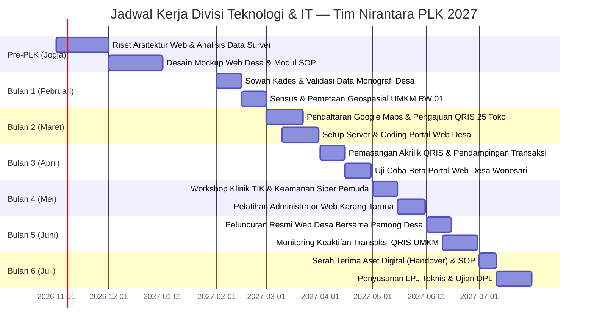

# 💻 Analisis Ilmiah & Rencana Program Kerja — Divisi Teknologi Informasi & Komunikasi (TIK)

> **Unit Kerja**: Divisi Teknologi Informasi & Komunikasi (TIK) — Tim PLK UNY Mengabdi NIRANTARA 2027  
> **Basis Akademik**: Program Studi Pendidikan Teknik Informatika (PTI), Fakultas Teknik (FT)  
> **Koordinator**: Novelia Harlinda, S.Pd. (Cand.) — NIM: `24050530045`  
> **Tim Pengembang & Eksekutor**: Fajar Ahnaf Mahardika (`24050530030`), Muhadzdzib Terry Al Fauzan (`24050530052`), Muhamad Riski (`24050530029`)  
> **Lokasi Sasaran**: Kantor Balai Desa Wonosari, Pelaku Usaha Mikro RW 01 Dukuh Majegan, dan Pemuda Karang Taruna Desa Wonosari, Kecamatan Trucuk, Kabupaten Klaten.

---

## 🔬 1. Landasan Teori & Pendekatan Riset Aksi (Action Research)

Penyusunan program kerja Divisi Teknologi ini mengadopsi kerangka metodologi **Technology Acceptance Model (TAM)** (*Davis, 1989*) yang dikombinasikan dengan pendekatan **Community-Based Participatory Research (CBPR)** dan **Participatory Rural Appraisal (PRA)**. Dalam konteks masyarakat perdesaan, keberhasilan implementasi teknologi informasi tidak hanya ditentukan oleh keunggulan teknis sistem (*Perceived Usefulness*), melainkan sangat bergantung pada kemudahan penggunaan (*Perceived Ease of Use*), kecocokan dengan norma sosial perdesaan (*Social Influence & Facilitating Conditions*), serta ketiadaan friksi operasional harian.

```
       [Kondisi Lapangan Desa Wonosari]
                     │
                     ▼
  ┌─────────────────────────────────────┐
  │   Analisis Kebutuhan Empiris (PRA)  │
  └──────────────────┬──────────────────┘
                     │
                     ▼
  ┌─────────────────────────────────────┐
  │   Analisis Akar Masalah (5 Whys)    │
  └──────────────────┬──────────────────┘
                     │
                     ▼
  ┌─────────────────────────────────────┐
  │   Kajian Multidimensi (Sosio-Tekno) │
  └──────────────────┬──────────────────┘
                     │
                     ▼
  ┌─────────────────────────────────────┐
  │   Desain Solusi Presisi (TAM Model) │
  └──────────────────┬──────────────────┘
                     │
                     ▼
  ┌─────────────────────────────────────┐
  │   Gantt Chart & Evaluasi Berkelanjutan│
  └─────────────────────────────────────┘
```

---

## 📊 2. Matriks Temuan Empiris Lapangan (Survei 24 Oktober 2026)

Berdasarkan hasil observasi fisik, wawancara mendalam (*in-depth interview*) dengan Kepala Desa Wonosari (Bapak Adi) dan Ketua RW 01 Dukuh Majegan (Bapak Ramelan), berikut adalah pemetaan faktual kondisi TIK di lokasi:

| No | Parameter Observasi | Fakta Lapangan (Kondisi Eksisting) | Kesenjangan (Gap Analysis) | Dampak terhadap Masyarakat Desa |
|:--:|---|---|---|---|
| **1** | **Profil & Layanan Web Desa** | Desa Wonosari memiliki domain/subdomain resmi, namun berstatus pasif/terbengkalai sejak 2 tahun terakhir. Data monografi desa, potensi pertanian, dan struktur perangkat desa sudah kedaluwarsa. | Tidak tersedianya kanal transparansi publik desa yang terintegrasi dan informatif bagi warga maupun investor luar. | Akses informasi birokrasi lambat; perantau asal Wonosari sulit memantau perkembangan desa; citra digital desa tertinggal. |
| **2** | **Visibilitas Digital UMKM (Peta)** | Sekitar 30+ titik usaha mikro (bengkel las, mebel kayu jati/mahoni, warung kelontong, warung makan soto/bakso, pengepul rosok) belum terdaftar secara resmi di **Google Maps**. | Ketiadaan jejak digital (*digital presence*) bagi pelaku usaha mikro lokal di platform navigasi global. | Calon pembeli dari luar desa kesulitan menemukan lokasi fisik toko; potensi omzet regional tidak teroptimasi. |
| **3** | **Sistem Transaksi Keuangan** | Transaksi pembayaran di UMKM RW 01 masih 100% menggunakan uang tunai (*cash*). Tidak ada satu pun pedagang yang memajang barcode QRIS. | Kesenjangan adopsi teknologi transaksi non-tunai perbankan digital di kalangan pedagang pasar dan warung. | Risiko uang palsu, masalah kembalian receh, dan hilangnya peluang transaksi dari generasi muda/wisatawan. |
| **4** | **Infrastruktur Jaringan & Perangkat** | Jaringan sinyal 4G stabil (Indosat, Telkomsel, XL), rumah posko memiliki WiFi 14 Mbps. Balai Desa memiliki perangkat komputer kantor (PC) namun jarang dioptimalkan selain untuk pengetikan Microsoft Word standar. | Rendahnya literasi pemanfaatan utilitas komputasi awan (*cloud storage* & otomasi spreadsheet) pada staf operasional desa. | Pengarsipan surat dan pendataan bansos masih rentan tumpang tindih (*redundancy data*). |

---

## 🔍 3. Analisis Akar Masalah (The 5 Whys Root Cause Analysis)

### Kasus A: Terbengkalainya Website Resmi Desa Wonosari
1. **Why 1**: Mengapa website desa Wonosari tidak aktif dan tidak pernah diperbarui?  
   *➔ Karena staf kelurahan yang ditugasi mengelola website tidak pernah mengunggah artikel atau data monografi terbaru.*
2. **Why 2**: Mengapa staf kelurahan tidak mengunggah data terbaru?  
   *➔ Karena staf merasa antarmuka Content Management System (CMS) web desa terlalu rumit, lambat, dan membingungkan.*
3. **Why 3**: Mengapa CMS terasa membingungkan bagi staf desa?  
   *➔ Karena sistem web dibuat oleh pihak ketiga masa lampau tanpa disertai buku manual SOP yang ramah pemula dan tanpa pelatihan berkelanjutan.*
4. **Why 4**: Mengapa tidak ada pelatihan berkelanjutan bagi staf desa?  
   *➔ Karena tidak ada alokasi anggaran pelatihan TIK khusus dalam APBDes Wonosari untuk pembinaan admin web desa.*
5. **Why 5 (Root Cause)**: Mengapa tidak ada alokasi prioritas TIK desa?  
   *➔ **Akar Masalah**: Belum terbentuknya kesadaran strategis (*mindset*) di jajaran pamong desa bahwa keterbukaan informasi digital desa merupakan instrumen akselerasi ekonomi dan pelayanan publik, serta tidak adanya agen pemuda lokal (Karang Taruna) yang diberdayakan sebagai tim redaksi digital desa.*

---

### Kasus B: Ketiadaan Titik Lokasi Google Maps & QRIS pada UMKM Warga
1. **Why 1**: Mengapa toko mebel dan warung makan di RW 01 Majegan tidak muncul di Google Maps?  
   *➔ Karena pemilik usaha tidak pernah mendaftarkan titik koordinat tokonya ke Google Business Profile.*
2. **Why 2**: Mengapa pemilik usaha tidak pernah mendaftarkan usahanya?  
   *➔ Karena mereka menganggap pendaftaran lokasi online itu berbayar mahal, rumit, dan memerlukan izin surat resmi.*
3. **Why 3**: Mengapa ada persepsi bahwa pendaftaran itu rumit dan berbayar?  
   *➔ Karena minimnya sosialisasi langsung dari pihak perbankan atau dinas terkait ke tingkat pedukuhan mengenai fitur gratis Google Maps dan QRIS.*
4. **Why 4**: Mengapa sosialisasi tidak pernah menyentuh level pedukuhan?  
   *➔ Karena program digitalisasi perbankan biasanya hanya berfokus pada pedagang pasar besar kecamatan atau kawasan perkotaan Klaten.*
5. **Why 5 (Root Cause)**: Mengapa pedagang tidak mencari tahu secara mandiri lewat smartphone mereka?  
   *➔ **Akar Masalah**: Keterbatasan literasi digital fungsional—para pedagang lansia/dewasa hanya memanfaatkan smartphone untuk aplikasi WhatsApp dan YouTube hiburan, tanpa menyadari bahwa ponsel mereka adalah alat pemasaran bisnis gratis dan kanal perbankan digital mandiri.*

---

## 🌐 4. Kajian Multidimensi Terpadu (Sosio-Tekno-Kultural)

Sebuah intervensi teknologi di Desa Wonosari akan ditolak jika mengabaikan lanskap sosiologis setempat. Berikut adalah mitigasi multidimensi yang dirancang tim:

```
                  ┌──────────────────────────────┐
                  │      Intervensi TIK          │
                  │   Desa Wonosari, Klaten      │
                  └──────────────┬───────────────┘
                                 │
     ┌───────────────────────────┼───────────────────────────┐
     ▼                           ▼                           ▼
┌──────────────┐          ┌──────────────┐            ┌──────────────┐
│ Aspek Manusia│          │Teknologi     │            │Sosial-Budaya │
│ & Literasi   │          │& Infrastruktur│           │& Norma Adat  │
└──────────────┘          └──────────────┘            └──────────────┘
```

### 1. Aspek Manusia (Human Factors & Behavioral Adoption)
- **Karakteristik Subjek**: Pelaku usaha mikro mayoritas berusia 35–55 tahun. Tingkat penerimaan terhadap istilah teknis berbahasa Inggris (*dashboard, upload, merchant*) sangat rendah.
- **Strategi Pendekatan**: Pendampingan bersifat **"One-on-One Door-to-Door"** (datang langsung ke warung/bengkel). Tim PTI mendampingi proses verifikasi email, foto produk, dan upload titik Maps sampai terbit secara langsung di ponsel pemilik usaha tanpa biaya sepeser pun.

### 2. Aspek Teknologi & Infrastruktur (Technological Affordance)
- **Ketersediaan**: Jaringan 4G sangat baik di seluruh Dukuh Majegan. Namun, spesifikasi smartphone pemilik warung beragam (sebagian memori internal terbatas).
- **Strategi Pendekatan**: Menggunakan aplikasi web ringan (*Lightweight Web App*) dan Google Maps bawaan tanpa memaksa pemilik warung menginstal aplikasi berat pihak ketiga yang memakan RAM ponsel.

### 3. Aspek Lingkungan (Environmental Impact)
- **Dampak Fisik**: Meminimalisir pencetakan brosur kertas promosi fisik yang berpotensi menjadi limbah sampah pekarangan baru.
- **Strategi Pendekatan**: Penggunaan akrilik standing mini QRIS berbahan tahan lama atau stiker vinil tahan hujan yang ditempel rapi pada etalase toko warga.

### 4. Aspek Sosial & Komunitas (Social Dynamics)
- **Dinamika Guyub Rukun**: Warga Wonosari sangat aktif dalam perkumpulan RT, Dasawisma, dan perkumpulan bapak-bapak ronda malam.
- **Strategi Pendekatan**: Demonstrasi kemudahan pembayaran QRIS dilakukan secara langsung di hadapan warga saat forum arisan RT atau kumpul pemuda Karang Taruna, agar terjadi efek *social proof* dan rasa percaya bersama antar-tetangga.

### 5. Aspek Budaya, Norma, & Nilai Adat (Cultural & Ethical Values)
- **Unggah-Ungguh & Etika Bertamu**: Wajib meminta izin kepada sesepuh dukuh (Ketua RW 01 Bpk. Ramelan dan Ketua RT setempat) sebelum mendata rumah warga. Wajib berpakaian rapi, sopan, bertutur kata bahasa Jawa krama/Indonesia santun, dan menghindari mendatangi toko pada jam sibuk memasak/istirahat siang (pukul 12.00–13.30 WIB).

---

## 🎯 5. Rumusan Rencana Program Kerja (Proker) Unggulan

### Proker 1: Revitalisasi & Modernisasi Portal Profil Desa Wonosari
- **Nama Program**: *Wonosari Digital Gateway (WDG)*
- **Tujuan**: Membangun portal web profil desa berbasis open-source yang elegan, cepat diakses melalui HP, memuat peta batas wilayah, informasi pamong, katalog monografi potensi desa, dan berita kegiatan masyarakat.
- **Metode Pelaksanaan**:
  1. *Focus Group Discussion (FGD)* kebutuhan data bersama Kepala Desa (Bpk. Adi) dan Sekretaris Desa.
  2. Redesain arsitektur web menggunakan layout responsif mobile-friendly.
  3. Pelatihan intensif 2 sesi bagi 2 orang perangkat desa dan 2 perwakilan pemuda Karang Taruna sebagai administrator web mandiri pasca-PLK.
  4. Penyusunan Buku Pedoman SOP Pengelolaan Web Desa (Hardcopy & PDF).
- **Indikator Keberhasilan (KPI SMART)**:
  * 1 Portal website profil desa aktif dengan domain resmi desa.
  * 100% data struktur pamong, monografi RW/Dukuh, dan potensi desa terpublikasikan secara mutakhir.
  * Minimal 2 orang pemuda desa tersertifikasi mampu mengoperasikan dan mengunggah artikel berita secara mandiri.

---

### Proker 2: Akselerasi Digitalisasi UMKM Warga (Google Maps & QRISisasi)
- **Nama Program**: *Peta Usaha Majegan & Transaksi Cerdas (PETRUK)*
- **Tujuan**: Meningkatkan eksposur digital dan kemudahan transaksi non-tunai bagi sedikitnya 25 pelaku usaha mikro di Desa Wonosari.
- **Metode Pelaksanaan**:
  1. Sensus dan pemetaan geospasial UMKM *door-to-door* di wilayah RW 01 Dukuh Majegan dan sekitarnya (mengambil foto toko, deskripsi produk, jam buka, kontak WhatsApp).
  2. Pendaftaran dan verifikasi titik lokasi pada Google Maps / Google Business Profile hingga status *Verified & Live*.
  3. Fasilitasi pendaftaran akun merchant QRIS terintegrasi (bekerja sama dengan perbankan nasional/dompet digital resmi seperti BCA/BRI/Bank BPD DIY/ShopeePay) tanpa biaya admin pendaftaran.
  4. Penyerahan akrilik/stand QRIS resmi serta pelatihan cara mengecek notifikasi saldo masuk di smartphone pemilik usaha.
- **Indikator Keberhasilan (KPI SMART)**:
  * Minimal 25 titik UMKM baru terindeks 100% aktif dan dapat ditelusuri di Google Maps.
  * Minimal 15 UMKM memiliki kode barcode QRIS resmi yang terpasang di tempat usahanya.
  * Rating kepuasan pedagang mitra mencapai >85% dalam lembar evaluasi adopsi digital.

---

### Proker 3: Workshop Literasi Keamanan Siber & Pemanfaatan AI Produktif Karang Taruna
- **Nama Program**: *Klinik TIK Muda Wonosari*
- **Tujuan**: Membekali generasi muda Dukuh Majegan dengan literasi keamanan data digital (menghindari judi online, pinjol ilegal, phising link) dan pemanfaatan alat AI modern untuk pembuatan materi promosi desa/bisnis.
- **Metode Pelaksanaan**: Workshop interaktif 1 hari di balai pertemuan RW 01, praktik langsung pembuatan desain grafis promosi produk lokal dengan Canva, dan edukasi proteksi sandi/rekening digital.
- **Indikator Keberhasilan (KPI SMART)**:
  * Dihadiri oleh minimal 20 orang anggota Karang Taruna Dukuh Majegan.
  * Terciptanya 5 katalog visual promosi UMKM lokal hasil karya peserta workshop.

---

## 📅 6. Jadwal Pelaksanaan Program Kerja (Gantt Chart 6 Bulan)



---

## 💰 7. Rencana Anggaran Biaya (RAB) Divisi Teknologi & IT

| No | Item Pengeluaran | Volume | Harga Satuan (Rp) | Total Biaya (Rp) | Sumber Dana |
|:--:|---|:---:|:---:|:---:|:---|
| 1 | Biaya Hosting Cloud & Domain Desa (.desa.id / cloud tier) 1 Tahun | 1 Paket | Rp 250.000,- | Rp 250.000,- | Kas Tim / Sponsorship |
| 2 | Pengadaan Dudukan Akrilik A6 Standing untuk Barcode QRIS Pedagang | 20 Buah | Rp 12.000,- | Rp 240.000,- | Kas Tim Nirantara |
| 3 | Cetak Stiker Vinil Tahan Air Barcode QRIS & Google Maps UMKM | 50 Lembar | Rp 3.000,- | Rp 150.000,- | Kas Tim Nirantara |
| 4 | Cetak Buku Pedoman SOP Administrator Web Desa (Hardcover Jilid Lux) | 2 Eksemplar | Rp 35.000,- | Rp 70.000,- | Kas Tim Nirantara |
| 5 | Konsumsi & Snack Workshop Klinik TIK Pemuda Karang Taruna | 25 Porsi | Rp 8.000,- | Rp 200.000,- | Kas Tim / Iuran Suka Rela |
| **TOTAL** | **Rencana Anggaran Divisi Teknologi & IT** | | | **Rp 910.000,-** | *(Telah Tercover di RAB Induk)* |

---

## 🛡️ 8. Matriks Manajemen Risiko & Rencana Keberlanjutan (Sustainability)

| Potensi Risiko | Tingkat Risiko | Dampak | Tindakan Mitigasi Preventif | Penanggung Jawab |
|---|:---:|---|---|---|
| Pemilik toko lupa sandi email atau menghapus aplikasi QRIS dari ponselnya | Sedang | Transaksi QRIS terhenti | Tim mencatat master email bisnis cadangan dalam kartu kendali pemilik toko dan menyematkan nomor kontak *helpdesk* tim PTI | Novelia Harlinda & Terry |
| Pihak ketiga menempelkan barcode QRIS palsu di atas akrilik toko | Tinggi | Kerugian finansial pedagang | Memberikan edukasi literasi visual: pedagang diajari selalu memeriksa kesesuaian nama toko pada layar HP pembeli sebelum menyerahkan barang | Fajar Ahnaf & Riski |
| Web desa kembali pasif setelah penarikan mahasiswa PLK ke Jogja | Tinggi | Program tidak berlanjut | Penandatanganan Berita Acara Handover dan penunjukan 2 pemuda Karang Taruna sebagai Redaktur Desa resmi yang disahkan dengan SK Kepala Desa Wonosari | Novelia Harlinda & Kades Adi |

---

← [[Dashboard Eksekusi PLK]] | [[Matriks Analisis Ilmiah & Integrasi Proker]] | [[Home]]
