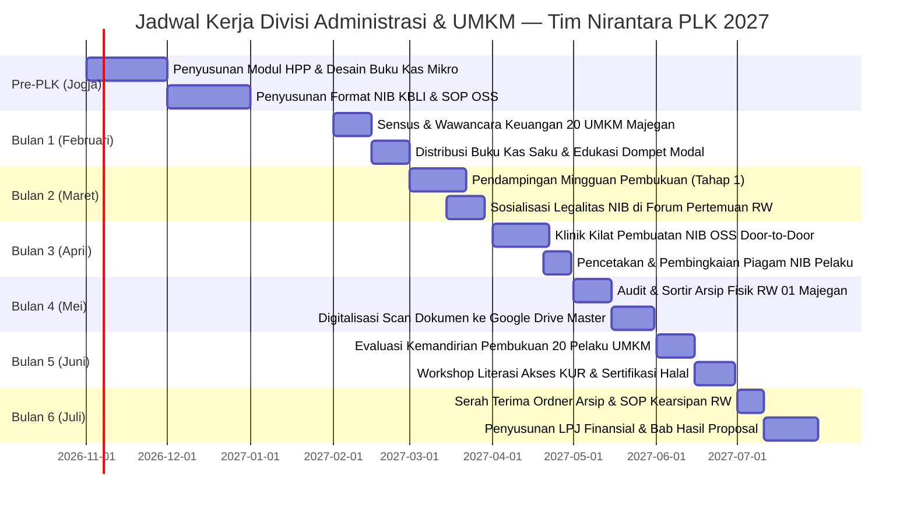

# 📈 Analisis Ilmiah & Rencana Program Kerja — Divisi Administrasi & Tata Kelola UMKM

> **Unit Kerja**: Divisi Administrasi & UMKM — Tim PLK UNY Mengabdi NIRANTARA 2027  
> **Basis Akademik**: Program Studi Pendidikan Administrasi Perkantoran (PADP), Fakultas Ekonomi dan Bisnis (FEB)  
> **Koordinator**: Faidatul Anugraheni M., S.Pd. (Cand.) — NIM: `24080330078`  
> **Anggota & Sekretaris 1**: Dinda Amelia Putri, S.Pd. (Cand.) — NIM: `24080330053`  
> **Lokasi Sasaran**: Sentra Kerajinan Mebel Kayu, Warung Makan/Kelontong RW 01 Dukuh Majegan, serta Pengurus Administrasi RT/RW Desa Wonosari, Trucuk, Klaten.

---

## 🔬 1. Landasan Teori & Kerangka Konseptual

Program kerja Divisi Administrasi & UMKM dirancang dengan mengacu pada **Teori Perilaku Terencana (*Theory of Planned Behavior* - Ajzen, 1991)** dalam konteks akuntansi keprilakuan (*behavioral accounting*) dan konsep **Good Corporate Governance (GCG) pada Skala Mikro**. Pada sektor usaha mikro perdesaan, kegagalan ekspansi bisnis dan tingginya kerentanan modal sering kali bukan disebabkan oleh ketiadaan pasar, melainkan akibat rendahnya **Financial Literacy** dan ketiadaan tata kelola kearsipan yang memisahkan antara entitas bisnis pribadi dengan modal kerja (*Business Entity Concept*).

```
  ┌─────────────────────────────────────────────────────────────┐
  │ Masalah Empiris UMKM Desa Wonosari (Survei 24 Okt 2026)      │
  │ • Uang modal & uang pribadi tercampur dalam satu dompet     │
  │ • Nol pencatatan arus kas (cash flow)                       │
  │ • Tidak memiliki legalitas NIB (Nomor Induk Berusaha)       │
  └──────────────────────────────┬──────────────────────────────┘
                                 │
                                 ▼
  ┌─────────────────────────────────────────────────────────────┐
  │ Kerangka Diagnostik: 5 Whys Root Cause Analysis             │
  │ Menguak hambatan psikologis, literasi, dan birokrasi        │
  └──────────────────────────────┬──────────────────────────────┘
                                 │
                                 ▼
  ┌─────────────────────────────────────────────────────────────┐
  │ Pendekatan Aksi Partisipatif (PAR) & Pendampingan Klinis     │
  │ • Buku Kas Sederhana (Single-Entry Bookkeeping)             │
  │ • Klinik OSS Kilat (Penerbitan NIB Resmi Kementerian)        │
  │ • Standardisasi Arsip Digital Lingkungan RW 01              │
  └──────────────────────────────┬──────────────────────────────┘
                                 │
                                 ▼
  ┌─────────────────────────────────────────────────────────────┐
  │ Luaran Nyata: Kemandirian Finansial, Akses Permodalan KUR,   │
  │ dan Tata Kelola Arsip Tertib Berkelanjutan                  │
  └─────────────────────────────────────────────────────────────┘
```

---

## 📊 2. Matriks Temuan Empiris Lapangan (Survei 24 Oktober 2026)

Hasil observasi langsung dan dialog bersama Ketua RW 01 Bapak Ramelan serta para perajin mebel di Dukuh Majegan menghasilkan data empiris sebagai berikut:

| No | Parameter Observasi | Fakta Lapangan (Kondisi Eksisting) | Kesenjangan (Gap Analysis) | Dampak terhadap UMKM / Desa |
|:--:|---|---|---|---|
| **1** | **Manajemen Arus Kas & Pembukuan** | 100% pelaku usaha mikro yang diobservasi tidak memiliki buku kas harian. Pencatatan pengeluaran kayu/bahan baku dan pemasukan pembeli hanya mengandalkan ingatan atau coretan di sobekan kardus. | Ketiadaan standar pembukuan tunggal (*single-entry*) yang memisahkan modal kerja dengan uang belanja rumah tangga. | Pelaku usaha sering mengalami krisis likuiditas tunai (*cash crunch*); modal tergerus tanpa disadari untuk kebutuhan keluarga; margin laba riil tidak pernah diketahui. |
| **2** | **Legalitas Usaha (NIB)** | Sebagian besar industri rumahan mebel kayu dan pedagang kelontong belum memiliki **Nomor Induk Berusaha (NIB)**. | Kesenjangan pemahaman regulasi perizinan berusaha berbasis risiko (OSS-RBA). | Pelaku UMKM tidak memenuhi syarat untuk mengajukan Kredit Usaha Rakyat (KUR) berbunga rendah di bank, bantuan subsidi alat dinas koperasi, maupun sertifikasi halal gratis. |
| **3** | **Penetapan Harga Pokok Penjualan (HPP)** | Perajin mebel menentukan harga jual kursi/meja berdasarkan taksiran (*feeling*) dan perbandingan harga umum tetangga, tanpa menghitung biaya depresiasi alat, tenaga kerja sendiri, dan biaya operasional listrik/bensin. | Ketidakakuratan kalkulasi HPP dan struktur penetapan harga (*pricing strategy*). | Potensi kerugian tersembunyi; ketika harga bahan kayu atau amplas naik, perajin justru mengalami penurunan modal tanpa tahu penyebabnya. |
| **4** | **Tata Kelola Arsip Sekretariat RW** | Notulensi rapat RT/RW, data monografi warga penerima bantuan, dan inventaris barang rukun kematian masih disimpan dalam lembaran buku folio manual yang rentan rusak/hilang dimakan rayap. | Ketiadaan sistem kearsipan ganda (*dual filing system*: fisik teratur + cadangan awan digital). | Kesulitan melacak riwayat persuratan warga dan mutasi kependudukan lampau secara cepat. |

---

## 🔍 3. Analisis Akar Masalah (The 5 Whys Root Cause Analysis)

### Kasus A: Ketiadaan Pembukuan Keuangan Usaha Mikro
1. **Why 1**: Mengapa perajin mebel dan pedagang warung di Wonosari tidak mencatat transaksi keuangan mereka?  
   *➔ Karena mereka merasa pembukuan itu memakan waktu lama dan membuat repot di tengah kesibukan mengamplas kayu atau melayani pembeli.*
2. **Why 2**: Mengapa mereka menganggap pembukuan itu memakan waktu dan rumit?  
   *➔ Karena persepsi mereka tentang pembukuan adalah akuntansi rumit ala perusahaan besar dengan debit, kredit, neraca saldo, dan laporan laba rugi.*
3. **Why 3**: Mengapa terbentuk persepsi bahwa pembukuan harus serumit itu?  
   *➔ Karena mereka tidak pernah dikenalkan dengan model **Buku Kas 3 Kolom Sederhana** (Tanggal, Uang Masuk, Uang Keluar, Sisa Kas) yang dirancang khusus untuk pedagang mikro.*
4. **Why 4**: Mengapa model sederhana tersebut tidak pernah diajarkan?  
   *➔ Karena pelatihan kewirausahaan dari instansi luar sering kali bersifat seremonial di tingkat kecamatan tanpa pendampingan intensif satu per satu (*mentoring*) di tempat usaha.*
5. **Why 5 (Root Cause)**: Mengapa tidak ada pendampingan langsung berulang?  
   *➔ **Akar Masalah**: Ketiadaan pendamping UMKM lokal di level pedukuhan yang mampu menerjemahkan prinsip akuntansi formal menjadi kebiasaan harian yang sangat mudah (hanya butuh 3 menit setiap tutup toko).*

---

### Kasus B: Rendahnya Kepemilikan NIB (Nomor Induk Berusaha)
1. **Why 1**: Mengapa para pelaku usaha mebel di Majegan belum memiliki NIB?  
   *➔ Karena mereka tidak pernah mendaftar di sistem Online Single Submission (OSS).*
2. **Why 2**: Mengapa mereka tidak mendaftar di portal OSS?  
   *➔ Karena mereka tidak tahu apa itu OSS dan mengira pengurusan izin usaha harus datang ke kantor dinas kabupaten di Klaten Kota dengan membawa banyak berkas.*
3. **Why 3**: Mengapa mereka tidak mengetahui bahwa NIB bisa dibuat dari HP dalam 10 menit?  
   *➔ Karena sosialisasi digitalisasi regulasi izin berusaha dari pemerintah belum terdiseminasi secara masif hingga tingkat pos kamling/arisan RT pedukuhan.*
4. **Why 4**: Mengapa informasi tersebut tidak tersebar di obrolan warga?  
   *➔ Karena para pelaku usaha tidak melihat urgensi langsung memiliki surat izin jika usahanya masih bisa berjalan secara informal tanpa ditegur.*
5. **Why 5 (Root Cause)**: Mengapa mereka merasa tidak membutuhkan izin formal?  
   *➔ **Akar Masalah**: Rendahnya literasi hukum ekonomi mikro—pelaku usaha belum menyadari bahwa NIB adalah "KTP Usaha" yang menjadi syarat mutlak membuka pintu akses pembiayaan bank formal (KUR bunga 6%), perlindungan hukum aset, serta legalitas perdagangan antar-kabupaten.*

---

## 🌐 4. Kajian Multidimensi Terpadu (Sosio-Ekonomi-Budaya)

```
                     ┌─────────────────────────────┐
                     │     Intervensi PADP-FEB     │
                     │  Desa Wonosari, Klaten      │
                     └──────────────┬──────────────┘
                                    │
     ┌──────────────────────────────┼──────────────────────────────┐
     ▼                              ▼                              ▼
┌──────────────┐             ┌──────────────┐               ┌──────────────┐
│ Aspek Manusia│             │Aspek Norma & │               │Aspek Sosial  │
│ & Psikologis │             │Kepercayaan   │               │& Kebiasaan   │
└──────────────┘             └──────────────┘               └──────────────┘
```

### 1. Aspek Manusia & Psikologis (Cognitive & Mental Accounting)
- **Hambatan Mental**: Keengganan mencatat uang masuk karena ada ketakutan bahwa pembukuan akan memperlihatkan bahwa usahanya sedang merugi, atau sebaliknya takut dikenakan pajak oleh aparat pemerintah.
- **Strategi Pendekatan**: Tim Divisi PADP mengedukasi dengan ramah bahwa pencatatan ini **bersifat rahasia internal milik keluarga sendiri** dan bahwa usaha mikro dengan omzet di bawah batas PTKP (Penghasilan Tidak Kena Pajak) bebas dari beban PPh final UMKM, justru pembukuan ini melindungi uang belanja sekolah anak agar tidak tergerus modal beli kayu.

### 2. Aspek Teknologi & Literasi Perangkat (Appropriate Technology)
- **Kondisi Perangkat**: Sebagian perajin kayu memiliki tangan yang kotor oleh serbuk gergaji/politur saat bekerja, sehingga tidak praktis jika dipaksa menginput aplikasi kasir di smartphone saat jam kerja.
- **Strategi Pendekatan**: Menerapkan sistem **Hybrid Bookkeeping**:
  1. *Fisik*: Buku Kas Saku bergaris laminasi tahan debu yang ditaruh di laci meja bengkel untuk mencatat coretan cepat nota harian.
  2. *Digital*: Panduan penggunaan aplikasi kasir smartphone ringan (BukuKas / BukuWarung) yang dioperasikan pada malam hari saat santai oleh istri/anak pedagang.

### 3. Aspek Lingkungan & Kelestarian Bahan (Raw Material Tracking)
- **Kondisi Sektor Mebel**: Bahan baku kayu jati, mahoni, dan akasia dibeli secara gelondongan atau papan dari pengepul lokal. Sisa serbuk kayu (grajen) sering dibuang percuma.
- **Strategi Pendekatan**: Pengarsipan kartu stok bahan baku kayu untuk memantau efisiensi pemotongan kayu dan berkolaborasi dengan Divisi Biologi untuk mendata serbuk kayu yang dapat digunakan sebagai campuran kompos/media tanam.

### 4. Aspek Sosial & Komunitas (Social Capital)
- **Kultur Paguyuban**: Para tukang mebel memiliki ikatan kekerabatan yang kuat. Jika satu orang berhasil mendapatkan manfaat NIB (misalnya pinjaman KUR cair atau dapat bantuan alat), tetangga perajin lainnya akan serentak ikut membuat.
- **Strategi Pendekatan**: Melakukan penetrasi awal (*early adopters*) pada 3 tokoh perajin mebel yang paling dihormati di RW 01 Majegan. Setelah NIB mereka terbit dan dipajang berbingkai rapi di bengkelnya, buat testimoni getok tular (*word of mouth*) ke perajin lainnya.

### 5. Aspek Budaya, Norma, & Norma Keagamaan (Local Ethics)
- **Nilai Kedermawanan & Utang Piutang Warga**: Warung kelontong desa sering diwarnai kebiasaan warga berutang (*ngebon*) dan pedagang merasa tidak enak (*pekewuh*) untuk menagih secara tegas.
- **Strategi Pendekatan**: Pelatihan kartu kendali piutang yang sopan dan tata krama Jawa dalam mengingatkan nota belanjaan tetangga tanpa merusak silaturahmi kekeluargaan dukuh.

---

## 🎯 5. Rumusan Rencana Program Kerja (Proker) Unggulan

### Proker 1: Pelatihan & Pendampingan Pembukuan Kas Sederhana UMKM
- **Nama Program**: *Klinik Pembukuan Tiga Menit (KUPAT)*
- **Tujuan**: Mendidik sedikitnya 20 pelaku UMKM di Dukuh Majegan agar mampu memisahkan dompet pribadi dari kas usaha dan mencatat arus kas harian secara tertib dan disiplin.
- **Metode Pelaksanaan**:
  1. Pembagian **Buku Kas Usaha Nirantara** siap pakai (telah dicetak khusus dengan format tabel sederhana: Tanggal, Keterangan, Masuk, Keluar, Saldo).
  2. Pendampingan klinis secara *door-to-door* selama 3 minggu berturut-turut untuk membimbing pencatatan nota real time.
  3. Simulasi perhitungan Harga Pokok Penjualan (HPP) untuk menentukan margin laba bersih produk mebel dan makanan warung.
- **Indikator Keberhasilan (KPI SMART)**:
  * Minimal 20 pelaku UMKM memiliki buku kas usaha mandiri dan mencatat transaksi secara konsisten minimal selama 30 hari observasi.
  * 100% pedagang mitra memahami formula pemisahan gaji pribadi dengan kas perputaran barang dagangan.

---

### Proker 2: Akselerasi Legalitas Usaha — Klinik Kilat NIB OSS
- **Nama Program**: *Layanan Izin Berusaha Cepat & Pasti (LEBAH)*
- **Tujuan**: Menerbitkan Nomor Induk Berusaha (NIB) secara resmi dan legal dari Kementerian Investasi/BKPM bagi minimal 15 pelaku usaha mikro di Desa Wonosari secara gratis.
- **Metode Pelaksanaan**:
  1. Pengumpulan berkas identitas (KTP, KK, dan data jenis usaha KBLI).
  2. Pendampingan pendaftaran akun OSS melalui smartphone pemilik usaha.
  3. Verifikasi dan penerbitan surat NIB langsung cetak di posko PLK Nirantara.
  4. Penyerahan sertifikat NIB berbingkai pigura kaca kepada setiap pemilik usaha untuk dipajang di tempat usahanya.
- **Indikator Keberhasilan (KPI SMART)**:
  * Minimal 15 NIB resmi terbit 100% dan terdaftar legal di database pemerintah.
  * Minimal 5 pemilik UMKM berkonsultasi mengenai pemanfaatan NIB untuk pengajuan fasilitas perbankan KUR dan sertifikasi produk.

---

### Proker 3: Revitalisasi Pengarsipan & Tata Kelola Dokumen RW 01
- **Nama Program**: *Gerakan Arsip Rapi & Digital Majegan (GARDU)*
- **Tujuan**: Menata dan mendokumentasikan arsip persuratan, monografi penduduk, dan inventaris barang RT/RW 01 Majegan dengan sistem pengarsipan dual (map fisik ordner warna + Google Drive cloud).
- **Metode Pelaksanaan**:
  1. Sortir berkas arsip lama, pemberian label kode klasifikasi surat, dan penataan dalam ordner arsip tahan rayap.
  2. Pemindaian (*scan*) dokumen vital ke dalam Google Drive master sekretariat tim Nirantara.
  3. Serah terima lemari/rak arsip mini terstandar dan buku pedoman kearsipan kepada Ketua RW 01 (Bpk. Ramelan).
- **Indikator Keberhasilan (KPI SMART)**:
  * 100% dokumen administrasi RW 01 tertata rapi dalam 5 ordner berkode warna tematik.
  * Tersedianya 1 salinan cloud arsip digital yang dapat diakses oleh ketua RW dari ponsel pintarnya.

---

## 📅 6. Jadwal Pelaksanaan Program Kerja (Gantt Chart 6 Bulan)



---

## 💰 7. Rencana Anggaran Biaya (RAB) Divisi Administrasi & UMKM

| No | Item Pengeluaran | Volume | Harga Satuan (Rp) | Total Biaya (Rp) | Sumber Dana |
|:--:|---|:---:|:---:|:---:|:---|
| 1 | Cetak Khusus Buku Kas Saku UMKM Nirantara (Full Color Cover) | 25 Buku | Rp 12.000,- | Rp 300.000,- | Kas Tim Nirantara |
| 2 | Pengadaan Bingkai Foto Kaca Minimalis A4 untuk Sertifikat NIB | 15 Buah | Rp 20.000,- | Rp 300.000,- | Kas Tim / Sponsorship |
| 3 | Pengadaan Ordner Arsip Bantex Besar & Map Snelhecter Dokumen RW | 6 Buah | Rp 25.000,- | Rp 150.000,- | Kas Tim Nirantara |
| 4 | Kertas Sertifikat Linen Tebal untuk Cetak Dokumen Legalitas NIB | 1 Rim | Rp 45.000,- | Rp 45.000,- | Kas Tim Nirantara |
| 5 | ATK, Spidol Warna, Sticky Notes, dan Pembatas Binder Arsip | 1 Paket | Rp 65.000,- | Rp 65.000,- | Kas Tim Nirantara |
| **TOTAL** | **Rencana Anggaran Divisi Administrasi & UMKM** | | | **Rp 860.000,-** | *(Telah Tercover di RAB Induk)* |

---

## 🛡️ 8. Matriks Manajemen Risiko & Rencana Keberlanjutan (Sustainability)

| Potensi Risiko | Tingkat Risiko | Dampak | Tindakan Mitigasi Preventif | Penanggung Jawab |
|---|:---:|---|---|---|
| Pemilik UMKM bosan/malas mencatat buku kas setelah 1 minggu berjalan | Tinggi | Data arus kas terputus | Tim menetapkan ritual "Jumat Kunjung": setiap Jumat sore tim PADP datang berkunjung 5 menit untuk mengapresiasi dan menempelkan stiker bintang prestasi di buku kas pedagang | Faidatul Anugraheni |
| Data NIK/KTP pendaftar OSS mengalami kendala validasi Dukcapil | Sedang | NIB gagal terbit otomatis | Melakukan verifikasi data awal di sistem kelurahan Wonosari dan berkoordinasi langsung dengan staf pelayanan kecamatan Trucuk | Dinda Amelia Putri |
| Ordner arsip RW rusak lembap karena dinding balai pertemuan yang dingin | Rendah | Kerusakan fisik dokumen kertas | Melapisi bagian bawah ordner dengan alas kayu kering dan memasukkan gel silika penyerap kelembapan di dalam lemari arsip | Faidatul & Dinda |

---

← [[Dashboard Eksekusi PLK]] | [[Matriks Analisis Ilmiah & Integrasi Proker]] | [[Home]]
