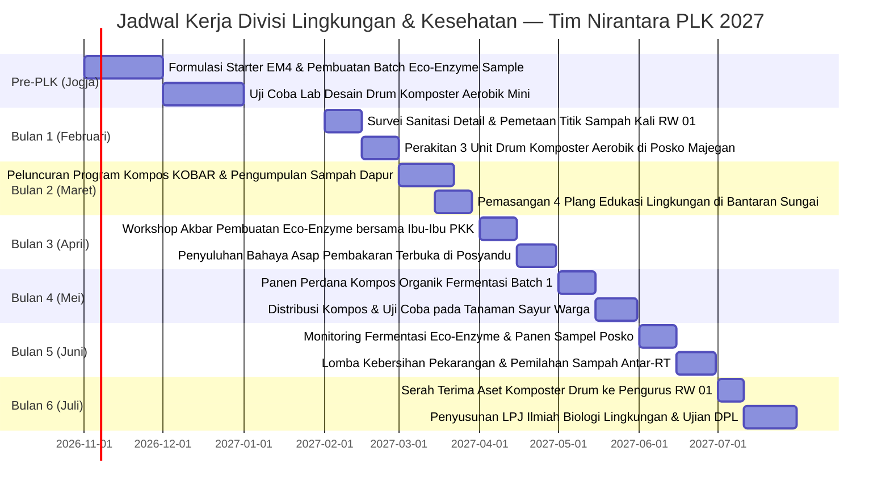

# 🌿 Analisis Ilmiah & Rencana Program Kerja — Divisi Lingkungan Hidup & Kesehatan Komunitas

> **Unit Kerja**: Divisi Lingkungan & Kesehatan — Tim PLK UNY Mengabdi NIRANTARA 2027  
> **Basis Akademik**: Program Studi Biologi, Fakultas Matematika dan Ilmu Pengetahuan Alam (FMIPA)  
> **Koordinator**: Intan Milansari, S.Si. (Cand.) — NIM: `24030830059`  
> **Anggota & Bendahara 2**: Zalfa Khoirunnisa, S.Si. (Cand.) — NIM: `24030830068`  
> **Lokasi Sasaran**: Area Pemukiman Warga RW 01 Dukuh Majegan, Bantaran Sungai/Kali, Lahan Pertanian Sawah, dan Kader Posyandu/PKK Desa Wonosari, Trucuk, Klaten.

---

## 🔬 1. Landasan Teori & Kerangka Ekologi-Kesehatan

Program kerja Divisi Lingkungan & Kesehatan dirancang berdasarkan paradigma **One Health** (*World Health Organization*, 2021) yang menyatakan bahwa kesehatan manusia, kesehatan hewan ternak, dan integritas ekosistem lingkungan hidup saling terikat secara tak terpisahkan. Pendekatan ini dipadukan dengan prinsip **Circular Economy** (*Ellen MacArthur Foundation*) dan bioteknologi tepat guna perdesaan (*Rural Appropriate Biotechnology*).

```
                      [PARADIGMA ONE HEALTH]
                                │
        ┌───────────────────────┴───────────────────────┐
        ▼                                               ▼
┌──────────────────────────────┐        ┌──────────────────────────────┐
│  Ekologi & Lingkungan Hidup  │        │   Kesehatan Masyarakat Desa  │
│  • Residu limbah organik     │◄──────►│   • Reduksi ISPA akibat asap │
│  • Polusi pembakaran sampah  │        │   • Sanitasi air bersih kali │
│  • Degradasi hara tanah      │        │   • Vektor nyamuk & lalat    │
└──────────────┬───────────────┘        └──────────────┬───────────────┘
               │                                       │
               └───────────────────┬───────────────────┘
                                   │
                                   ▼
             ┌───────────────────────────────────────────┐
             │       Intervensi Biologi Terapan          │
             │  • Kompos Aerobik Fermentasi EM4          │
             │  • Fermentasi Eco-Enzyme Kulit Buah       │
             │  • Kampanye Stop Pembakaran Terbuka       │
             └───────────────────────────────────────────┘
```

---

## 📊 2. Matriks Temuan Empiris Lapangan (Survei 24 Oktober 2026)

Berdasarkan hasil observasi fisik lingkungan dukuh, penelusuran bantaran kali, dan wawancara dengan Ketua RW 01 Bapak Ramelan, teridentifikasi kondisi lingkungan dan kesehatan warga sebagai berikut:

| No | Parameter Observasi | Fakta Lapangan (Kondisi Eksisting) | Kesenjangan (Gap Analysis) | Dampak terhadap Lingkungan & Warga |
|:--:|---|---|---|---|
| **1** | **Pengelolaan Sampah Rumah Tangga** | Tidak ada armada pengangkutan sampah dari Dinas Lingkungan Hidup (DLH) Klaten ke RW 01 Majegan. Mayoritas warga membuang sampah ke pekarangan belakang atau bantaran sungai, lalu **membakarnya secara terbuka (*open burning*)** pada sore hari. | Ketiadaan sistem tata kelola sampah terpadu (*zero waste system*) dan pemilahan organik-anorganik sejak dari dapur. | Asap pekat pembakaran plastik/daun memicu batuk, alergi pernapasan, dan risiko infeksi saluran pernapasan akut (ISPA); abu sisa pembakaran mencemari tanah. |
| **2** | **Pencemaran Aliran Sungai / Kali** | Di pinggiran aliran sungai kecil dekat area posko dan sawah, ditemukan tumpukan kantong kresek sampah plastik domestik yang dibuang warga dan menyumbat pintu air irigasi. | Rendahnya kesadaran ekologis dan ketiadaan tempat penampungan sampah sementara (TPS) yang layak. | Risiko pendangkalan kali, bau menyengat di musim kemarau, dan sarang nyamuk vektor demam berdarah (DBD). |
| **3** | **Potensi Limbah Organik & Pertanian** | Sisa kulit buah, sayuran rumah tangga, dan limbah jerami pascapanen melimpah ruah, namun 100% langsung dibuang atau dibakar di tengah sawah. | Ketiadaan transfer teknologi biokonversi limbah biomassa menjadi pupuk kompos organik bernilai ekonomis. | Kehilangan potensi nutrisi alami tanah; petani ketergantungan pada pupuk kimia urea/NPK sintetis yang mahal dan langka. |
| **4** | **Kebutuhan Sanitasi & Pembersih Rumah** | Posko dan rumah warga mengandalkan bahan pembersih kimia komersial (karbol/detergen sintetis) yang air limbahnya langsung meresap ke tanah dekat sumur air gali. | Belum adanya pemanfaatan disinfektan/pembersih lantai organik alami hasil fermentasi (*eco-enzyme*). | Residu bahan kimia sintetis berpotensi mencemari kualitas air tanah sumur dangkal warga. |

---

## 🔍 3. Analisis Akar Masalah (The 5 Whys Root Cause Analysis)

### Kasus A: Tradisi Pembakaran Sampah Terbuka (*Open Burning*) di Pekarangan
1. **Why 1**: Mengapa warga RW 01 Dukuh Majegan membakar sampah di pekarangan dan pinggir kali setiap sore?  
   *➔ Karena sampah rumah tangga menumpuk dan tidak ada tempat lain untuk membuangnya.*
2. **Why 2**: Mengapa tidak ada tempat pembuangan sampah resmi?  
   *➔ Karena truk pengangkut sampah DLH Kabupaten Klaten tidak menjangkau rute perkampungan dalam Dukuh Majegan (hanya menjangkau jalan raya utama kecamatan).*
3. **Why 3**: Mengapa desa tidak menyediakan Tempat Pengelolaan Sampah Terpadu (TPST/TPS3R)?  
   *➔ Karena keterbatasan lahan desa dan tingginya biaya investasi pengadaan mesin pencacah serta armada tosa desa.*
4. **Why 4**: Mengapa warga memilih jalan pintas membakarnya daripada mengubur/mengomposkannya?  
   *➔ Karena membakar dianggap cara tercepat, termudah, dan memusnahkan tumpukan sampah dalam hitungan menit tanpa mengeluarkan biaya.*
5. **Why 5 (Root Cause)**: Mengapa warga tidak menyadari bahaya asap racun pembakaran plastik (dioksin & furan)?  
   *➔ **Akar Masalah**: Kebiasaan kultural turun-temurun (*cultural inertia*) yang menganggap asap pembakaran sampah sebagai hal lumrah, diperparah ketiadaan edukasi biologis-kesehatan tentang bahaya karsinogenik dioksin dan minimnya keterampilan memisahkan sampah organik dapur untuk difermentasi secara bersih tanpa bau.*

---

### Kasus B: Ketergantungan Pupuk Kimia & Kelangkaan Pupuk Sawah
1. **Why 1**: Mengapa para petani di Wonosari mengeluhkan kelangkaan dan mahalnya pupuk urea/NPK?  
   *➔ Karena kuota pupuk subsidi dari pemerintah terbatas dan penyalurannya sering terlambat saat musim tanam tiba.*
2. **Why 2**: Mengapa petani sangat bergantung pada pupuk kimia subsidi?  
   *➔ Karena kondisi struktur tanah sawah sudah rusak dan jenuh hara akibat pemakaian pupuk kimia sintetis berlebihan selama puluhan tahun.*
3. **Why 3**: Mengapa petani tidak menggunakan pupuk kompos organik buatan sendiri?  
   *➔ Karena petani menganggap pembuatan pupuk kompos memakan waktu lama (berbulan-bulan), berbau busuk, dan ribet proses pembalikannya.*
4. **Why 4**: Mengapa ada anggapan bahwa kompos berbau busuk dan prosesnya lama?  
   *➔ Karena mereka belum pernah mempraktikkan bioteknologi starter mikroorganisme anaerob/aerob modern (seperti aktivator EM4 dan fermentasi sistem Takakura/drum tertutup) yang mampu mematangkan kompos dalam 2–3 minggu tanpa menimbulkan bau busuk.*
5. **Why 5 (Root Cause)**: Mengapa bioteknologi fermentasi EM4 tidak diadopsi secara luas?  
   *➔ **Akar Masalah**: Ketiadaan jembatan sains terapan (*applied science extension*) dari perguruan tinggi ke kelompok tani desa untuk mendemonstrasikan bahwa sampah organik rumah tangga dan kotoran ternak di sekitar kandang dapat diolah menjadi pupuk hayati cair dan padat secara sangat mudah, murah, dan higienis.*

---

## 🌐 4. Kajian Multidimensi Terpadu (Bio-Sosio-Ekologis)

```
                    ┌───────────────────────────────┐
                    │ Intervensi Biologi & Kesehatan│
                    │    Desa Wonosari, Klaten      │
                    └───────────────┬───────────────┘
                                    │
     ┌──────────────────────────────┼──────────────────────────────┐
     ▼                              ▼                              ▼
┌──────────────┐             ┌──────────────┐               ┌──────────────┐
│ Aspek Manusia│             │Aspek Fungsional│             │Aspek Budaya, │
│ & Kebiasaan  │             │& Mikrobiologi │              │Sosial & Norma│
└──────────────┘             └──────────────┘               └──────────────┘
```

### 1. Aspek Manusia & Kebiasaan Hidup (Behavioral Ecology)
- **Karakteristik Ibu Rumah Tangga**: Ibu-ibu pengelola dapur memiliki rutinitas memasak pagi dan siang hari. Mereka enggan mengolah sampah jika metodenya rumit atau mengotori lantai dapur.
- **Strategi Pendekatan**: Memperkenalkan **Komposter Ember Tumpuk Sederhana** atau botol galon bekas fermentasi *Eco-Enzyme* yang diletakkan rapi di samping wastafel/halaman samping. Setiap sisa kupasan sayur/kulit buah langsung dimasukkan tanpa bau menyengat karena aromanya justru wangi asam segar fermentasi buah.

### 2. Aspek Teknologi & Mikrobiologi Tepat Guna (Biological Feasibility)
- **Formulasi Starter**: Menggunakan bakteri pengurai alami *Effective Microorganisms-4 (EM4)* pertanian dan ragi/molase (tetes tebu) yang mudah dibeli di toko tani Trucuk dengan harga murah (Rp 25.000,- per liter botol bisa untuk puluhan drum kompos).
- **Rasio Fermentasi Eco-Enzyme**: Menggunakan rasio emas standar biologis **1 : 3 : 10** (1 Bagian Gula Merah/Molase : 3 Bagian Kulit Buah Segar : 10 Bagian Air Sumur Jernih) yang difermentasi selama minimal 90 hari dalam wadah plastik kedap udara dengan katup pelepas gas.

### 3. Aspek Lingkungan & Ekologi Tanah (Ecosystem Resilience)
- **Konservasi Sawah**: Penambahan bahan organik kompos mengembalikan populasi cacing tanah (*Lumbricus rubellus*) dan mikoriza alami, meningkatkan daya ikat air tanah (*water holding capacity*) sawah saat kemarau, dan mengurangi limpasan residu kimia ke air tanah.

### 4. Aspek Sosial & Komunitas Ibu-Ibu (Social Infrastructure)
- **Basis Penggerak PKK & Posyandu**: Organisasi PKK RW 01 Dukuh Majegan sangat aktif berkumpul setiap bulan. Kelompok dasawisma adalah kanal terkuat untuk mendiseminasikan keterampilan pembuatan eco-enzyme dan pemilahan sampah.
- **Strategi Pendekatan**: Menjadikan kader PKK sebagai "Duta Lingkungan Bersih Nirantara". Mengadakan lomba mini antar-RT dalam menghasilkan botol eco-enzyme terbersih dengan hadiah bibit tanaman sayuran.

### 5. Aspek Budaya, Norma, & Filosofi Jawa (Cultural Harmony)
- **Falsafah *Memayu Hayuning Bawana***: Masyarakat perdesaan Jawa memegang prinsip luhur menjaga keselarasan alam semesta. Pembakaran sampah yang merusak udara dan pengotoran sungai pada dasarnya bertentangan dengan falsafah adiluhung ini.
- **Strategi Pendekatan**: Mengemas kampanye lingkungan tidak dengan nada menggurui atau menyalahkan kebiasaan warga, melainkan dengan mengangkat kembali nilai luhur *"Sedekah Bumi"*—bahwa mengembalikan sisa tanaman ke tanah sebagai kompos adalah wujud syukur atas rezeki hasil bumi Wonosari.

---

## 🎯 5. Rumusan Rencana Program Kerja (Proker) Unggulan

### Proker 1: Pelatihan Pembuatan Kompos Organik Fermentasi (Komposter Drum Aerobik)
- **Nama Program**: *Kompos Berkah Wonosari (KOBAR)*
- **Tujuan**: Mengolah minimal 300 kg limbah organik daun, jerami, dan sisa dapur menjadi pupuk kompos organik matang kaya hara makro (N, P, K) untuk pekarangan dan sawah warga.
- **Metode Pelaksanaan**:
  1. Pengadaan dan perakitan 3 unit percontohan **Drum Komposter Aerobik Berpori** yang ditempatkan di Posko Majegan, Balai Pertemuan RW 01, dan salah satu pekarangan warga.
  2. Demonstrasi pencampuran bahan: sisa organik hijau (sampah dapur/jerami) + sisa cokelat (serbuk gergaji mebel/sekam) + larutan bioaktivator EM4 + molase.
  3. Monitoring suhu termofilik (45–60°C) pada minggu ke-1 hingga penurunan suhu stabil dan aroma berbau tanah hutan (minggu ke-3).
  4. Pengemasan pupuk kompos matang dalam kantong berlabel tim Nirantara dan dibagikan gratis kepada warga penggiat tanaman hias dan sayuran pekarangan.
- **Indikator Keberhasilan (KPI SMART)**:
  * Terpasangnya 3 unit instalasi drum komposter aerobik fungsional di Dukuh Majegan.
  * Menghasilkan sedikitnya 150 kg pupuk kompos organik siap pakai beraroma tanah subur.
  * Minimal 25 warga memahami proses biologis pengomposan tanpa menimbulkan bau busuk dan belatung.

---

### Proker 2: Workshop Produksi Eco-Enzyme Multiguna Bersama Ibu-Ibu PKK
- **Nama Program**: *Ibu Cerdas Eco-Enzyme Majegan (ICEM)*
- **Tujuan**: Mengedukasi sedikitnya 30 ibu rumah tangga dan kader PKK RW 01 dalam memanfaatkan kulit buah (jeruk, nanas, pepaya, semangka) menjadi cairan pembersih serbaguna dan desinfektan alami.
- **Metode Pelaksanaan**:
  1. Sosialisasi manfaat eco-enzyme untuk pembersih lantai, sabun cuci piring alami, pupuk daun cair, dan pengurang bau selokan.
  2. Praktik langsung (*hands-on workshop*) mencampur bahan dengan perbandingan 1:3:10 dalam toples plastik kedap udara.
  3. Pembuatan label pencatatan tanggal fermentasi dan jadwal pembukaan gas pada 2 minggu pertama.
  4. Pembagian botol semprot (*spray bottle*) sampel eco-enzyme matang yang telah disiapkan tim Biologi dari Jogja untuk langsung dibuktikan manfaatnya di rumah masing-masing.
- **Indikator Keberhasilan (KPI SMART)**:
  * Minimal 30 peserta ibu-ibu PKK berhasil meracik 1 wadah eco-enzyme mandiri berkapasitas 5 liter.
  * 100% peserta mampu menjelaskan fungsi eco-enzyme sebagai pengganti cairan pembersih kimia lantai rumah tangga.

---

### Proker 3: Kampanye Edukasi Kesehatan Lingkungan & Gerakan Anti-Bakar Sampah (Anti-ISPA)
- **Nama Program**: *Majegan Sehat Bebas Asap (MASSA)*
- **Tujuan**: Menurunkan frekuensi pembakaran sampah terbuka di pekarangan RW 01 dan meningkatkan pemahaman warga mengenai risiko karsinogenik asap plastik terhadap lansia dan balita.
- **Metode Pelaksanaan**:
  1. Pemasangan 4 plang papan edukasi permanen berbahan kayu mebel lokal di titik-titik rawan pembuangan sampah liar pinggir kali (*"Sungai Bukan Tempat Sampah: Jaga Warisan Air Anak Cucu"*).
  2. Kolaborasi penyuluhan kesehatan bersama Bidan Desa / Kader Posyandu mengenai pencegahan penyakit Infeksi Saluran Pernapasan Akut (ISPA) dan pola hidup bersih sehat (PHBS).
  3. Penyediaan kantong pemilah sampah anorganik (botol kaca, kardus, plastik keras) yang dapat disalurkan ke bank sampah / pengepul rosok terdekat.
- **Indikator Keberhasilan (KPI SMART)**:
  * Terpasangnya 4 plang himbauan edukatif permanen di bantaran kali dan gang utama dukuh.
  * Penurunan titik pembakaran sampah terbuka di pemukiman RW 01 sebesar minimal 40% pada bulan ke-4 pelaksanaan PLK.

---

## 📅 6. Jadwal Pelaksanaan Program Kerja (Gantt Chart 6 Bulan)



---

## 💰 7. Rencana Anggaran Biaya (RAB) Divisi Lingkungan & Kesehatan

| No | Item Pengeluaran | Volume | Harga Satuan (Rp) | Total Biaya (Rp) | Sumber Dana |
|:--:|---|:---:|:---:|:---:|:---|
| 1 | Pengadaan Drum Plastik Bekas 100L Berpenutup untuk Komposter | 3 Unit | Rp 110.000,- | Rp 330.000,- | Kas Tim Nirantara |
| 2 | Pembelian Bioaktivator EM4 Pertanian & Molase Tetes Tebu | 4 Botol | Rp 30.000,- | Rp 120.000,- | Kas Tim Nirantara |
| 3 | Pengadaan Toples Plastik Fermentasi Eco-Enzyme 5 Liter untuk PKK | 10 Buah | Rp 18.000,- | Rp 180.000,- | Kas Tim / Sponsorship |
| 4 | Pembuatan Papan Plang Himbauan Kayu Cat Tahan Hujan | 4 Buah | Rp 35.000,- | Rp 140.000,- | Kas Tim Nirantara |
| 5 | Gula Merah Tebu Asli untuk Praktik Fermentasi Eco-Enzyme (5 kg) | 5 Kg | Rp 18.000,- | Rp 90.000,- | Kas Tim Nirantara |
| 6 | Pengadaan Botol Semprot (Spray Bottle) 250ml untuk Sampel Warga | 20 Buah | Rp 6.000,- | Rp 120.000,- | Kas Tim Nirantara |
| **TOTAL** | **Rencana Anggaran Divisi Lingkungan & Kesehatan** | | | **Rp 980.000,-** | *(Telah Tercover di RAB Induk)* |

---

## 🛡️ 8. Matriks Manajemen Risiko & Rencana Keberlanjutan (Sustainability)

| Potensi Risiko | Tingkat Risiko | Dampak | Tindakan Mitigasi Preventif | Penanggung Jawab |
|---|:---:|---|---|---|
| Fermentasi kompos menimbulkan belatung/lalat karena aerasi kurang baik | Sedang | Warga merasa jijik dan program terhenti | Menjaga rasio C/N seimbang dengan menambahkan serbuk gergaji mebel/sekam dan memastikan pipa ventilasi udara drum tertutup kawat kasa nyamuk | Intan Milansari |
| Wadah toples eco-enzyme meledak akibat akumulasi gas fermentasi | Sedang | Wadah pecah dan cairan tumpah | Wajib menggunakan wadah plastik fleksibel (jangan kaca) dan melatih ibu-ibu membuka tutup toples selama 5 detik setiap hari pada 2 minggu pertama | Zalfa Khoirunnisa |
| Warga tetap membakar sampah plastik sembunyi-sembunyi di malam hari | Tinggi | Polusi asap berlanjut | Mengaktifkan bank sampah plastik pedukuhan yang bekerja sama dengan pengepul rosok lokal sehingga sampah anorganik memiliki nilai rupiah bagi warga | Intan & Zalfa |

---

← [[Dashboard Eksekusi PLK]] | [[Matriks Analisis Ilmiah & Integrasi Proker]] | [[Home]]
