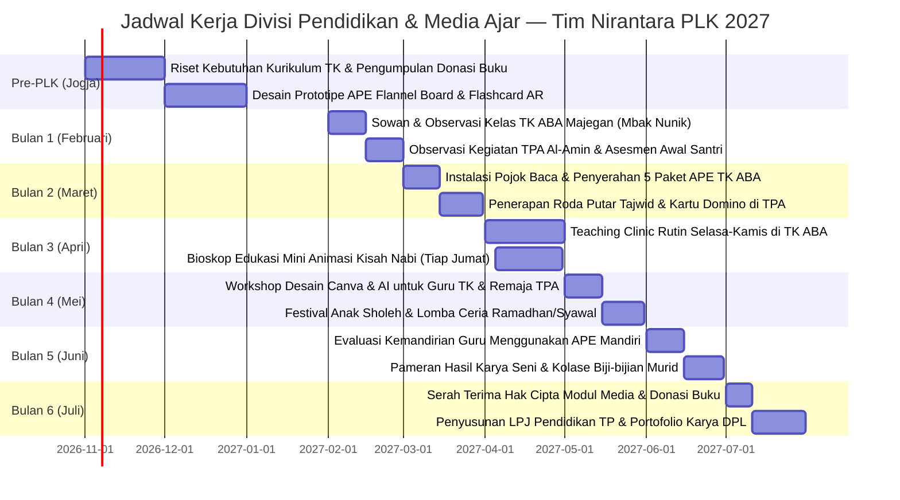

# 📚 Analisis Ilmiah & Rencana Program Kerja — Divisi Pendidikan & Inovasi Media Pembelajaran

> **Unit Kerja**: Divisi Pendidikan & Media Ajar — Tim PLK UNY Mengabdi NIRANTARA 2027  
> **Basis Akademik**: Program Studi Teknologi Pendidikan (TP), Fakultas Ilmu Pendidikan dan Psikologi (FIP)  
> **Koordinator**: Alvina Aulia Az Zahra, S.Pd. (Cand.) — NIM: `24010530018`  
> **Anggota & Perkap 2**: Krissandra Siagian, S.Pd. (Cand.) — NIM: `24010530004`  
> **Lokasi Sasaran**: TK ABA Majegan (Kepala Sekolah/Guru: Mbak Nunik, ±15 murid), TPA Masjid Al-Amin Dukuh Majegan, serta Pendidik PAUD & Pemuda Remaja Masjid Desa Wonosari, Trucuk, Klaten.

---

## 🔬 1. Landasan Teori & Kerangka Desain Pembelajaran (Instructional Design)

Penyusunan intervensi pedagogis Divisi Pendidikan mengadopsi model desain instruksional **ADDIE (*Analysis, Design, Development, Implementation, Evaluation*)** (*Branch, 2009*) yang dipadukan dengan **Teori Perkembangan Kognitif Jean Piaget** (khususnya tahap pra-operasional usia 2–7 tahun pada anak TK) dan prinsip **Gamifikasi Edukatif (*Educational Gamification*)**. 

Dalam konteks pendidikan non-formal perdesaan, stimulasi belajar anak sangat memerlukan media konkret multisensori (*Cone of Experience - Edgar Dale*) agar transmisi materi ajar (literasi dasar, motorik halus, adab, dan huruf hijaiyah) dapat dipahami secara menyenangkan tanpa beban psikologis kebosanan (*learning fatigue*).

```
        [Tahap Analisis (Analysis)]
        Survei 24 Okt 2026: TK ABA Majegan & TPA Masjid Al-Amin
                     │
                     ▼
        [Tahap Perancangan (Design)]
        Desain Kurikulum Interaktif, Flashcard & Gamifikasi Hijaiyah
                     │
                     ▼
        [Tahap Pengembangan (Development)]
        Produksi Alat Peraga Edukatif (APE), Big Book Flannel & Modul Canva
                     │
                     ▼
        [Tahap Penerapan (Implementation)]
        Teaching Clinic Mingguan di TK ABA & Kelas Kreatif Sore di TPA
                     │
                     ▼
        [Tahap Evaluasi (Evaluation)]
        Asesmen Motorik/Kognitif Anak & Pelatihan Mandiri Guru TK/Ustadz TPA
```

---

## 📊 2. Matriks Temuan Empiris Lapangan (Survei 24 Oktober 2026)

Berdasarkan hasil audiensi lapangan dengan pengurus dukuh, observasi fisik gedung TK ABA Majegan, dan wawancara dengan pengelola sekolah (Mbak Nunik) serta Takmir Masjid Al-Amin:

| No | Parameter Observasi | Fakta Lapangan (Kondisi Eksisting) | Kesenjangan (Gap Analysis) | Dampak terhadap Anak Didik & Guru |
|:--:|---|---|---|---|
| **1** | **Sarana Belajar TK ABA Majegan** | Memiliki ±15 murid usia 4–6 tahun. Kondisi ruang kelas bersih namun minim Alat Peraga Edukatif (APE) modern. Media ajar didominasi buku gambar kertas fotokopian dan majalah lama. | Ketiadaan media ajar manipulatif multisensori (perabaan, visual interaktif, motorik halus) yang merangsang kecerdasan kinestetik anak. | Minat konsentrasi anak cepat buyar; stimulasi daya imajinasi anak usia dini kurang optimal dibandingkan standar PAUD kota. |
| **2** | **Kapasitas TIK Pengajar PAUD/TK** | Guru TK (Mbak Nunik dan rekan) sangat berdedikasi namun belum terbiasa merancang lembar kerja anak berbasis digital grafis (Canva for Education) maupun pemanfaatan audio-visual tematik. | Keterbatasan keterampilan perancangan media instruksional berbasis teknologi ramah pemula (*instructional media authoring*). | Waktu guru tersita untuk menggambar pola manual; variasi tema mingguan terbatas dan repetitif. |
| **3** | **Proses Belajar Santri TPA Masjid Al-Amin** | Santri belajar mengaji setiap sore (ba'da ashar/maghrib) berjumlah sekitar 20–25 anak. Metode belajar masih konvensional sorogan/iqro satu per satu, santri yang menunggu giliran sering berlarian dan ribut di dalam masjid. | Ketiadaan media transisi yang terstruktur (animasi kisah 25 nabi, kartu tajwid gamifikasi, dan kuis islami interaktif). | Tingkat retensi hafalan doa dan tajwid rendah; anak merasa jenuh mengaji karena suasana kelas pasif dan monoton. |
| **4** | **Pojok Baca & Literasi Anak Dukuh** | Tidak tersedia sudut baca (*reading corner*) anak di lingkungan posko maupun balai RT. Buku cerita bergambar anak sangat langka ditemukan di rumah warga. | Ketiadaan akses terhadap bahan bacaan literasi anak berkualitas yang menanamkan budaya gemar membaca sejak dini. | Ketergantungan tinggi anak-anak usia SD/TK pada gawai/smartphone orang tua untuk bermain game online pasif tanpa nilai edukasi. |

---

## 🔍 3. Analisis Akar Masalah (The 5 Whys Root Cause Analysis)

### Kasus A: Keterbatasan Media Ajar Interaktif di TK ABA Majegan
1. **Why 1**: Mengapa proses belajar di TK ABA Majegan masih mengandalkan media kertas konvensional dan buku gambar usang?  
   *➔ Karena sekolah tidak memiliki persediaan Alat Peraga Edukatif (APE) baru.*
2. **Why 2**: Mengapa sekolah tidak membeli APE modern atau permainan sensori baru?  
   *➔ Karena anggaran operasional sekolah (BOP PAUD) sangat terbatas dan diprioritaskan untuk honor guru serta operasional listrik gedung.*
3. **Why 3**: Mengapa guru tidak memproduksi media ajar kreatif sendiri dari bahan limbah/sederhana di sekitar desa?  
   *➔ Karena guru tidak memiliki panduan modul dan waktu luang untuk meriset model pembuatan media ajar mandiri.*
4. **Why 4**: Mengapa guru kekurangan referensi desain media pembelajaran kreatif?  
   *➔ Karena guru TK di pedukuhan jarang diikutsertakan dalam pelatihan pembuatan media pembelajaran berbasis kurikulum merdeka oleh gugus PAUD kecamatan.*
5. **Why 5 (Root Cause)**: Mengapa pelatihan inovasi media ajar jarang menyentuh pendidik TK pedukuhan?  
   *➔ **Akar Masalah**: Kesenjangan distribusi pelatihan profesional guru (*teacher professional development*) antara sekolah perkotaan dan desa pedukuhan, serta ketiadaan kolaborasi pentahelix antara mahasiswa teknologi pendidikan dengan sekolah PAUD lokal.*

---

### Kasus B: Suasana Belajar Monoton & Kejenuhan Santri di TPA Al-Amin
1. **Why 1**: Mengapa santri TPA Masjid Al-Amin sering gaduh dan kurang antusias saat menunggu giliran mengaji?  
   *➔ Karena tidak ada kegiatan selingan edukatif yang terstruktur saat mereka menunggu antrean sorogan Iqro.*
2. **Why 2**: Mengapa tidak ada aktivitas selingan yang menarik?  
   *➔ Karena ustadz dan ustadzah pengajar TPA berjuang sendirian tanpa asisten dan hanya fokus menyimak bacaan satu anak di meja depan.*
3. **Why 3**: Mengapa ustadz/ustadzah tidak membagi kelas dengan media kelompok (seperti kartu kuis atau proyektor video)?  
   *➔ Karena TPA Al-Amin tidak memiliki perlengkapan media visual dan materi ajar multimedia keagamaan yang siap putar.*
4. **Why 4**: Mengapa materi multimedia belum pernah diterapkan di TPA Al-Amin?  
   *➔ Karena remaja masjid setempat belum pernah dilatih untuk menjadi fasilitator media ajar islami berbasis teknologi digital.*
5. **Why 5 (Root Cause)**: Mengapa remaja masjid belum diberdayakan dalam teknologi pendidikan TPA?  
   *➔ **Akar Masalah**: Manajemen pengajaran TPA masih berjalan secara alamiah tanpa desain kurikulum instruksional terpadu (*instructional system design*), sehingga potensi perangkat multimedia belum terintegrasi ke dalam kurikulum TPA pedukuhan.*

---

## 🌐 4. Kajian Multidimensi Terpadu (Pedagogis-Sosio-Kultural)

```
                    ┌───────────────────────────────┐
                    │ Intervensi Teknologi Edukasi  │
                    │    Desa Wonosari, Klaten      │
                    └───────────────┬───────────────┘
                                    │
     ┌──────────────────────────────┼──────────────────────────────┐
     ▼                              ▼                              ▼
┌──────────────┐             ┌──────────────┐               ┌──────────────┐
│ Aspek Anak & │             │Aspek Perangkat│              │Aspek Norma,  │
│ Psikologi    │             │& Fasilitas   │               │Adab & Agama  │
└──────────────┘             └──────────────┘               └──────────────┘
```

### 1. Aspek Perkembangan Anak & Psikologi Belajar (Developmental Psychology)
- **Karakteristik Usia 4–10 Tahun**: Anak-anak Dukuh Majegan sangat energik, terbiasa bermain di luar rumah (halaman/sawah), dan memiliki rentang perhatian pendek (*short attention span* ±15–20 menit).
- **Strategi Pendekatan**: Menerapkan metode **Belajar Sambil Bermain (*Play-based Learning*)**. Memperkenalkan konsep huruf hijaiyah, angka, dan sains dasar melalui permainan fisik (Ular Tangga Raksasa Edukatif, Domino Angka Kayu, dan Papan Flanel Cerita).

### 2. Aspek Teknologi & Fasilitas Ruang (Instructional Technology)
- **Kondisi Ruangan**: Ruang kelas TK ABA dan serambi Masjid Al-Amin memiliki pencahayaan alami yang baik dan stopkontak listrik yang memadai.
- **Strategi Pendekatan**: Menggunakan **Proyektor Portabel Tim Nirantara** untuk menyajikan video animasi dongeng budi pekerti dan kisah nabi resolusi tinggi seminggu sekali, serta pemanfaatan tablet/laptop posko untuk pengenalan *coding unplugged* (pola logika tanpa layar) bagi anak-anak.

### 3. Aspek Lingkungan & Pemanfaatan Material Lokal (Eco-Pedagogy)
- **Bahan Alami Sekitar Desa**: Memanfaatkan limbah serbuk kayu mebel halus, daun kering, dan biji-bijian jagung/padi desa sebagai bahan kolase tekstur (*sensory bin*) untuk mengasah motorik halus anak TK secara gratis dan ramah lingkungan.

### 4. Aspek Sosial & Komunitas Orang Tua (Parental Engagement)
- **Budaya Menunggu Anak**: Ibu-ibu di Majegan terbiasa menunggui anak-anaknya di teras TK hingga jam pulang sekolah (pukul 07.30–10.00 WIB).
- **Strategi Pendekatan**: Mengubah waktu tunggu ibu-ibu menjadi **"Pojok Parenting Inspiratif"**, di mana tim Divisi TP berdiskusi ringan mengenai pendampingan belajar anak di rumah dan pembatasan durasi layar (*screen time*) smartphone anak.

### 5. Aspek Budaya, Norma, & Nilai Adab Islam (Normative & Islamic Values)
- **Kultur Santri & Unggah-Ungguh Jawa**: Menekankan adab sopan santun kepada guru/orang tua (*ta'dzim*), pembiasaan doa harian, adab sebelum masuk masjid, dan pelestarian lagu dolanan anak Jawa bernuansa akhlak mulia (seperti tembang dolanan *Gundhul-Gundhul Pacul* dan *Sluku-Sluku Bathok* yang dimaknai secara filosofis).

---

## 🎯 5. Rumusan Rencana Program Kerja (Proker) Unggulan

### Proker 1: Revitalisasi Media Ajar Interaktif & Pojok Sensori Literasi TK ABA Majegan
- **Nama Program**: *Taman Pintar Majegan (TAMPAN)*
- **Tujuan**: Menyediakan paket Media Pembelajaran Edukatif (APE) interaktif multisensori dan mendirikan Pojok Baca Anak Ramah Literasi di TK ABA Majegan.
- **Metode Pelaksanaan**:
  1. Pembuatan dan penyerahan 5 jenis APE tematik: **Papan Flanel Cerita (Flannel Board)**, **Puzzle Balok Kayu Geometri**, **Kartu Flashcard Beranimasi Augmented Reality (AR)**, **Sensory Bin Biji-bijian Desa**, dan **Ular Tangga Raksasa Karakter**.
  2. Penataan Sudut Baca (*Literacy Corner*) berkarpet empuk di ruang kelas TK ABA yang dilengkapi 30+ buku cerita bergambar anak sumbangan program donasi buku tim Nirantara.
  3. Program mengajar mingguan (*Teaching Clinic*) mendampingi Mbak Nunik setiap hari Selasa dan Kamis pagi dengan tema sains sederhana dan kreasi seni melipat/mewarnai.
- **Indikator Keberhasilan (KPI SMART)**:
  * Terpasangnya 1 Pojok Baca Ramah Anak aktif dengan minimal 30 eksemplar buku cerita bergambar layak baca.
  * Tersedianya 5 paket instrumen APE baru yang digunakan rutin dalam pembelajaran harian TK ABA.
  * Peningkatan skor antusiasme dan keterlibatan aktif 15 murid TK sebesar >80% pada lembar observasi partisipasi anak.

---

### Proker 2: Digitalisasi & Gamifikasi Pembelajaran Santri TPA Masjid Al-Amin
- **Nama Program**: *Santri Cerdas & Berakhlak Al-Amin (SABA)*
- **Tujuan**: Mentransformasi metode pembelajaran di TPA Masjid Al-Amin menjadi lebih dinamis, visual, dan menyenangkan melalui pemanfaatan media multimedia keagamaan.
- **Metode Pelaksanaan**:
  1. Pengadaan media **"Roda Putar Tajwid Interaktif"** dan **Kartu Domino Hijaiyah** untuk mengeliminasi kebosanan santri saat menunggu antrean sorogan mengaji.
  2. Penayangan bioskop edukasi mini islami (Animasi Kisah 25 Nabi dan Teladan Budi Pekerti Sahabat Rasul) setiap hari Jumat sore menggunakan proyektor tim posko.
  3. Pembuatan "Papan Bintang Prestasi Santri" untuk mencatat capaian hafalan surat pendek, doa harian, dan ketertiban sholat berjamaah secara visual dan transparan.
- **Indikator Keberhasilan (KPI SMART)**:
  * 100% dari 25 santri TPA Al-Amin terlibat aktif dalam aktivitas belajar berbasis gamifikasi.
  * Rata-rata hafalan surat pendek juz 30 dan doa harian santri meningkat minimal 3 surat/doa per santri selama masa PLK.

---

### Proker 3: Workshop Pembuatan Media Pembelajaran Interaktif Berbasis Canva & AI untuk Pendidik PAUD & Remaja Masjid
- **Nama Program**: *Guru Kreatif Era Digital Wonosari (GARDITA)*
- **Tujuan**: Melatih guru TK ABA Majegan, kader posyandu, dan ustadz/ustadzah muda TPA dalam merancang lembar kerja anak, poster dakwah, dan media presentasi menarik menggunakan Canva for Education dan alat bantu AI generator gambar secara gratis dan praktis.
- **Metode Pelaksanaan**: Workshop praktis 1 hari di serambi masjid/posko Majegan, pendampingan pembuatan 1 proyek media ajar mandiri per peserta, dan pembagian template siap edit.
- **Indikator Keberhasilan (KPI SMART)**:
  * Dihadiri oleh 100% tenaga pendidik TK ABA Majegan dan minimal 10 orang perwakilan remaja masjid pengajar TPA.
  * Setiap peserta menghasilkan minimal 1 portofolio media ajar digital (Lembar Kerja Anak / Poster Edukasi) yang langsung siap cetak dan dipakai.

---

## 📅 6. Jadwal Pelaksanaan Program Kerja (Gantt Chart 6 Bulan)



---

## 💰 7. Rencana Anggaran Biaya (RAB) Divisi Pendidikan & Media Ajar

| No | Item Pengeluaran | Volume | Harga Satuan (Rp) | Total Biaya (Rp) | Sumber Dana |
|:--:|---|:---:|:---:|:---:|:---|
| 1 | Pengadaan Bahan Baku Kain Flanel, Velcro, Busa Hati untuk APE | 1 Paket | Rp 160.000,- | Rp 160.000,- | Kas Tim Nirantara |
| 2 | Pengadaan Rak Buku Kayu Minimalis untuk Pojok Baca TK ABA | 1 Unit | Rp 180.000,- | Rp 180.000,- | Kas Tim / Donatur |
| 3 | Cetak Laminasi Kartu Flashcard AR, Domino Hijaiyah & Roda Tajwid | 5 Set | Rp 30.000,- | Rp 150.000,- | Kas Tim Nirantara |
| 4 | Pembuatan Ular Tangga Edukatif Raksasa Bahan Flexi Banner (2x2 Meter)| 1 Buah | Rp 80.000,- | Rp 80.000,- | Kas Tim Nirantara |
| 5 | ATK Kertas Origami, Krayon, Lem Kayu, dan Gunting Tumpul Ramah Anak| 1 Paket | Rp 110.000,- | Rp 110.000,- | Kas Tim Nirantara |
| 6 | Hadiah dan Sertifikat Apresiasi Festival Ceria Santri TPA Al-Amin | 25 Paket | Rp 8.000,- | Rp 200.000,- | Kas Tim / Sponsorship |
| **TOTAL** | **Rencana Anggaran Divisi Pendidikan & Media Ajar** | | | **Rp 880.000,-** | *(Telah Tercover di RAB Induk)* |

---

## 🛡️ 8. Matriks Manajemen Risiko & Rencana Keberlanjutan (Sustainability)

| Potensi Risiko | Tingkat Risiko | Dampak | Tindakan Mitigasi Preventif | Penanggung Jawab |
|---|:---:|---|---|---|
| APE kain flanel atau balok kayu cepat rusak/hilang tercecer dimainkan anak-anak | Sedang | Kelengkapan media berkurang | Menyediakan kotak kontainer plastik transparan bertutup (*storage box*) berlabel dan membuat SOP penyimpanan tertib bersama guru | Alvina Aulia (Vina) |
| Anak-anak TK merasa malu/takut saat pertama kali diajar oleh mahasiswa baru | Rendah | Partisipasi belajar rendah | Menerapkan sesi *Ice Breaking* bernyanyi bersama dan pembagian stiker apresiasi lucu di awal setiap pertemuan | Krissandra Siagian |
| Pengurus TPA kembali ke metode ceramah konvensional setelah tim PLK selesai | Tinggi | Media multimedia tidak terpakai | Melatih 2 pemuda remaja masjid setempat sebagai penanggung jawab inventaris media audio-visual dan menyerahkan flashdisk master arsip video animasi | Alvina & Sandra |

---

← [[Dashboard Eksekusi PLK]] | [[Matriks Analisis Ilmiah & Integrasi Proker]] | [[Home]]
