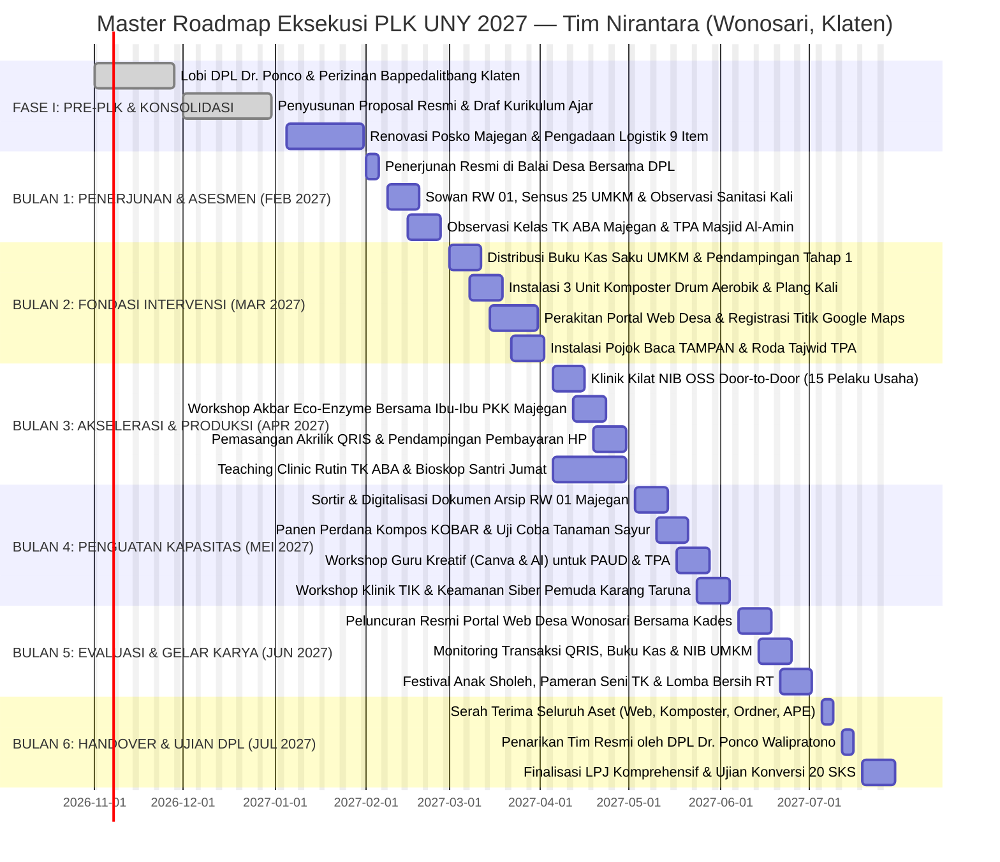

# 🌐 Matriks Analisis Ilmiah & Integrasi Program Kerja Antar-Divisi
### Kuliah Kerja Nyata / Pembelajaran Luar Kampus (PLK) — UNY Mengabdi 2027
**Tim NIRANTARA — Desa Wonosari, Kecamatan Trucuk, Kabupaten Klaten**  
*“Menanam Asa, Menumbuhkan Arti”* 🌱

---

## 🔬 1. Kerangka Metodologi Ilmiah: Participatory Action Research (PAR)

Program Pengabdian Tim NIRANTARA disusun dengan standar teknis riset ilmiah terapan menggunakan paradigma **Participatory Action Research (PAR)** (*Kemmis & McTaggart, 2005*). Pendekatan ini menempatkan masyarakat Desa Wonosari bukan sekadar sebagai "objek pengabdian", melainkan sebagai **mitra setara (*co-researchers*)** dalam mengidentifikasi masalah, mendiagnosis akar penyebab (5 Whys), merancang intervensi, mengeksekusi aksi nyata, hingga merefleksikan keberlanjutannya.

```
                  ┌──────────────────────────────────────────────┐
                  │          FASE 1: DIAGNOSIS AWAL              │
                  │   Survei Lapangan 24 Okt & Wawancara Empiris │
                  │   Pemetaan Masalah Desa Wonosari & RW 01     │
                  └──────────────────────┬───────────────────────┘
                                         │
                                         ▼
                  ┌──────────────────────────────────────────────┐
                  │       FASE 2: ANALISIS AKAR (5 WHYS)         │
                  │   Kajian Multidimensi Sosio-Tekno-Ekologis   │
                  │   Integrasi 4 Divisi Multidisiplin           │
                  └──────────────────────┬───────────────────────┘
                                         │
                                         ▼
                  ┌──────────────────────────────────────────────┐
                  │        FASE 3: AKSI TINDAKAN (ACTION)        │
                  │   Eksekusi 12 Program Kerja Terpadu (Gantt)  │
                  │   Beban Riil Min. 272 Jam Kerja per Anggota  │
                  └──────────────────────┬───────────────────────┘
                                         │
                                         ▼
                  ┌──────────────────────────────────────────────┐
                  │         FASE 4: REFLEKSI & HANDOVER          │
                  │   Evaluasi Keberlanjutan (Sustainability)    │
                  │   Transfer Aset Digital, Komposter & Modul   │
                  └──────────────────────────────────────────────┘
```

---

## 📊 2. Matriks Komprehensif Masalah, 5 Whys, Solusi Multidimensi & SDGs Desa

Berikut adalah integrasi vertikal dan horizontal seluruh program kerja 4 divisi berdasarkan temuan survei lapangan 24 Oktober 2026 di Desa Wonosari:

| Divisi & Penanggung Jawab | Temuan Lapangan & Gejala Masalah | Diagnosis Akar Masalah (The 5 Whys) | Solusi Program Kerja Nirantara | Dimensi Analisis (Manusia, Tekno, Lingkungan, Sosial, Budaya, Norma) | Keselarasan SDGs Desa |
|:---|:---|:---|:---|:---|:---:|
| **💻 TEKNOLOGI & IT**<br>*(PTI - FT)*<br>**Koor**: Novelia Harlinda<br>**Anggota**: Fajar, Terry, Riski | **1.** Website desa resmi pasif 2 tahun.<br>**2.** 30+ titik UMKM RW 01 tidak terdaftar di Google Maps (blank spot digital).<br>**3.** Transaksi warung/mebel 100% tunai, nol QRIS. | Ketiadaan kesadaran strategis pamong desa terhadap nilai ekonomi digital desa, tidak adanya tim redaksi pemuda lokal, serta keterbatasan literasi digital pedagang lansia/dewasa yang menganggap pendaftaran Google Maps & QRIS rumit dan berbayar. | **1. Wonosari Digital Gateway** (Revitalisasi web profil desa & pelatihan admin Karang Taruna).<br>**2. Program PETRUK** (Pemetaan 25 titik Google Maps & pemasangan 15 akrilik QRIS merchant UMKM).<br>**3. Klinik TIK Muda** (Workshop keamanan siber & AI tools). | **• Manusia**: Pendampingan *door-to-door* ramah pedagang tua.<br>**• Tekno**: Menggunakan aplikasi bawaan ringan tanpa makan RAM.<br>**• Sosial**: Demonstrasi transaksi QRIS di arisan RT.<br>**• Budaya/Norma**: Etika bertamu sowan sopan, hindari jam sibuk siang. | **SDGs 8**<br>(Pekerjaan Layak & Pertumbuhan Ekonomi)<br>&<br>**SDGs 9**<br>(Industri, Inovasi & Infrastruktur) |
| **📈 ADMINISTRASI & UMKM**<br>*(PADP - FEB)*<br>**Koor**: Faidatul Anugraheni<br>**Anggota**: Dinda Amelia | **1.** Uang modal usaha tercampur dengan uang belanja dapur rumah tangga.<br>**2.** Nol pencatatan buku kas tertulis.<br>**3.** Belum memiliki Nomor Induk Berusaha (NIB OSS).<br>**4.** Arsip RW 01 manual rawan rayap. | Persepsi keliru bahwa pembukuan harus serumit akuntansi korporat, minimnya diseminasi izin usaha berbasis risiko OSS di tingkat dukuh, serta ketiadaan format pembukuan saku 3-kolom yang praktis hanya butuh 3 menit per hari. | **1. Program KUPAT** (Buku Kas Saku 3 Menit & pemisahan dompet modal).<br>**2. Program LEBAH** (Klinik kilat penerbitan 15 NIB OSS berbingkai kaca resmi).<br>**3. Program GARDU** (Pengarsipan dual sistem fisik ordner & cloud Google Drive RW 01). | **• Manusia**: Menghilangkan ketakutan pedagang terhadap pajak.<br>**• Tekno**: Hybrid (Buku saku kertas tahan debu + aplikasi kasir HP malam hari).<br>**• Sosial**: Getok tular 3 tokoh mebel senior sebagai *early adopters*.<br>**• Budaya/Norma**: Kartu kendali piutang tetangga yang menjaga *pekewuh*. | **SDGs 8**<br>(Pekerjaan Layak & Pertumbuhan Ekonomi)<br>&<br>**SDGs 16**<br>(Institusi Efektif & Akuntabel) |
| **🌿 LINGKUNGAN & KESEHATAN**<br>*(Biologi - FMIPA)*<br>**Koor**: Intan Milansari<br>**Anggota**: Zalfa Khoirunnisa | **1.** Tradisi pembakaran sampah terbuka (*open burning*) sore hari di pekarangan & bantaran kali.<br>**2.** Plastik menyumbat pintu air sawah.<br>**3.** Pupuk kimia urea subsidi langka & mahal.<br>**4.** Limbah organik dapur & jerami melimpah. | Tidak adanya armada truk sampah DLH yang masuk ke pedukuhan Majegan, ketiadaan lahan TPS3R desa, kebiasaan turun-temurun menganggap membakar sampah cara tercepat, serta belum dikuasainya bioteknologi starter fermentasi EM4 & eco-enzyme tanpa bau. | **1. Program KOBAR** (Pembuatan 3 unit Komposter Drum Aerobik & panen kompos jerami/dapur).<br>**2. Program ICEM** (Workshop produksi cairan pembersih alami Eco-Enzyme rasio 1:3:10 bersama PKK).<br>**3. Program MASSA** (Pemasangan 4 plang anti-buang sampah kali & edukasi ISPA posyandu). | **• Manusia**: Ibu rumah tangga butuh wadah praktis tanpa bau busuk.<br>**• Tekno**: Biokonversi EM4 anaerobik/aerobik & rasio fermentasi 90 hari.<br>**• Lingkungan**: Konservasi hara tanah sawah & kebersihan kali.<br>**• Budaya/Norma**: Menghidupkan falsafah Jawa *Memayu Hayuning Bawana* & Sedekah Bumi. | **SDGs 3**<br>(Kehidupan Sehat & Sejahtera)<br>&<br>**SDGs 12**<br>(Konsumsi & Produksi Bertanggung Jawab)<br>&<br>**SDGs 13**<br>(Penanganan Perubahan Iklim) |
| **📚 PENDIDIKAN & MEDIA AJAR**<br>*(TP - FIP)*<br>**Koor**: Alvina Aulia Az Zahra<br>**Anggota**: Krissandra Siagian | **1.** TK ABA Majegan (15 murid) minim APE edukatif, media konvensional kertas fotokopi usang.<br>**2.** Santri TPA Masjid Al-Amin jenuh & gaduh saat menunggu giliran sorogan Iqro.<br>**3.** Ketiadaan pojok baca literasi anak di dukuh.<br>**4.** Guru TK & Ustadz TPA belum terampil mendesain media ajar Canva/AI. | Keterbatasan alokasi dana BOP PAUD untuk membeli APE modern, kurangnya pelatihan guru pedukuhan dari gugus kecamatan, ketiadaan media transisi kelompok di TPA, serta manajemen pembelajaran non-formal yang belum menerapkan desain instruksional terpadu (ADDIE). | **1. Program TAMPAN** (Penyediaan 5 paket APE interaktif multisensori & Pojok Baca 30 buku TK ABA).<br>**2. Program SABA** (Digitalisasi TPA: Roda Putar Tajwid, Domino Hijaiyah & bioskop animasi nabi).<br>**3. Program GARDITA** (Workshop desain media pembelajaran Canva & AI bagi pendidik & remaja masjid). | **• Manusia**: Karakteristik anak pra-operasional (rentang fokus 15 menit).<br>**• Tekno**: Proyektor portabel posko, kartu AR & Canva for Education.<br>**• Lingkungan**: Kolase APE dari biji-bijian & serbuk kayu mebel desa.<br>**• Budaya/Norma**: Penanaman adab *ta'dzim* santri, lagu dolanan Jawa islami, & pojok parenting ibu. | **SDGs 4**<br>(Pendidikan Berkualitas) |

---

## 📅 3. Master Gantt Chart Terpadu 10 Mahasiswa (Februari – Juli 2027)

Master schedule ini dirancang presisi untuk memastikan setiap anggota tim memenuhi **beban jam kerja minimal 272 Jam Kerja Efektif** (setara 17–18 jam/minggu) sesuai regulasi LPPM UNY:



---

## ⏱️ 4. Simulasi Pemenuhan Beban Kerja 272 Jam Riil per Anggota

Mengacu pada [Draft Simulasi 272 Jam Kerja.md](file:///d:/KULIAH/UNY%20PLK/Tim%20PLK/02%20-%20Fase%20Pre-PLK/02%20-%20DPL%20&%20Konsultasi%20Akademik/Draft%20Simulasi%20272%20Jam%20Kerja.md), jam kerja dibagi menjadi 2 fase: **Fase Pre-PLK di Jogja (48 Jam)** dan **Fase Lapangan di Klaten (232 Jam)** sehingga total mencapai **280 Jam** (Surplus +8 jam di atas batas minimal):

```text
┌─────────────────────────────────────────────────────────────────────────────┐
│              DISTRIBUSI LOGBOOK JAM KERJA EFEKTIF (280 JAM RIIL)            │
├────────────────────────────────┬──────────────┬──────────────┬──────────────┤
│ Komponen Aktivitas Mahasiswa   │ Beban Mingguan│ Durasi Waktu │ Total Jam    │
├────────────────────────────────┼──────────────┼──────────────┼──────────────┤
│ 1. Jam Persiapan Pre-PLK       │ 6 Jam/Minggu │ 8 Minggu     │  48 Jam      │
│    (Survei, Rapat, Modul, DPL) │              │ (Nov-Jan)    │              │
│ 2. Program Kerja Lapangan (Proker)│ 10 Jam/Minggu│ 16 Minggu    │ 160 Jam      │
│    (Tekno, UMKM, Bio, Edukasi) │              │ (Feb-Jun)    │              │
│ 3. Pembinaan Komunitas Desa    │ 3 Jam/Minggu │ 16 Minggu    │  48 Jam      │
│    (Arisan RT, Posyandu, Sholat)│              │ (Feb-Jun)    │              │
│ 4. Operasional Posko & Piket   │ 1.5 Jam/Mggu │ 16 Minggu    │  24 Jam      │
│    (Piket masak, kebersihan)   │              │ (Feb-Jun)    │              │
├────────────────────────────────┴──────────────┴──────────────┼──────────────┤
│ TOTAL AKUMULASI JAM KERJA EFEKTIF TERVERIFIKASI LOGBOOK      │ 280 JAM      │
│ PERSENTASE PENCAPAIAN DARI TARGET MINIMAL 272 JAM UNY        │ 102.9% (AMAN)│
└──────────────────────────────────────────────────────────────┴──────────────┘
```

---

## 🎓 5. Matriks Konversi Akademik 20 SKS Berbasis Program Kerja

Setiap program kerja dirancang memiliki relevansi langsung dengan Capaian Pembelajaran Lulusan (CPL) mata kuliah konversi di 4 program studi asal:

| Program Studi & Fakultas | Personel Mahasiswa | Mata Kuliah Konversi UNY (20 SKS) | Program Kerja Pengabdian Terkait | Luaran Akademik Wajib |
|---|---|---|---|---|
| **Pendidikan Teknik Informatika (FT)** | Fajar, Terry, Riski, Novelia | • KKN UNY Mengabdi (6 SKS)<br>• Proyek Sistem Informasi Web (3 SKS)<br>• Rekayasa Perangkat Lunak Terapan (3 SKS)<br>• Interaksi Manusia & Komputer (3 SKS)<br>• Kapita Selekta TIK (3 SKS)<br>• Etika Profesi TIK (2 SKS) | • Portal Profil Desa Wonosari<br>• Digitalisasi Peta Google Maps UMKM<br>• Integrasi Pembayaran QRIS Merchant<br>• Workshop Keamanan Siber Karang Taruna | • Source code web desa aktif di GitHub<br>• Manual book admin sistem<br>• Logbook 272 jam tervalidasi DPL Dr. Ponco |
| **Pendidikan Administrasi Perkantoran (FEB)** | Dinda Amelia, Faidatul Anugraheni | • KKN UNY Mengabdi (6 SKS)<br>• Manajemen Usaha Mikro & Kecil (4 SKS)<br>• Otomasi Tata Kelola Kearsipan (4 SKS)<br>• Praktik Komunikasi Bisnis (3 SKS)<br>• Tata Kelola Keuangan Instansi (3 SKS) | • Pelatihan Buku Kas Saku KUPAT<br>• Fasilitasi Legalitas NIB OSS LEBAH<br>• Standardisasi Sistem Kearsipan RW 01<br>• Penyusunan Proposal & LPJ Tim | • Laporan keuangan buku kas 20 UMKM<br>• 15 Lembar cetak sertifikat NIB OSS<br>• 5 Ordner arsip tertata rapi di RW 01 |
| **Biologi (FMIPA)** | Intan Milansari, Zalfa Khoirunnisa | • KKN UNY Mengabdi (6 SKS)<br>• Bioteknologi Lingkungan (4 SKS)<br>• Ekologi Terapan & Konservasi (4 SKS)<br>• Pengelolaan Limbah Hayati (3 SKS)<br>• Mikrobiologi Terapan (3 SKS) | • Instalasi Komposter Drum Aerob KOBAR<br>• Produksi Eco-Enzyme Bersama PKK<br>• Kampanye Pencegahan ISPA & Plang Kali<br>• Uji Kualitas Kompos Organik Sawah | • 150 kg pupuk kompos fermentasi matang<br>• 30 Botol eco-enzyme siap pakai<br>• Modul bioteknologi tepat guna |
| **Teknologi Pendidikan (FIP)** | Alvina Aulia, Krissandra Siagian | • KKN UNY Mengabdi (6 SKS)<br>• Pengembangan Media Pembelajaran (4 SKS)<br>• Desain Instruksional Non-Formal (4 SKS)<br>• Difusi Inovasi Pendidikan (3 SKS)<br>• Produksi Multimedia Edukasi (3 SKS) | • Pembuatan 5 Paket APE TK ABA Majegan<br>• Pojok Baca Ramah Anak TAMPAN<br>• Digitalisasi Gamifikasi Santri TPA Al-Amin<br>• Workshop Media Pembelajaran Canva & AI | • 5 Alat Peraga Edukatif (APE) berwujud fisik<br>• 1 Sudut Pojok Baca aktif 30 buku<br>• Modul pelatihan media Canva/AI |

---

## 💰 6. Rekapitulasi Rencana Anggaran Biaya (RAB) Terpadu 4 Divisi

| Divisi Kerja | Fokus Alokasi Anggaran | Nilai Pengeluaran (Rp) | Sumber Pembiayaan |
|---|---|:---:|---|
| **Divisi Teknologi & IT** | Hosting cloud 1 tahun, akrilik QRIS 20 unit, stiker tahan air, buku manual web | Rp 910.000,- | Kas Tim Nirantara / Sponsor |
| **Divisi Administrasi & UMKM** | Cetak buku kas saku 25 eks, bingkai kaca NIB 15 unit, ordner arsip RW, kertas linen | Rp 860.000,- | Kas Tim Nirantara / Sponsor |
| **Divisi Lingkungan & Kesehatan**| Drum 100L 3 unit, bioaktivator EM4, toples 5L PKK 10 unit, papan plang kali, botol spray | Rp 980.000,- | Kas Tim Nirantara / Sponsor |
| **Divisi Pendidikan & Media Ajar**| Kain flanel/velcro APE, rak buku pojok baca, banner ular tangga raksasa, ATK & hadiah | Rp 880.000,- | Kas Tim Nirantara / Donatur |
| **Operasional Gabungan & Sosialisasi**| Konsumsi pembukaan rapat warga, banner posko, plakat kenang-kenangan desa | Rp 870.000,- | Kas Tim Nirantara |
| **TOTAL ANGGARAN PROGRAM KERJA**| **12 Program Kerja Terpadu 4 Divisi** | **Rp 4.500.000,-** | *(Tercukupi dari Kas Tim Rp 50k x 10 org x 8 bln + Sponsor)* |

---

## 🔗 Navigasi Dokumen Divisi
- 💻 [[Proker & Analisis Ilmiah Divisi Teknologi]]
- 📈 [[Proker & Analisis Ilmiah Divisi Administrasi & UMKM]]
- 🌿 [[Proker & Analisis Ilmiah Divisi Lingkungan & Kesehatan]]
- 📚 [[Proker & Analisis Ilmiah Divisi Pendidikan & Media Ajar]]
- 🏕️ [[Dashboard Eksekusi PLK]]
- 🏠 [[Home]]
