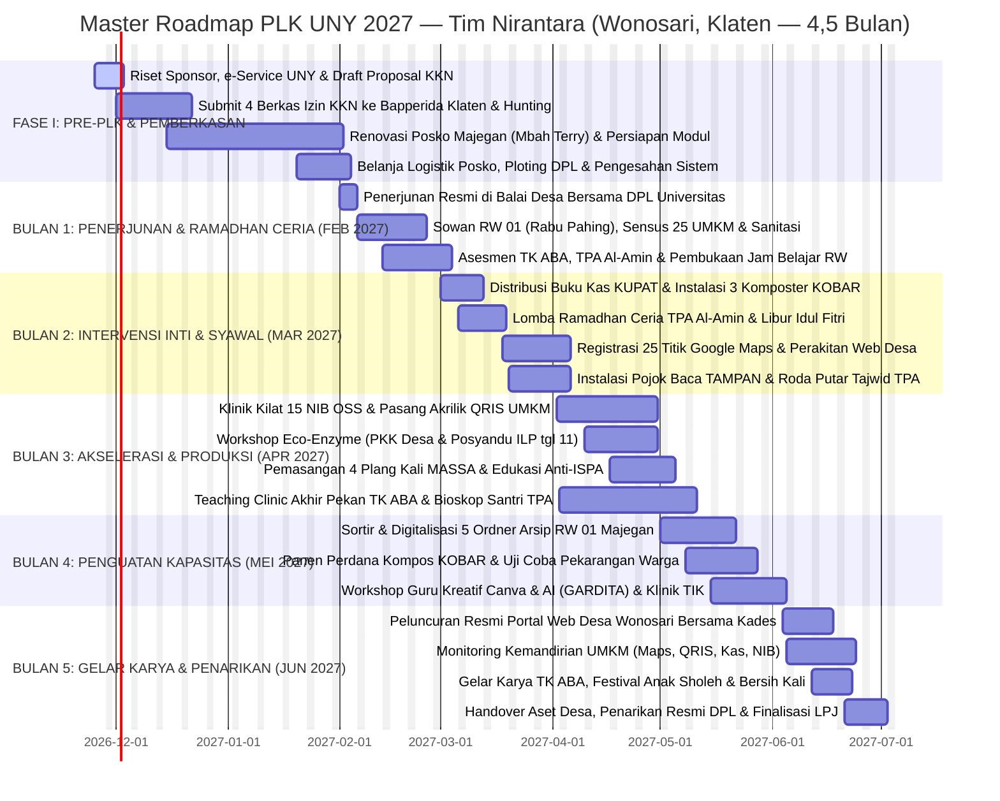

# 🌐 Matriks Analisis Ilmiah & Integrasi Program Kerja Antar-Divisi
### Kuliah Kerja Nyata / Pembelajaran Luar Kampus (PLK) — UNY Mengabdi 2027
**Tim NIRANTARA — RW 01 Dukuh Majegan, Desa Wonosari, Kecamatan Trucuk, Kabupaten Klaten**  
*“Menanam Asa, Menumbuhkan Arti”* 🌱

---

> [!NOTE]
> **Basis Data & Konteks Terkini (Per 25 November 2026):**
> - **Status Kelompok**: 1 Kelompok Mandiri (10 Mahasiswa dari 4 Fakultas: FT, FEB, FMIPA, FIP) — Sah sesuai Panduan PLK UNY 2025 (min. 1 – maks. 3 kelompok per kelurahan).
> - **Durasi & Pola Terjun**: **4,5 Bulan (Februari – Juni 2027)** dengan pola *Weekend Stay* (Jumat sore s.d. Minggu malam) + jadwal hari efektif/libur kuliah agar tidak mengganggu perkuliahan tatap muka Senin–Kamis di kampus.
> - **Posko Eksklusif**: Rumah keluarga Muhadzdzib Terry Al Fauzan di RT 03 Dukuh Majegan (100% eksklusif dihuni Tim Nirantara; WiFi 14 Mbps, sumur jernih, kanopi parkir 20 motor; renovasi posko Des 2026–Jan 2027).
> - **Perizinan & DPL**: Perizinan kabupaten melalui **Bapperida Kabupaten Klaten** (`siip.bappedaklt@gmail.com`); penentuan DPL resmi di-plot oleh Universitas/Unit KKN UNY (dengan **Dr. Ponco Walipratono, S.Pd.T., M.Pd.** sebagai target usulan tim).

---

## 🔬 1. Kerangka Metodologi Ilmiah: Participatory Action Research (PAR)

Program Pengabdian Tim NIRANTARA disusun dengan standar teknis riset ilmiah terapan menggunakan paradigma **Participatory Action Research (PAR)** (*Kemmis & McTaggart, 2005*). Pendekatan ini menempatkan masyarakat Desa Wonosari bukan sekadar sebagai "objek pengabdian", melainkan sebagai **mitra setara (*co-researchers*)** dalam mengidentifikasi masalah, mendiagnosis akar penyebab (5 Whys), merancang intervensi, mengeksekusi aksi nyata, hingga merefleksikan keberlanjutannya.

```
                  ┌──────────────────────────────────────────────┐
                  │          FASE 1: DIAGNOSIS AWAL              │
                  │   Survei Lapangan 24 Okt & Wawancara Empiris │
                  │   Audiensi Kades Adi & Ketua RW 01 Ramelan   │
                  └──────────────────────┬───────────────────────┘
                                         │
                                         ▼
                  ┌──────────────────────────────────────────────┐
                  │       FASE 2: ANALISIS AKAR (5 WHYS)         │
                  │   Kajian Multidimensi Sosio-Tekno-Ekologis   │
                  │   Integrasi 4 Divisi Multidisiplin           │
                  └──────────────────────┬───────────────────────┘
                                         │
                                         ▼
                  ┌──────────────────────────────────────────────┐
                  │        FASE 3: AKSI TINDAKAN (ACTION)        │
                  │   Eksekusi 12 Program Kerja Terpadu (4,5 Bln)│
                  │   Beban Riil Min. 272 Jam Kerja per Anggota  │
                  └──────────────────────┬───────────────────────┘
                                         │
                                         ▼
                  ┌──────────────────────────────────────────────┐
                  │         FASE 4: REFLEKSI & HANDOVER          │
                  │   Evaluasi Keberlanjutan (Sustainability)    │
                  │   Transfer Aset Digital, Komposter & Modul   │
                  └──────────────────────────────────────────────┘
```

---

## 📊 2. Matriks Komprehensif Masalah, 5 Whys, Solusi Multidimensi & SDGs Desa

Berikut adalah integrasi vertikal dan horizontal seluruh program kerja 4 divisi berdasarkan temuan survei lapangan 24 Oktober 2026 di RW 01 Dukuh Majegan (6 RT, ±270 KK), Desa Wonosari:

| Divisi & Penanggung Jawab | Temuan Lapangan & Gejala Masalah | Diagnosis Akar Masalah (The 5 Whys) | Solusi Program Kerja Nirantara | Dimensi Analisis (Manusia, Tekno, Lingkungan, Sosial, Budaya, Norma) | Keselarasan SDGs Desa |
|:---|:---|:---|:---|:---|:---:|
| **💻 TEKNOLOGI & IT**<br>*(PTI - FT)*<br>**Koor**: Novelia Harlinda<br>**Anggota**: Fajar, Terry, Riski | **1.** Website desa resmi pasif 2 tahun.<br>**2.** 25+ titik UMKM RW 01 (warung makan, kelontong, bengkel mebel) belum terdaftar di Google Maps.<br>**3.** Transaksi usaha masih 100% tunai, nol QRIS. | Ketiadaan kesadaran strategis pamong desa terhadap nilai ekonomi digital desa, tidak adanya tim redaksi Karang Taruna lokal (*Bina Remaja* & *Bakti Remaja*), serta keterbatasan literasi digital pedagang yang mengira pendaftaran Maps & QRIS rumit dan berbayar. | **1. Wonosari Digital Gateway** (Revitalisasi web profil desa & pelatihan admin Karang Taruna).<br>**2. Program PETRUK** (Pemetaan 25 titik Google Maps & pemasangan 15 merchant QRIS UMKM).<br>**3. Klinik TIK Muda** (Workshop keamanan siber & AI tools untuk Karang Taruna RW 01/RT 06). | **• Manusia**: Pendampingan *door-to-door* ramah pedagang usia 35–55 th.<br>**• Tekno**: Aplikasi bawaan ringan tanpa makan RAM; WiFi posko 14 Mbps.<br>**• Sosial**: Sosialisasi di pertemuan rutin pengurus RW (Selasa malam/Rabu Pahing).<br>**• Budaya/Norma**: Sowan sopan, hindari jam istirahat siang (12.00–13.30 WIB). | **SDGs 8**<br>(Pekerjaan Layak & Pertumbuhan Ekonomi)<br>&<br>**SDGs 9**<br>(Industri, Inovasi & Infrastruktur) |
| **📈 ADMINISTRASI & UMKM**<br>*(PADP - FEB)*<br>**Koor**: Faidatul Anugraheni<br>**Anggota**: Dinda Amelia | **1.** Uang modal usaha warung & mebel tercampur dengan uang belanja dapur.<br>**2.** Nol pencatatan buku kas tertulis.<br>**3.** Belum memiliki Nomor Induk Berusaha (NIB OSS).<br>**4.** Arsip RW 01 manual rawan rayap. | Persepsi keliru bahwa pembukuan harus serumit akuntansi korporat, minimnya diseminasi izin usaha OSS-RBA di tingkat dukuh, serta ketiadaan format pembukuan saku 3-kolom yang hanya butuh 3 menit tiap tutup toko. | **1. Program KUPAT** (Buku Kas Saku 3 Menit & pemisahan dompet modal untuk 20 UMKM).<br>**2. Program LEBAH** (Klinik kilat penerbitan 15 NIB OSS berbingkai kaca resmi).<br>**3. Program GARDU** (Pengarsipan dual sistem 5 ordner fisik & cloud Google Drive RW 01). | **• Manusia**: Menghilangkan ketakutan pedagang terhadap pajak.<br>**• Tekno**: Hybrid (Buku saku tahan debu gergaji + aplikasi HP malam hari).<br>**• Sosial**: Getok tular 3 tokoh perajin mebel senior sebagai *early adopters*.<br>**• Budaya/Norma**: Kartu kendali piutang tetangga yang menjaga *pekewuh*. | **SDGs 8**<br>(Pekerjaan Layak & Pertumbuhan Ekonomi)<br>&<br>**SDGs 16**<br>(Institusi Efektif & Akuntabel) |
| **🌿 LINGKUNGAN & KESEHATAN**<br>*(Biologi - FMIPA)*<br>**Koor**: Intan Milansari<br>**Anggota**: Zalfa Khoirunnisa | **1.** Tradisi pembakaran sampah terbuka (*open burning*) di pekarangan & bantaran kali.<br>**2.** Plastik menyumbat pintu air irigasi sawah.<br>**3.** Pupuk subsidi minim; non-subsidi mahal (Rp 200–250rb/sak).<br>**4.** KWT selatan vakum; serbuk kayu mebel & jerami melimpah. | Truk DLH tak masuk dukuh & warga enggan ke TPS karena kendala angkut/biaya; anggapan membakar sampah cara tercepat; serta belum dikuasainya bioteknologi starter EM4 & eco-enzyme tanpa bau. *(Catatan survei: PKK terpusat di Balai Desa; RW 01 aktif di Posyandu ILP tgl 11 & Muslimat)*. | **1. Program KOBAR** (3 unit Komposter Drum Aerobik EM4 + campuran serbuk kayu mebel lokal & panen 150 kg kompos).<br>**2. Program ICEM** (Workshop Eco-Enzyme 1:3:10 bersama **PKK Desa Wonosari & Kader Posyandu ILP/Muslimat Majegan**).<br>**3. Program MASSA** (4 plang anti-buang sampah kali & edukasi anti-ISPA di Posyandu ILP). | **• Manusia**: Ibu rumah tangga butuh wadah praktis tanpa bau busuk.<br>**• Tekno**: Biokonversi EM4 + grajen mebel & fermentasi eco-enzyme 90 hari.<br>**• Lingkungan**: Konservasi hara tanah 3× tanam sawah & kebersihan kali irigasi.<br>**• Budaya/Norma**: Menghidupkan falsafah Jawa *Memayu Hayuning Bawana* & Sedekah Bumi. | **SDGs 3**<br>(Kehidupan Sehat & Sejahtera)<br>&<br>**SDGs 12**<br>(Konsumsi & Produksi Bertanggung Jawab)<br>&<br>**SDGs 13**<br>(Penanganan Perubahan Iklim) |
| **📚 PENDIDIKAN & MEDIA AJAR**<br>*(TP - FIP)*<br>**Koor**: Alvina Aulia Az Zahra<br>**Anggota**: Krissandra Siagian | **1.** TK ABA Majegan (±15 murid, pengasuh Mbak Nunik) minim APE interaktif.<br>**2.** Santri TPA Masjid Al-Amin (20–25 anak, aktif 3×/mggu) jenuh menunggu sorogan Iqro.<br>**3.** Tidak ada SD di RW 01 & minim pojok baca; Bapak RW menggagas **Jam Belajar Anak**. | Keterbatasan dana BOP PAUD untuk APE modern, minimnya pelatihan media ajar Canva/AI guru pedukuhan, ketiadaan media transisi di TPA, serta belum terwujudnya pendampingan jam belajar sore/malam bagi anak dukuh. | **1. Program TAMPAN** (5 paket APE multisensori, Pojok Baca 30 buku TK ABA, & *Teaching Clinic* akhir pekan).<br>**2. Program SABA** (Gamifikasi TPA: Roda Putar Tajwid, Domino Hijaiyah, bioskop kisah nabi, & **Bimbel Jam Belajar Anak RW 01**).<br>**3. Program GARDITA** (Workshop media Canva & AI guru TK & remaja masjid). | **• Manusia**: Rentang fokus anak 15–20 menit (tahap pra-operasional Piaget).<br>**• Tekno**: Proyektor portabel posko, flashcard AR & Canva for Education.<br>**• Lingkungan**: Kolase APE dari biji-bijian & serbuk kayu mebel desa.<br>**• Budaya/Norma**: Penanaman adab *ta'dzim* santri, lagu dolanan Jawa islami, & pojok parenting ibu. | **SDGs 4**<br>(Pendidikan Berkualitas) |

---

## 📅 3. Master Gantt Chart Terpadu 10 Mahasiswa (Nov 2026 – Jun 2027)

Master schedule ini diselaraskan dengan **kalender akademik Semester Genap 2026/2027** (pelaksanaan **4,5 bulan: Februari – Juni 2027** berbasis *Weekend Stay*) serta kalender nasional (**Ramadhan 1448 H mulai ~8 Feb 2027 & Idul Fitri ~10–11 Mar 2027**):



---

## ⏱️ 4. Simulasi Pemenuhan Beban Kerja 272 Jam Riil (Luar vs Dalam Lokasi)

Memperhatikan kebijakan **4 Dosen PIC Prodi** (di mana **PTI, PADP, dan Biologi** mengizinkan jam persiapan teknis di Jogja, sedangkan **TP FIP mewajibkan 272 jam aktivitas fisik langsung di Klaten**), simulasi beban kerja disusun agar seluruh 10 mahasiswa aman melampaui target minimal 272 jam:

| Skema Anggota | Jam Pre-PLK & Persiapan Teknis (Jogja) | Jam Lapangan Fisik di Klaten (Feb–Jun 2027 / 18–20 Pekan) | Total Akumulasi | Status Logbook |
|---|---|---|---|---|
| **Tim PTI, PADP, & Biologi (8 Orang)** | **48 Jam** *(Survei 24 Okt, riset, modul, coding web, starter EM4)* | **232 Jam** *(Weekend stay ~12 jam/mggu × 18 mggu + hari efektif)* | **280 Jam** | 🟢 **102.9% (Surplus +8 jam)** |
| **Tim TP FIP — Vina & Sandra (2 Orang)** | **0 Jam** *(Tidak diklaim sesuai aturan ketat PIC TP)* | **280+ Jam Fisik Klaten** *(Stay Jumat malam–Minggu malam: ~16–20 jam/mggu × 16–18 mggu aktif di TK ABA, TPA, Jam Belajar RW, & Workshop)* | **280+ Jam** | 🟢 **103%+ Murni Fisik Klaten** |

---

## 🎓 5. Matriks Rekognisi Akademik & Keselarasan Kurikulum 4 Prodi

Berdasarkan hasil **Konsultasi Resmi PIC 4 Program Studi** (Oktober–November 2026), pengakuan SKS di SIAKAD berbeda antar fakultas:

| Program Studi & Fakultas | Personel Mahasiswa | Skema Rekognisi SKS Resmi (Sesuai PIC Prodi) | Program Kerja Pengabdian Terkait | Luaran Akademik Wajib |
|---|---|---|---|---|
| **Pendidikan Teknik Informatika (FT)**<br>*(PIC: Dr. Sigit Pambudi)* | Fajar, Terry, Riski, Novelia | 🟢 **KKN 6 SKS (`MLK60605`) + MKTK Pilihan Prodi hingga maks. 20 SKS** *(cek kurikulum bersama PIC)* | • Portal Profil Desa Wonosari (*WDG*)<br>• Pemetaan 25 Maps & 15 QRIS (*PETRUK*)<br>• Workshop Keamanan Siber & AI (*Klinik TIK Muda*) | • Source code web desa & manual book<br>• Logbook 272 jam, video, berita 5W1H, & MoU/IA |
| **Pendidikan Administrasi Perkantoran (FEB)**<br>*(PIC: Hilmy Pradana Sundawan)* | Dinda Amelia, Faidatul Anugraheni | 🔵 **Fix KKN 6 SKS (`MLK60605`)** *(makul teori tetap ditempuh reguler Senin–Kamis)* | • Buku Kas Saku 3 Menit (*KUPAT*)<br>• Fasilitasi 15 NIB OSS (*LEBAH*)<br>• Standardisasi Arsip RW 01 (*GARDU*) | • Rekap buku kas 20 UMKM & 15 NIB OSS<br>• 5 Ordner arsip fisik + cloud RW 01 & LPJ tim |
| **Biologi (FMIPA)**<br>*(PIC: Dr. Anna & Dr. Ixora)* | Intan Milansari, Zalfa Khoirunnisa | 🔵 **Fix KKN 6 SKS (`MLK60605`)** *(tidak konversi ke makul prodi lain; linieritas lingkungan sbg nilai tambah)* | • Komposter Drum Aerobik EM4 (*KOBAR*)<br>• Eco-Enzyme 1:3:10 PKK & Posyandu (*ICEM*)<br>• Kampanye Anti-ISPA & Plang Kali (*MASSA*) | • 150 kg kompos matang & 30 botol eco-enzyme<br>• Modul bioteknologi & dokumentasi 5W1H |
| **Teknologi Pendidikan (FIP)**<br>*(PIC: Dosen PIC TP FIP)* | Alvina Aulia, Krissandra Siagian | 🟢 **KKN 6 SKS (`MLK60605`) + Peluang MKTK Media Pembelajaran / Difusi Inovasi** *(konfirmasi lanjutan PIC)* | • 5 Paket APE & Pojok Baca TK ABA (*TAMPAN*)<br>• Gamifikasi TPA & Jam Belajar RW (*SABA*)<br>• Workshop Canva & AI Guru (*GARDITA*) | • 5 APE fisik, Pojok Baca 30 buku & modul Canva<br>• Logbook 272+ jam **murni fisik Klaten** |

---

## 💰 6. Rekapitulasi Rencana Anggaran Biaya (RAB) & Skema Pendanaan Terpadu

| Divisi Kerja | Fokus Alokasi Anggaran | Nilai Pengeluaran (Rp) | Sumber Pembiayaan |
|---|---| :---: |---|
| **Divisi Teknologi & IT** | Hosting cloud/domain desa, dudukan akrilik QRIS 15–20 unit, stiker tahan air, buku manual web, konsumsi Klinik TIK | Rp 910.000,- | Kas Tim (QRIS 1 Pintu) / Sponsor |
| **Divisi Administrasi & UMKM** | Cetak buku kas saku 25 eks, bingkai kaca NIB 15 unit, ordner arsip RW, kertas linen & ATK arsip | Rp 860.000,- | Kas Tim / Sponsor (Bank Klaten/UMKM) |
| **Divisi Lingkungan & Kesehatan** | Drum 100L 3 unit, bioaktivator EM4 & molase, toples 5L 10 unit, 4 papan plang kali, gula merah, botol spray | Rp 980.000,- | Kas Tim / Sponsor (AQUA Klaten/Toko Tani) |
| **Divisi Pendidikan & Media Ajar** | Bahan APE flanel/velcro, rak buku pojok baca, ular tangga raksasa 2×2m, kartu laminasi, ATK & hadiah TPA | Rp 880.000,- | Kas Tim / Open Donasi Buku & QRIS / BAZNAS |
| **Operasional Gabungan & Legalitas** | Print proposal & jilid Bapperida, materai, transport dinas Klaten, konsumsi rapat warga, banner posko, plakat desa | Rp 870.000,- | Kas Tim Nirantara |
| **TOTAL ANGGARAN PROGRAM KERJA** | **12 Program Kerja Terpadu 4 Divisi (4,5 Bulan)** | **Rp 4.500.000,-** | *Kas Tim (Nov–Jun: Rp 50k×10×7–8 bln ≈ Rp 3,5–4 Jt) + Sponsorship CSR/In-Kind + Bantuan Program UNY (Rp 2,5 Jt cair ~Mar 2027)* |

---

## 🔗 Navigasi Dokumen Divisi
- 💻 [[Proker & Analisis Ilmiah Divisi Teknologi]]
- 📈 [[Proker & Analisis Ilmiah Divisi Administrasi & UMKM]]
- 🌿 [[Proker & Analisis Ilmiah Divisi Lingkungan & Kesehatan]]
- 📚 [[Proker & Analisis Ilmiah Divisi Pendidikan & Media Ajar]]
- 🏕️ [[Dashboard Eksekusi PLK]]
- 🏠 [[Home]]
